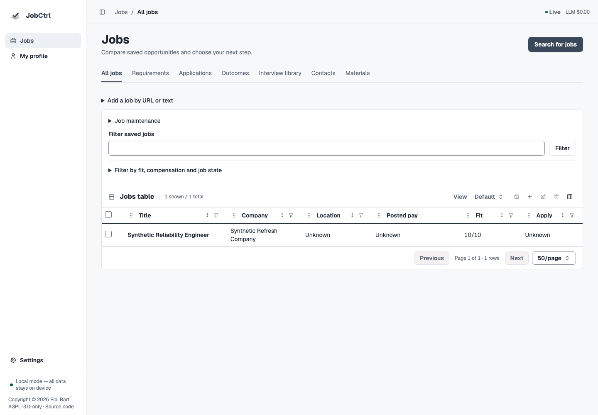

<div align="center">

# JobCtrl

**Local job-search automation. You approve every application.**

[Live demo](https://demo.jobctrl.dev) · [Docs](https://jobctrl.dev) ·
[Comparison](https://jobctrl.dev/comparison) ·
[Help test](https://github.com/ebarti/JobCtrl/discussions/797)

[](https://github.com/ebarti/JobCtrl/actions/workflows/typescript.yml)
[](https://github.com/ebarti/JobCtrl/actions/workflows/release-check.yml)
[](LICENSE)



<sub>Original source candidate. Synthetic data; published-version availability is separate.</sub>

</div>

JobCtrl finds job postings, explains fit against your saved evidence, composes a
resume from approved wording, and prepares the application for your review.
Your data lives in `~/.jobctrl/` on your machine; there is no account and no
hosted backend.

The current source candidate uses **Jobs**, **My profile** and **Settings**, with
comparison, preparation, the real Plate editor and application review connected
to the selected job. The [redesign ledger](docs/plans/2026-11-11-original-app-redesign.md)
records implementation and verification; the
[published release](https://github.com/ebarti/JobCtrl/releases/latest) establishes
what installed users receive. Source documentation and the offline demo do not
establish a release or hosted deployment.

## Install

Early access. The signed release runs on Apple-silicon Macs with macOS 15 or
later and bundles its own runtimes.

```bash
curl -fsSL https://jobctrl.dev/install.sh | sh
# or: brew install ebarti/tap/jobctrl
```

In a new terminal, run `jobctrl start` to start the local services and open the
app. Create your profile, then connect an LLM provider (Codex, Claude, or
Google) under **Settings → Connections**; JobCtrl uses your own provider
account. In the Python source candidate, saved native credentials are resolved
for new provider work. Run `jobctrl setup` and fix any `MISSING` rows in its
report. An active environment-owned credential remains authoritative until you
remove that override and restart the affected process.

In the source candidate, set roles, locations, sources and limits in **My profile
→ Search preferences**, then open **Jobs → Search for jobs** and explicitly
choose **Start search**. [Getting Started](https://jobctrl.dev/user/getting-started)
covers first-run setup in detail. `jobctrl uninstall` removes JobCtrl and keeps
`~/.jobctrl/` unless you add `--remove-data`.

## What It Does

1. **Find:** explicitly search configured sources or import a known posting.
   Saved search preferences show what the next search will use.
2. **Compare:** keep roles, location, pay, fit and application state together in
   the Jobs table. Open a job and return to the same comparison context.
   JobCtrl fetches the full posting and its apply link. While the local
   worker runs, it also rechecks saved postings and shows overdue or uncertain
   availability without replacing saved descriptions or materials.
3. **Understand fit:** inspect source-bound requirement assessments and the
   resulting 1–10 score. Factual support and exact wording coverage stay separate.
4. **Prepare and edit:** choose a tailored or full-baseline resume in one bounded
   task, edit it in the existing Plate editor, then review/accept the exact
   rendered document. Failed refreshes preserve earlier accepted materials.
5. **Review:** inspect the exact application packet and rehearsal before its
   separate approval. Saved Profile/wording edits launch no automatic matching
   or regeneration; **Update affected matches** is explicit.
6. **Apply and record:** a dry run inspects the application form and submits nothing; it
   needs Claude and a Chrome or Chromium browser enabled in Settings. You fill
   in and submit browser forms yourself. The only applications JobCtrl submits
   itself are emails from your Gmail, with the recipient and attachment you
   approved, sent at most once.

Admitted discovery and preparation run on Temporal, a workflow engine, and
retain their durable identity through interruptions.

JobCtrl also shows posted salaries and market estimates with their evidence,
records application outcomes, keeps contacts, and drafts outreach for you to
send. Explore the local [interview question library and job preparation](https://jobctrl.dev/user/materials-and-tailoring#interview-preparation);
its guidance is a research draft, and personal prep remains in beta.

## Safety

- Auto-apply is off by default. When on, it sends the email applications you
  approved; browser forms still wait for you to complete and submit them.
- A confirmed application to an opening blocks further submissions to it. An
  equivalent role at the same employer needs your explicit confirmation.
- A daily LLM budget, $25 by default, stops new LLM work once JobCtrl's own
  estimate of the day's spend reaches it.
- The local API binds to 127.0.0.1 by default. Don't expose it to a network:
  it serves your profile, jobs, and documents.
- Discover queries Indeed, LinkedIn, and ZipRecruiter by default and does not
  check robots.txt. Automated access can violate a site's terms; disable any
  source you are not allowed to query automatically.

## What Leaves Your Machine

Outside requests run when you start a step that needs them, and while the local
worker rechecks due saved postings:

- **LLM providers:** posting text, relevant profile evidence, and generated
  text. Offer communication drafts also send the confirmed offer terms and sources,
  decision attestation, and recorded compensation evidence through the configured
  outreach provider. Optional company briefings send only selected public source text and the reviewed company identity. Opt-in Required-bullet coaching sends the selected saved bullets and
  linked evidence to your configured provider. During a dry run, Claude also sees the application page, but never your
  profile or documents.
- **Job boards and other sites:** Discover, Enrich, and Apply dry-run requests, plus
  opt-in contact research, company briefings and bounded saved-posting availability checks. The
  availability checks use public APIs or an anonymous browser. With the browser extension paired and connected,
  Discover and Enrich use your Chrome session and its cookies for supported
  provider-owned hosts. Other posting hosts use the worker’s address-pinned
  public transport.
- **Salary data sources:** when a benchmark is missing or over a week old, a
  Discover run fetches public data from Euro Top Tech, plus ECB exchange rates
  and Eurostat price levels when needed; Levels.fyi or Glassdoor only if you
  enable them.
- **Gmail, if connected:** verification-code and outcome lookups, and the
  application emails you approve.
- **Google Maps** (address autocomplete), **CapSolver** (CAPTCHA solving), and
  **Langfuse** (metadata-only traces by default; prompt/completion capture requires
  an additional explicit debugging opt-in): only if you configure them.
- **Photon place lookup:** only when you explicitly request a location lookup;
  it receives that location query. Typing or navigating makes no lookup request.

Details: [Data, Privacy & Safety](https://jobctrl.dev/user/data-and-safety) ·
[Security](https://jobctrl.dev/user/security)

## Documentation

[Getting Started](https://jobctrl.dev/user/getting-started) ·
[Daily Workflow and CLI reference](https://jobctrl.dev/user/normal-flows) ·
[Configuration](https://jobctrl.dev/user/configuration) ·
[Architecture](https://jobctrl.dev/architecture/) ·
[Developer Guide](https://jobctrl.dev/developer/) ·
[Roadmap](ROADMAP.md) · [Contributing](CONTRIBUTING.md) ·
[Security policy](SECURITY.md)

## Development

```bash
git clone https://github.com/ebarti/JobCtrl.git && cd JobCtrl
scripts/install        # install the toolchain and dependencies
corepack pnpm check    # typecheck and lint
corepack pnpm e2e      # run the real application journeys
corepack pnpm dev      # run the full stack; keep this terminal open
```

See [Local Development](docs/local-development.md).

## License

[AGPL-3.0-only](LICENSE). Copyright (C) 2026 Eloi Barti. See [NOTICE](NOTICE).

For source-linked translations of accepted resumes, see
[Reviewed Locale Variants](docs/user/locale-variants.md). Terminology and formatting
are reviewed independently before locale acceptance and export.

Reviewed open-ended screening answers are available in Job Detail and Apply Review. See [Screening Answers](docs/user/screening-answers.md) for deliberate source selection, review, reuse and manual-use history.
