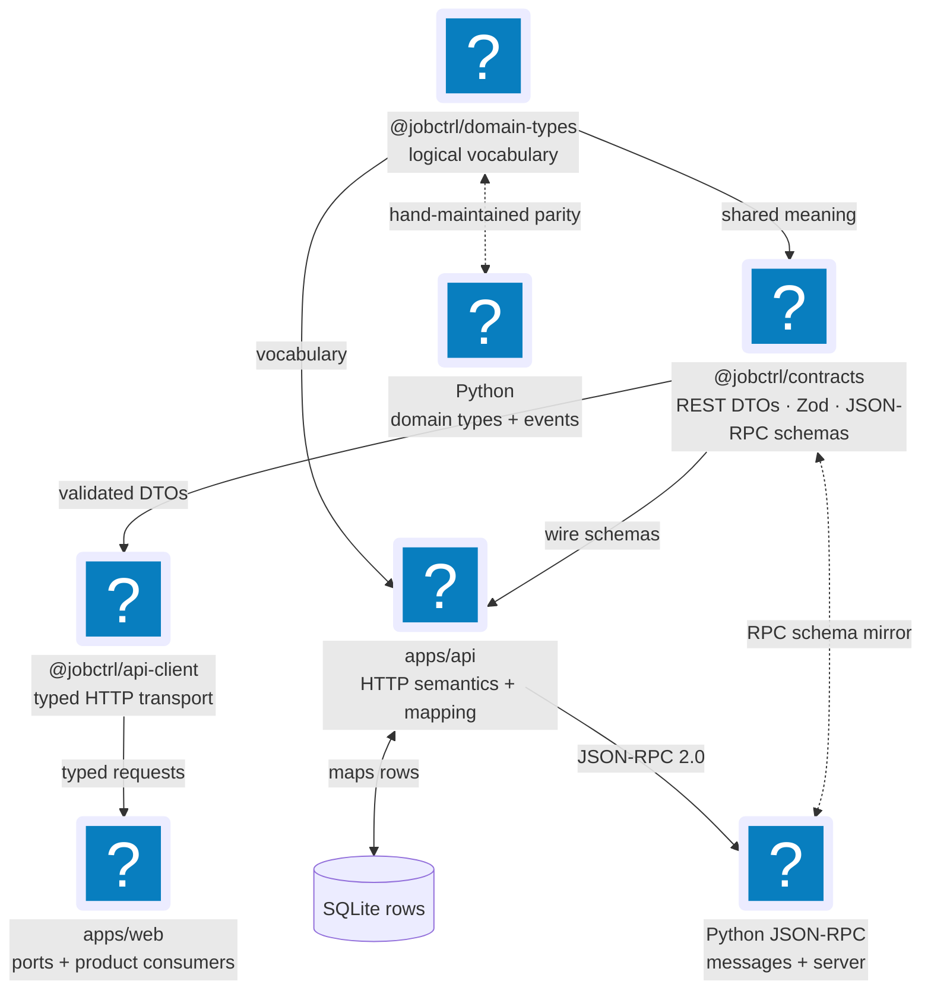

# Contracts, Types & API Boundaries

JobCtrl separates domain meaning, wire validation, transport behavior, and
runtime implementation. That separation lets the web app and TypeScript API
share precise types without turning HTTP DTOs, SQLite rows, or Python objects
into competing domain models.

The API caches Python JSON-RPC adapters by app directory, configuration path and
runtime identity. Provider, import and other services may retain adapters for
different contexts concurrently. Selecting another context preserves in-flight
requests and later calls on existing adapters; explicit registry reset closes
all cached contexts. A context change must not revoke a service's live handle.

**Read this if** you are adding a field, event, route, JSON-RPC method, or typed
client call and need to know which layer owns the contract.

Gmail feedback scan summaries and `ApplicationEmailFeedbackIngested` payloads
use canonical `jobId` across Python, REST contracts, domain events, and web
invalidation. Posting and application URLs are search hints, never identity.

## Enrichment Retry Ownership

`pipeline/retry.py::reset_retry_stages` owns explicit enrichment resets. The
CLI reaches it through `state.reset_job_stage`; HTTP uses the synchronous
`reset_enrichment` RPC. The TypeScript adapter validates both the request and
the returned target cohort. Other single-stage commands retain their owners.
When bulk retry contains Enrich, companion stage-row resets join that same
Python transaction to preserve the existing all-or-nothing cohort; their
aggregate-specific commands are not migrated.

The service acquires SQLite's writer before resolving identities and loading
the aggregate. It retains accepted descriptions, application URLs, extraction
history, saved scores, approved materials and approval bindings. It resets the
aggregate lifecycle to `pending`, clears stage timing/errors/blockers and old
execution metadata, advances the stage version fence, and writes `StageReset`
in the same transaction. Existing attempt counts and limits survive unless
reset was explicitly requested or the stage was exhausted. A missing stage
uses the Python stage defaults. Bulk targets are rechecked under the writer;
a target that is no longer failed/exhausted aborts the complete reset cohort.

Owned transactions commit before event publication and HTTP acknowledgement.
An inherited transaction uses a savepoint and remains under its caller's
control; its durable events become visible after that caller commits. Failed
persistence rolls back the entire reset. The existing durable event stream
refreshes job and pipeline views, while canonical `pending` enrichment blocks
downstream preparation until enrichment succeeds again. A reset does not
delete downstream accepted artifacts or dispatch Apply.

Later invariant-heavy commands should move one bounded decision and its
transaction into an application service before adding transport adapters.
Keep the existing RPC registry, error envelopes and HTTP response contracts;
do not duplicate lifecycle policy in a caller or split atomic cohorts across
writers.

## Dependency Direction

The important direction is domain vocabulary → wire contract → transport. The
API implements the wire contract, while the Python runtime mirrors only the
cross-language boundaries it consumes.

## Contract Owners

| Layer | Source owner | Contains | Must not contain |
| --- | --- | --- | --- |
| Python domain model | `workers/automation/src/jobctrl/domain/` | Aggregate behavior, invariants, value objects, use cases, and Python domain events | HTTP status codes, fetch behavior, or database/provider mechanics |
| Shared TypeScript domain vocabulary | `packages/domain-types/` | Branded identities, shared stage/state values, the TypeScript domain-event union, projection shapes consumed across packages, and browser-safe pure product policies such as Required-bullet coaching | Claiming authority over Python aggregate behavior, HTTP status codes, database access, or browser globals |
| REST and JSON-RPC wire contract | `packages/contracts/` | Zod request/response schemas, DTOs, wire enums, API query shapes, JSON-RPC envelopes, params, and result schemas | Route registration, persistence, fetch calls, or ownership of the domain-event union |
| Typed HTTP transport | `packages/api-client/` | URL/query encoding, HTTP methods, request timeout, typed return values, and transport errors | Business rules, server validation, or canonical state |
| HTTP implementation | `apps/api/` | Fastify routing, security gates, status codes, schema application, DTO mapping, projection reads, simple commands, JSON-RPC dispatch, and SSE framing | Provider/browser workflow execution or a second copy of shared DTOs |
| Frontend boundary | `apps/web/src/shared/ports/ApiClientPort.ts` plus adapters | The capability the web app consumes and the selected local/demo implementation | Direct transport calls from feature components |
| Python JSON-RPC mirror | `workers/automation/src/jobctrl/domain/rpc/messages.py` | Python validation/types for the methods crossing the TypeScript-to-Python boundary | Browser-facing REST contracts |
| Physical persistence | Owning SQLite repository/write module and schema initialization | Tables, columns, indexes, migration compatibility, and row serialization | Domain meaning merely because a column exists |

`packages/contracts` depends on `packages/domain-types` and re-exports selected
projection types. That is a dependency, not duplicate ownership: shared
TypeScript vocabulary stays in `domain-types`, while Python aggregates remain
authoritative for their behavior and invariants. The contract package exposes
only the wire-safe shapes API consumers need.

Required-bullet source preparation, result binding and cleanup applicability
live in `packages/domain-types/src/profile/required-bullet-suggestions.ts`.
They share readonly structural inputs/results without runtime I/O or upward
contract dependencies. `packages/contracts` owns the wire schemas and inferred
DTOs, including strict model references/kinds/guidance/nullable proposals. The API validates a saved
snapshot, dispatches the worker and fences the returned version. Python's
`domain/profile/required_bullet_coaching.py` calls `LlmPort` for all semantic
findings. Only mechanical source identity, bounds and exact whitespace acceptance
remain in TypeScript; no adapter determines findings from text heuristics.
The Profile form consumes the shared acceptance guard. The offline demo marks
coaching unavailable. Shape changes update structural and wire owners together.

`ApplicationSubmitted` models the existing launcher payload in the shared event
union: `run_id`, `result: "applied"`, `finished_at`, nullable `duration_ms`,
nullable numeric `worker_id`, and nullable `model`, plus canonical `jobId`.
The SSE envelope and browser parser preserve these lifecycle field names;
consumers use `run_id` to identify the submitted run.

`DryRunCompleted` models the existing launcher payload in the shared event union.
Its lifecycle fields (`run_id`, `finished_at`, `dry_run`, and evidence bindings)
retain their persisted snake_case names; SSE adds canonical `jobId`/`tenantId`
without renaming those fields. See the [SSE contract](../api/complete-contract.md#dry-run-completion)
for the payload boundary.

The interview vocabulary in `packages/domain-types/src/interview/` is pure
shared meaning; `packages/contracts/src/interview.ts` owns strict catalog,
selection, prep/history, and note wire schemas. Python's interview value objects
and catalog types mirror those shapes. One deterministic authored catalog emits
the packaged worker JSON consumed by both runtimes, instead of independently
maintained runtime content. Catalog reads are direct asset handlers;
prep/history/notes keep canonical Materials ownership and exact-schema storage.
The generated endpoint/client path, frontend port/local/demo adapters, RPC
selection mirror, both projection builders, and event/invalidation registries
must evolve together. HTTP and RPC validation preserve the conditional
profile-version fence for explicit evidence choices; worker validation resolves
their actual current tenant/profile ownership and accepted status before spend.
Note conflicts preserve structured `responseBody` in
`JobCtrlApiError` for form reconciliation. See the
[complete interview contract](../api/complete-contract.md#interview-catalog-preparation-and-notes).

## Three API Boundaries

### Browser REST API

The web app uses product routes exposed by the loopback Fastify server.
Job/operations reads return DTOs built from projection rows; profile, settings,
credentials, compensation-policy, and resume-template reads use their canonical
SQLite, config, or secure-store owners directly. Simple commands can complete
synchronously; commands accepted for durable execution return workflow
identity after the Python runtime has started Temporal work.

The route documentation is intentionally layered:

1. [Local TypeScript API](../local-ts-api.md) explains route families and core
   semantics.
2. The focused [Profile & Settings](../api/profile-and-settings.md),
   [Jobs & Materials](../api/jobs-and-materials.md), and
   [Operations & Events](../api/operations-and-events.md) pages explain one
   product boundary at a time.
3. [Complete API Contract](../api/complete-contract.md) owns the exhaustive
   fields, status codes, precedence rules, and route variants.

Do not reproduce that exhaustive contract here. This page owns layer and source
responsibility, not a mutable route catalog.

### TypeScript-To-Python JSON-RPC

`packages/contracts/src/rpc.ts` owns the TypeScript JSON-RPC 2.0 envelope and
method schemas. `workers/automation/src/jobctrl/domain/rpc/messages.py` mirrors
the application contract; `apps/api/src/json-rpc-adapter.ts` supplies the local
transport; and `workers/automation/src/jobctrl/infrastructure/rpc/server.py`
dispatches it.

In the current runtime:

- the TypeScript API starts and reuses one `jobctrl rpc` subprocess;
- synchronous methods return their validated result through JSON-RPC;
- workflow methods return run/workflow identity after the Python side starts a
  Temporal workflow, with a nested `result` when `awaitResult` is true; and
- the TypeScript API does not enqueue Temporal work directly.

The browser does not call arbitrary JSON-RPC methods. Product routes validate
intent, enforce local security, and translate to the narrower worker command.
See [Runtime & Processes](runtime.md) and
[Operations & Events API](../api/operations-and-events.md) for dispatch and
health behavior.

The shared boundary fixture in `workers/automation/tests/fixtures/rpc_boundary.json`
is exercised by the Python parser and registered stdin/stdout server. The
Python test checks the live output against `rpc_boundary_python.json`; the
TypeScript test validates that same observation snapshot with the actual Zod
schemas. Together the tests compare the live default registration set with
`RpcMethods` and check a synthetic `provider_models` synchronous result and
`run_stage` workflow start. The TypeScript endpoint spec remains the source
for route-to-worker method references; these fixtures are test baselines, not
a second production registry.

The guard currently **characterizes, rather than removes**, these request
differences:

| Request shape | TypeScript schema | Python parser/server today |
| --- | --- | --- |
| Missing or non-`2.0` `jsonrpc` | Rejects | Accepts and responds with `2.0` |
| `params` as `false`, `null`, zero, empty string, or empty array | Rejects | Replaces with `{}` |
| Boolean `id` | Rejects | Accepts (Python boolean is an integer) |
| Fractional numeric `id` | Accepts | Rejects as invalid request |
| Explicit `id: null` | Accepts | Treats as a notification and emits no response |
| Extra envelope key | Rejects | Ignores |

`RunStageParamsSchema` includes the current caller controls: `sourceIds` (up to
50 unique, trimmed IDs of 1–160 characters, only with an effective Discover
stage), `reason` (up to 400 characters), and boolean `awaitResult` and
`refreshApplyUrl`. An explicit `stages` list takes precedence over `stage`, as
in `workflow_specs.py`. A true `refreshApplyUrl` requires only Enrich, one
canonical `jobId`, and `limit: 1`. Profile import also accepts boolean
`awaitResult`. Cancellation preserves the worker's `requestedBy`, `source`, and
nullable `reason` metadata with its 160/80/500 character bounds.

`RpcContracts` in `rpc.ts` associates the parameter and dispatch-result schemas
owned there and derives method-specific `RpcParams` inputs and `RpcResult`
outputs for every current TypeScript caller. `JsonRpcDispatcher.call` has no
record-based public overload. `callRpc` applies the shared parameter and result
parsers to injected dispatchers as well as the subprocess adapter; the adapter
validates parameters before resolving or spawning a command. Endpoint dispatch
specifications bind the method to those same schemas. Python registration
remains the runtime inventory. Verification requires the explicit supported
`provider: "codex"` parameter, matching the registered worker handler.
Workflow starts use acknowledgments, even when their activity has a synchronous
result schema. Compensation refresh also retains its supported
synchronous result branch, and stage runs retain `LocalActionResult` for old
sync adapters. Generic acknowledgments preserve additional identity metadata
and nested payloads. Acknowledgments allow a null `firstExecutionRunId` when
Temporal has no first execution identity; availability starts still require
both `runId` and `workflowId`.

Awaited stage results mirror the actual serialized workflow dataclasses:
`JobPipelineWorkflowResult` has `stages_completed`, `stages_failed`, `failure`,
and `error_code`, without `status`; Discover has its own family, enrichment,
and compensation fields. Awaited profile import retains `status`, `draft`,
`error`, and `error_code`. URL and manual-capture imports require their nested
workflow result because their current callers always await it. An awaited
`run_stage` or `profile_import` call requires completion, rather than accepting
a start-only acknowledgment. Stage completion must match Discover or pipeline
input, using the worker's deduplicated effective stages; an explicit `stages`
list takes precedence over `stage`. Transmitted stage values remain unchanged.
Invalid output raises `RpcContractError` separately from transport
failures, allowing each feature to preserve its HTTP error mapping. Worker
error envelopes, request IDs, progress notifications, timeouts and close
behavior remain transport concerns.

Profile continuation keeps its `profile_updated:<eventId>` reason through the
registered handler and deterministic workflow identity. The enforcing action
dispatcher awaits completion before the server records a handled marker;
structural, start, wait or transport failure leaves the durable intent available
for startup reattachment. A validated terminal failed completion records one
`ProfileContinuationFailed` event with its source event, execution identity and
bounded error code. It receives no successful handled marker and is excluded
from pending dispatch, allowing newer profile revisions to proceed. Its original
workflow and failed job stages remain inspectable and retain their retry policy;
reattachment never reruns a completed failed workflow or claims it succeeded.
The route integration tests in `apps/api/test/server.test.ts` use exact-schema
owned workspaces and the registered Python handlers through the real adapter.
Their synthetic WorkflowStarter and completion handle expose workflow input and
ordering, returning the production result dataclasses. Held completion also
checks marker ordering during startup reattachment. These fixtures do not
exercise live acquisition, Temporal persistence or model quality.

The shared suite also covers parameter and parse errors, unknown-method
mapping, workflow acknowledgments, and a negative registration/schema mutation.
Its behavior probes exercise two methods; registration coverage alone does not
prove the other methods' parameter/result behavior. The probe's synthetic
awaited `{status: "succeeded"}` object establishes acknowledgment preservation,
not the production pipeline result shape. Contract tests separately cover
the production shapes and malformed controls. The original Python observations
and envelope compatibility assertions remain unchanged.

A separate wire-policy decision should resolve version, falsy params, extra
keys, and ID semantics before aligning `JsonRpcRequest.from_dict` and the TypeScript envelope
schema with compatibility tests. In particular, decide both fractional and
explicit-null ID behavior before tightening either side. The default API
adapter currently generates integer IDs; the explicit-null case is outside
its normal call path. The TypeScript API's constructed
outbound requests remain the supported caller path.

### Domain Events Over SSE

Server-Sent Events (SSE) reuse the domain-event vocabulary, but the event union
does **not** live in `packages/contracts`. Its TypeScript authority is
`packages/domain-types/src/events/`, mirrored by
`workers/automation/src/jobctrl/domain/events/`.

`apps/api/src/event-stream.ts` frames durable `job_events` rows as SSE. The web
parser checks that the event type belongs to the known domain-event registry,
then the Operations invalidation router maps that event to query keys. An SSE
payload is an invalidation/change notification; it is not the full job or
projection response contract.

The exact framing, replay, tenant, and reconnect rules live in
[Local TypeScript API](../local-ts-api.md) and
[Frontend Realtime](frontend/realtime.md).

Frontend consumers import unchanged REST DTOs, Zod schemas and constants directly
from `@jobctrl/contracts`, and domain vocabulary/events from
`@jobctrl/domain-types`. Operations owns read hooks and genuine frontend input
refinements, not a transparent DTO facade; re-export aliases do not shield
consumers from changes to their canonical shapes. See [frontend type ownership](frontend/state-and-ports.md#_6-5-canonical-dtos-and-frontend-input-refinements).

## Logical Types Are Not Rows Or DTOs

A single fact can have three representations without having three owners:

| Representation | Purpose | Example responsibility |
| --- | --- | --- |
| Domain value/event | Express meaning and valid states | A branded identity, stage-state union, or past-tense event |
| Persistence row | Store the fact efficiently and compatibly | Snake-case columns, indexes, nullable legacy fields |
| API DTO | Present a stable, privacy-safe client shape | Camel-case response, summarized evidence, pagination metadata |

Translation belongs at the boundary. Repositories translate rows to domain
values; API mapping translates projections/domain values to DTOs. A column
addition does not automatically become a public field, and a presentation-only
DTO field does not automatically become canonical storage.

## Cross-Language Parity

TypeScript and Python share concepts by explicit mirrors, not generated code.
The domain parity check compares the covered event names/payload fields and
pipeline stage/state vocabulary; focused tests and shared fixtures cover
additional projection and JSON-RPC shapes. The source anchors are:

- `packages/domain-types/src/events/` and
  `workers/automation/src/jobctrl/domain/events/`;
- `packages/domain-types/src/pipeline.ts` and
  `workers/automation/src/jobctrl/domain/pipeline_types.py`;
- `packages/contracts/src/rpc.ts` and
  `workers/automation/src/jobctrl/domain/rpc/messages.py`; and
- `scripts/check-domain-type-parity.py` plus the focused API/Python parity
  tests.

Do not assume one parity script proves every contract in both languages. When a
boundary grows, add a fixture or assertion at that boundary.

## Change Checklist

| Change | Required ownership pass |
| --- | --- |
| New or changed domain value/state | Update `packages/domain-types`, the matching Python domain type when cross-runtime, and parity coverage before consumers |
| New domain event | Update both event registries/factories, the producer, projection handling, frontend invalidation, and parity tests |
| REST request/response field | Update `packages/contracts`, API validation/mapping, API-client use, affected frontend port/consumer, and the owning API reference |
| JSON-RPC method/field | Update `packages/contracts/src/rpc.ts`, the Python message mirror and handler registration, adapter tests, and dispatch documentation |
| Projection field | Start from its canonical data owner, update every responsible projection builder, then the DTO/API/client/UI and shared parity fixture |
| SQLite-only migration field | Update the owning schema/repository and [Storage](storage.md); expose it through a contract only when a product consumer needs it |

## Future Architecture (Not Implemented)

The domain-model reference names hosted HTTP/service transports, hosted data
adapters, and authenticated tenant injection as evolution seams. The current
product uses a loopback Fastify API, a long-lived local JSON-RPC subprocess,
local Temporal, and SQLite. See the explicitly future sections in
[Cross-Context Integration](domain-model/integration.md) and
[Cloud Evolution](domain-model/cloud.md); do not describe those adapters as
available current contracts.

## Availability Command And Read Boundary

The strict endpoint spec owns `POST /v1/jobs/:jobId/actions/check-availability`
and its queued acknowledgement. The API supplies trusted runtime identity to
`check_posting_availability`; Python validates it before starting the registered
Temporal workflow. The frontend consumes the generated API client through its
port. It imports availability DTOs directly from `@jobctrl/contracts`; Operations
retains only the endpoint-derived command acknowledgement type. Jobs GET
exposes persisted observation DTOs and calculated freshness without transport
side effects. Python and TypeScript event registries, endpoint JSON Schema
fixtures and RPC registration observations are updated together.

## Semantic Determination Authority

Contracts owns the versioned semantic codes/labels and strict read envelopes. Worker determinations own meaning, with closed enums, extra-field rejection and canonical citations. API/web/extension consumers join IDs and read persisted verdicts; they never construct provenance or categories from text overlap. Interactive calls are sync RPC, activity calls remain outside Temporal replay.

See [the decision](../decisions.md#_2026-10-07-semantic-judgments-are-llm-determinations) for caching, provenance and failure contracts.

Company briefing DTOs live in `packages/contracts/src/company-briefings.ts`; Python owns the generated `company_briefing` determination schema. Operations validates stored shapes, IDs, source hashes and verbatim citation membership before returning the optional Job Detail view. Corrupt optional provenance yields an explicit unavailable view rather than breaking unrelated job content. See [Company Briefings](../user/company-briefings.md).

## Incremental Endpoint Migration

The provider family uses the existing `ENDPOINTS` declarations in
`packages/contracts/src/endpoint-spec.ts`: `providerStatus`, `providerModels`
and `verifyCodexProvider`. The declarations own HTTP methods, paths, request
and response schemas, worker dependencies and demo capability metadata.
`apps/api/src/endpoint-routes.ts` registers them under the existing HTTP security
hooks. `apps/api/src/provider-handlers.ts` owns provider orchestration and safe
error mappings; its catalog function is also used by Settings validation.
`callRpc` enforces the reconciled `RpcContracts` on injected dispatchers and the
subprocess adapter. The response schemas reuse the sanitized RPC results,
including catalog order and the prohibition on models for unready providers.

`createEndpointMethods` supplies the checked methods on `JobCtrlApiClient`;
there are no separate provider path/method implementations. The frontend port
and local adapter keep their public methods. Demo status is synthetic and
disconnected, demo models are a synthetic catalog, and verification remains
unavailable. Their capability classifications come from the same declarations.

Migrate the next family one cohesive slice at a time:

1. Trace current client entry, HTTP security, feature operation, worker handoff,
   response, consumers and any durable resume/settlement path. Record current
   status codes, ignored inputs, readiness and demo behavior before moving it.
2. Reuse or reconcile its owning RPC parameter/result schemas. Declare the
   endpoint once with its method, path, request, sanitized response, dependencies
   and demo metadata. Preserve the existing compatibility policy.
3. Place orchestration in a feature-owned handler module, inject it through
   `registerEndpointRoutes`, and remove the duplicate manual registration.
   Use declarative dispatch only when its mapping already fits the operation.
4. Remove handwritten client transport methods so `createEndpointMethods` owns
   transport and parsing. Keep the frontend port and adapters compatible; remove
   duplicate demo manifest entries when the declaration takes ownership.
5. Extend the complete explicit JSON-Schema expectation, retaining all pinned
   endpoints. The API contract test combines the historical domain-types fixture
   with `apps/api/test/fixtures/provider-endpoint-specs.json` for this family.
   Do not regenerate unrelated fixtures. Test generated-client-to-route success,
   readiness outcomes, RPC/transport failures, malformed/private fields and
   security rejection before dispatch, plus affected consumers.
6. Update the owning API references and retain candidate-bound check evidence.
   Independent product QA/review and controller publication gates still determine
   delivery; a typecheck or implementation checkpoint does not establish it.

This migration preserves the #954 compatibility boundary: the JSON-RPC envelope
observations above (version, falsy params, extra keys and ID semantics) remain
characterized differences. Moving HTTP registration does not authorize tightening
Python envelope parsing or changing workflow acknowledgments. Provider operations
are synchronous; they introduce no workflow start, durable settlement, artifact
refresh or approval mutation. Existing Discover/profile workflow, continuation,
restart and settlement compatibility checks remain applicable to the shared
contract path.

The provider integration tests use the actual generated HTTP client and a local
Fastify listener, with a synthetic `JsonRpcDispatcher` returning bounded results
or failures. Tests supply first-party Origin metadata to Node fetch to represent
a browser request. These tests prove mapping, parsing, transport and security
behavior; they do not prove SDK authentication, credential import, live model
catalog access or model quality. The existing workflow fixtures described above
use synthetic workflow handles and do not establish live Temporal recovery.

## Career-learning contract

`packages/contracts/src/career-learning.ts` owns strict cohort/preview,
comparison and milestone wire DTOs. The Python Operations owner publishes the
`career_demand_comparison` schema into the generated semantic-result registry.
Endpoint-derived GET/POST `/v1/evidence-map/learning` methods dispatch through
`career_learning` with exact runtime and tenant bindings. Reads and previews do
not call a model. Preview fingerprints and expected revisions fence reviewed
sources and concurrent writes. Only a successful strict, cited determination
replaces a cohort; source-bound selections and activity have independent
canonical histories. The demo classifies both endpoints as unavailable.

## Source proposal review boundary

`SourceProposalEvidenceSchema` and the additive `SourceLocatorCandidateSummary.proposal`
DTO live in `packages/contracts`. Python's explicit history CLI feeds the existing
learner/locator queue; the API reads its recorded receipts without running that
learner. Source-coordinate parsing is a literal URL contract in both runtimes,
covered by matching structural URL cases. It does not infer employer identity,
relevance or completeness. `SourceLocationCandidateReviewed` belongs to both
domain event registries and invalidates the existing source controls over SSE.

## Offer Contract

`packages/contracts/src/offers.ts` owns strict user-attested offer term, source,
expected-ID command and immutable history DTOs. `apps/api/src/offers.ts` owns
transactional conflict/history semantics; `offer-routes.ts` is its HTTP adapter.
The existing `generate_outreach_draft` RPC gains closed offer communication
kinds and an optional canonical offer revision ID. Python reads these sources
from the ledger; callers cannot supply a substitute offer or achievement pack.
`OfferRecordChanged` public vocabulary contains references only. Private
payloads are redacted by the SSE adapter before crossing the browser event
boundary. Browser offer actions and compensation reads have explicit
unavailable demo capabilities.
