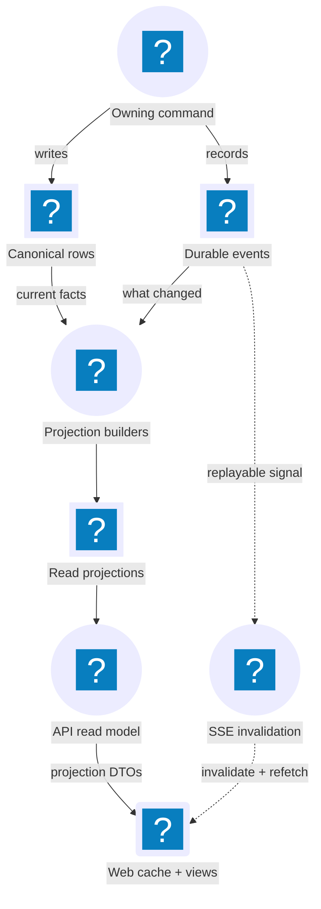

# Data, Events & Projections

JobCtrl keeps canonical business facts, durable domain events, denormalized
read projections, browser invalidations, and diagnostic telemetry as separate
concerns. They can share SQLite or describe the same workflow, but they have
different owners and different correctness guarantees.

**Read this if** you are adding a table, event, projection field, realtime
update, audit entry, or telemetry span and need to identify the source of truth.

## Current Data Flow

The event log marks what changed; projection builders read events plus canonical
rows to materialize client-friendly views. Solid arrows form the correctness
path. Dashed arrows carry invalidation signals; they never transfer canonical
state.

Telemetry observes execution but sits outside this product-state correctness
and recovery path.

The diagram is deliberately not an event-sourcing diagram: most aggregates are
loaded from canonical tables, not reconstructed by replaying `job_events` on
every command or request.

Gmail feedback ingestion commits its evidence, suggestion, and durable event in
one transaction before publishing the event to projection subscribers. After
mail retrieval, that transaction rechecks the tenant-scoped job and provider
message so concurrent deletion or scanning cannot leave orphaned or duplicate
evidence. Raw message bodies stay out of event payloads and scan summaries.

## Name The Layer Before Changing It

| Layer | Meaning | Authority and recovery |
| --- | --- | --- |
| Canonical domain/operational state | The current facts owned by an aggregate or explicit operational model: jobs, profile, scores, materials, stage state, reviews, outcomes, contacts, policies, and registered artifacts | Owning repository/write module and its SQLite/file transaction. See [Storage](storage.md). |
| Domain event | An immutable, past-tense fact that a meaningful change occurred | Typed event vocabulary plus its durable append in `job_events`. Events support audit, integration, dirty-entity detection, and selected event-folded lifecycles. |
| Read-model projection | A denormalized shape optimized for a list, detail, dashboard, artifact, workflow, contact, or other read | Derived and rebuildable. Never a command/write authority. See the [projection catalog](read-model.md#projection-catalog). |
| SSE frame | A tenant-scoped delivery of a durable event row to the browser | A replayable invalidation signal. The subsequent projection read is the UI correctness boundary. |
| Persisted operational metric | A bounded attempt/outcome row used by product operations and source-quality reads | SQLite application data such as `operational_attempt_metrics`, not an OpenTelemetry span. |
| Telemetry span | Diagnostic metadata about an LLM call, workflow/activity, stage, JSON-RPC dispatch, or adapter operation | Opt-in OpenTelemetry export. It is not product state and cannot repair a projection. See [Observability](observability.md). |

Logs are diagnostic artifacts, not domain events. Temporal history is durable
workflow-engine state, not the JobCtrl read model. Generated files are physical
artifacts whose registered metadata determines whether the product may serve
them.

## Canonical State And Physical Storage

`~/.jobctrl/jobctrl.db` contains canonical rows, the event log, and derived
projection tables in one local SQLite authority. Generated resumes, cover
letters, PDFs, and logs remain files; non-secret runtime settings live in
`config.json`; credentials and browser state have separate protected owners.

[Storage](storage.md) owns the path and schema inventory. This page owns the
semantic distinction between a canonical row, an event, and a projection; it
does not repeat the table catalog.

## Domain Event Contract

The TypeScript authority for event names and payload types is
`packages/domain-types/src/events/`. Python mirrors that vocabulary under
`workers/automation/src/jobctrl/domain/events/`. Every event carries a tenant,
timestamp, event type, and typed/contextual payload. The durable row additionally
records event identity and optional job/stage/entity references needed for
ordered replay and audit lookup.

`job_events` is the durable integration and audit spine, but it is not the sole
source of every business fact. Projection builders commonly use an event to
identify a dirty job or family, then read canonical aggregate tables to build
the current read shape. Apply-run and workflow-run projections fold their
lifecycle events more directly.

Safety-sensitive event and projection families keep private content at their
canonical owner and expose allow-listed identifiers, kinds, counts, state,
timestamps, and provenance metadata. This is not yet a universal guarantee for
all historical event families: pipeline failures can persist an exception
message. Treat exception text as potentially durable and sanitize it at the
producer rather than placing sensitive values in exceptions.

Owned email Apply keeps the full `EmailApplicationCandidateRecorded` preview
in the canonical event ledger for Apply Review. Its direct publisher event,
wrapped `ApplyRunEventRecorded`, derived Apply timeline and SSE replay expose
only references/status. This filtering also applies when historical private
rows are replayed. The same filtering covers `AgentResult`, whose raw model
output can repeat the recipient and email body, and wrapped result events.
`EmailApplicationSent` retains validated provider identifiers
and the operation binding in canonical storage; broad delivery omits those
provider identifiers. Send failures use a bounded ambiguity reason, without raw
exceptions or provider bodies. Apply Review reads the canonical preview rather
than reconstructing it from broad events.
The launcher owns the email `ApplicationSubmitted` publication when it settles
the durable receipt; the use case does not emit an earlier duplicate terminal
notification. Owned Apply aggregate notifications wait until the SQLite owner
commits, including when settlement inherits a caller transaction. Rollback,
rollback to a caller savepoint and connection close discard uncommitted
notifications. Each callback checks its exact committed event row before fan-out;
receipt and submitted-fact subscribers observe the complete settlement together.
A process stop after commit can lose an in-memory notification; durable event
replay remains authoritative.

Interview preparation has three separate authorities: the installed immutable
public catalog, generation-versioned job prep with retained source context,
and independently revisioned tenant/job/question notes. The catalog list/detail
path is asset-backed and needs no database; personal prep/history/notes use
canonical local state and authorized detail reads. `InterviewPrepGenerated`,
`InterviewPrepFailed`, and `InterviewQuestionNoteSaved` contain safe IDs,
versions, timestamps, and counts only. Outline text, user notes, profile
excerpts, and note/context bindings never enter events or telemetry. See
[Materials](materials.md#stored-interview-preparation) and the
[interview read model](read-model.md#interview-preparation-and-notes).

## Write And Publish Path Today

Python and TypeScript can both perform canonical local writes, but each write
still begins at the owning domain/application boundary.

### Python writes

1. The use case or repository validates the change and writes its canonical
   rows in an open SQLite transaction.
2. `record_job_event` inserts the `job_events` row that becomes durable when
   the caller commits, then publishes an in-memory `DomainEvent` through the
   process-wide `InProcessEventBus`.
3. Outside the commit-bound owned Apply aggregate path described above, that
   notification occurs before the caller commits. The wildcard
   `ProjectionBuilder` subscriber refreshes through the publishing thread's
   thread-local SQLite connection inside a savepoint when a transaction is
   already open. The publisher retains commit and rollback ownership.
4. A projection-handler error is logged and does not erase the canonical write
   or durable event. The savepoint rolls back partial derived rows and the
   cursor together, so a later explicit/bootstrap refresh can catch up.

The in-process bus is therefore a low-latency notification mechanism, not the
durability guarantee. `job_events` plus projection watermarks provide recovery.

### TypeScript writes and reads

Simple commands hosted by the TypeScript API write canonical SQLite state and
events in their owning modules, then refresh the affected projections. Read
model functions call `refreshProjections` before selecting projection rows, so
the API can catch up after worker writes or process restarts.

JSON-RPC methods are either synchronous or workflow-starting. Workflow-starting
methods ask the Python side to start Temporal; synchronous provider-backed
methods return directly. Some TypeScript-owned flows persist canonical queued
intent or stage state before and after dispatch so the product can show pending
work. Those rows are product state, not a second workflow queue.

## Projection Ownership And Consistency

The first family cutover gives `job_detail_projections` to TypeScript. The
runtime inventory and designated destinations for subsequent bounded cutovers
are below. A destination is a plan until its duplicate writer is removed; this
change does not claim exclusive ownership of the remaining shared families.

| Family | Current materializers | Designated owner |
| --- | --- | --- |
| `job_detail_projections` | TypeScript only | TypeScript (cut over) |
| `job_list_projections`, `evidence_usage_projections` | Python and TypeScript | Python (CLI digest and interview consumers), pending separate cutovers |
| `artifact_list_projections`, `dashboard_projections` | Python and TypeScript | TypeScript (API consumers), pending separate cutovers |
| `apply_run_projections`, `workflow_run_projections` | Python only | Python (preserved) |
| `pipeline_step_projections`, `source_quality_stats` | Python and TypeScript | Python, pending a separate cutover |
| `contact_projections`, `contact_research_task_projections`, `outreach_thread_projections`, `due_follow_up_projections` | Python and TypeScript | TypeScript (API consumers), pending separate cutovers |

Python refreshes its families at bootstrap, through its event subscription and
explicit workflow/activity finalization. TypeScript refreshes its families
before API reads and after API-owned writes. Command-owned deletion/purge may
remove derived rows; frozen offline migrations construct their version's
candidate schema. Neither is a second live detail materializer.

The remaining shared families retain independent
`typescript:operations_projections:<tenant>` and
`python:operations_projections:<tenant>` cursors. Detail uses
`typescript:job_detail_projections:v1:<tenant>`; none of these consumers can
acknowledge another's events. Legacy `operations_projections` cursors are
retained but unused, including opaque tenant IDs containing colons.

### Job-detail freshness and recovery

`refreshJobDetailProjections` processes at most `REFRESH_EVENT_BATCH_LIMIT`
tenant-filtered events in one transaction, rebuilding each affected JobId from
canonical rows and publishing its cursor atomically. A settled detail pass
only reads its cursor and pending-event index: it does not scan all jobs or
acquire a writer. The existing TypeScript background drain continues capped
passes without requiring another request. Other, uncut families still retain
their existing broad reconciliation paths; this is not a claim that every API
GET is free of SQLite writes.

API Job Detail checks its requested JobId; Apply Review checks each returned
job before reading requirement evidence. A pending event beyond the
current batch, a missing/obsolete row, mismatched score versions or compensation
summaries, or newer canonical stage state causes a single-job repair through
the existing list and detail materializers without advancing either cursor. The selected list metadata and
detail evidence are read in one SQLite transaction, so a missed Python
notification cannot mix score versions. This preserves read-after-write even
behind an unrelated backlog. Python CLI/workflow commands
commit canonical state and events; detail catches up when the API consumes
them. Their dashboard funnel reads canonical stages and never waits for detail.
Apply/workflow family ownership and approval bindings are unchanged.

`repairJobDetailProjections` is the explicit canonical full scan for API startup,
migration and operator repair. It repairs missing rows, removes orphans and
recovers canonical writes with no event. First activation (no family cursor)
also performs this scan. Ordinary incremental passes never perform it. Repair
and cursor publication share a writer transaction; failed repair or refresh
preserves the previous projection and all accepted artifacts. A nested call
uses the caller's savepoint boundary and cannot commit its canonical changes.

The rollout requires no schema migration: stop both old runtimes, install the
matching API/worker revision, then start the API to atomically rebuild detail.
Retain the existing schema, canonical rows, files and runtime cursors. The
pre-removal shared parity fixtures establish column/JSON compatibility; the
mixed-runtime fixture proves the Python writer no longer touches detail and
that committed events recover in either process order. Rollback stops both
runtimes and restores the previous matching API/worker revision, whose shared
fold still understands the unchanged table. Do not mix old and new processes
across the ownership boundary. The new family cursor may remain; older builds
ignore it. Restarting the new API after rollback repairs canonical state again.

Event coverage is registry-derived. `DOMAIN_EVENT_TYPES`, its Python mirror,
projection folds, and the frontend invalidation-handler map must agree through
exhaustiveness and parity tests. Documentation may list event families for
orientation, but it does not own a numeric total; adding an event updates the
registries, producer/consumer folds, and tests rather than a prose count.

A projection refresh reads its tenant's events newer than its cursor to mark
dirty entities/families, rebuilds their denormalized rows, and advances the
cursor in one transaction. Standalone passes acquire `BEGIN IMMEDIATE` before
reading the snapshot. Nested passes use a savepoint and leave the enclosing
transaction to its caller. Any failure rolls back the entire pass, including
replacement deletes. TypeScript applies its per-pass event bound after tenant
filtering. Direct contact, contact-research, and outreach refreshes use the same
transaction boundary; outreach threads and due follow-ups publish together.
Permanent job deletion rebuilds affected aggregates synchronously
and retains these cursors; it does not replay unrelated history. First-run and
schema-recovery paths also detect missing/stale projection rows and rebuild from
canonical state even when old events are already watermarked.

Employer-analysis detail projections carry the analysis prompt version. The
TypeScript owner repairs an obsolete shape at startup or on its keyed detail
read without requiring a new event. The API also checks that version before serving it as current;
the native semantic-schema cutover clears the derived shape and keeps canonical
analysis history and accepted artifacts.

SQLite serializes concurrent writers. Idempotent upserts, monotonic watermarks,
and missing-row backfills make repeated refreshes safe. For the exact current
projection responsibilities, use [Apply Feedback & Projections](read-model.md);
for workflow/event recovery, use
[Operations & Events](pipeline/operations.md#domain-events-projections-and-sse).

The apply launcher emits `DryRunCompleted` when a run finishes without submitting.
The apply-run projection maps it to `dry_run_complete`; the shared event registry
and apply-owned browser handler refresh the corresponding reads. This event is
separate from `ApplicationSubmitted` and does not establish an applied job or a
submission outcome.

## SSE Is Invalidation, Not State Transfer

`apps/api/src/event-stream.ts` polls committed `job_events` rows, preserves
event order with event IDs, and supports reconnect replay. The web app parses
known event types and routes each one through
`apps/web/src/contexts/operations/invalidation-router.ts`.

Most handlers invalidate the smallest safe query-key scope. A bounded
high-frequency path may patch cached data directly, but projection refetch is
the correctness backstop. Missing an SSE frame may delay freshness; it must not
lose the canonical fact.

The framing and resume rules belong to
[Local TypeScript API](../local-ts-api.md); cache behavior belongs to
[Frontend Realtime](frontend/realtime.md).

## Operational Data Is Not Telemetry

`operational_attempt_metrics` persists bounded pipeline/source outcomes that
the product can aggregate into source-quality and operations views. Those rows
are application data and follow SQLite privacy rules.

OpenTelemetry spans are diagnostic exports. The LLM-generation path explicitly
limits attributes to safe metadata and omits raw prompts, completions, job text,
profiles, materials, credentials, and exception messages. Generic tracing can
still record exception text and status descriptions, so exceptions must not
contain sensitive values. Telemetry can explain an execution, but it never
becomes the source for job stage, score, materials, apply status, or projection
recovery.

## Change Checklist

| If you add or change… | Update the owning path |
| --- | --- |
| A canonical fact | Owning aggregate/use case, repository/write module, schema/migration, and [Storage](storage.md) |
| A domain event | TypeScript and Python event definitions, durable producer, affected projection logic, frontend invalidation, and parity coverage |
| A projection field | Canonical source first; every responsible builder/store; DTO/API mapping; shared fixture; consuming query/UI |
| A realtime reaction | Domain event owner plus the typed invalidation handler; do not invent a UI-only event bus |
| A persisted operational metric | The operation boundary that records it, its safe schema, aggregation/projection reader, and privacy tests |
| A diagnostic span | Instrumentation under the owning runtime and [Observability](observability.md); do not add a domain event unless the occurrence is product/audit truth |

## Future Architecture (Not Implemented)

The backend domain-model reference names a transactional outbox, queue-based
delivery, hosted databases, and hosted projection consumers as evolution
seams. The current product uses SQLite, an in-process Python event bus, two local
projection materializers, and a polling SSE endpoint. See the explicitly
future material in [Cross-Context Integration](domain-model/integration.md) and
[Cloud Evolution](domain-model/cloud.md); those components are not current
runtime dependencies.

## Saved Posting Observations

Enrichment's `JobAvailabilityObserved` ledger entry is the current availability
authority. Its latest attempt/verdict and prior successful evidence are distinct;
unknown refreshes retain accepted snapshots and artifacts. Successful state
changes also emit `JobActiveStateChanged` for existing queue projections.
Read-time Jobs availability is read directly from the latest indexed event,
with overdue/in-progress derived from time and the current job lease, so no
employer fetch or projection replay is hidden inside GET.

The cross-language registry includes `JobAvailabilityObserved` and internal
`AvailabilityLeaseChanged`. SSE treats the former as tenant/job list/detail
invalidation; the latter invalidates detail/lists only for job-scoped command
feedback and ignores workspace/host reservation churn. Internal lease,
request and sweep facts do not become user application outcomes. Source closure
never calls Discovery's policy-deletion routine and cannot emit `JobDeleted`.

## Company briefing reads

The optional briefing ledger is read directly by Operations through exact tenant/company/job identities and its persisted determination ID. It adds no projection family. Accepted snapshots and failed attempts remain separate immutable records. Source bodies stay out of SSE; reference-only `JobUpdated` notifications invalidate each linked Job Detail and the existing digest. The [storage owner](storage.md#company-briefing-ledger) defines physical retention.

## Selected-job cohorts and reviewed milestones

The Operations career-learning service records private `career_cohort`,
`career_milestone` and `career_attempt` entities on the existing indexed
`job_events` journal. Accepted cohort revisions bind immutable canonical
posting/confirmed-achievement snapshots to one `career_demand_comparison`
envelope. The no-model preview fingerprints the exact sources; the browser
supplies that fingerprint for comparison. Sources are rechecked before spend
and, under a SQLite writer lock, before accepting a replacement. Cohort and
milestone writes compare expected revisions. Failed refreshes add attempt state
without replacing the accepted cohort. Choosing a proposal requires current
sources and explicit user action; completion retains user evidence statements
and revision history without promoting capability.

The dedicated API reads recorded IDs and validates the envelope, request
fingerprint, typed result and citations. General SSE suppresses the private
`CareerLearningRecorded` payload. Profile and posting/identity events invalidate
the tenant-scoped career-learning read key; successful mutations install the
canonical response, and failed optimistic activity updates restore the accepted
cache. Source changes mark historical records rather than reinterpreting them.

## Saved-history source proposals

The explicit `source-proposals from-history` command reads current posting
locators/canonical identities and canonical enrichment application targets,
then calls the existing learner in proposal-only mode. It writes only the
existing source-locator queue and source-control events. Proposal receipts use
`SourceLocationCandidateDiscovered` with `proposalOnly`, a normalized
`coordinateKey`, candidate ID and immutable origin/extraction/sample evidence.
They have null `job_id` so source review authority survives job removal.
The normalized coordinate is also the event `entity_ref` under `discovery`,
using the existing entity index for per-source learning fences.

`SourceLocationCandidateReviewed` records candidate ID, coordinate, decision
(`promote`, `reject`, `reset`), reason and decision time. The latest recorded
review/proposal state fences ordinary learning by coordinate, including other
posting URLs from the same recognized board. Rejection and queue deletion,
and promotion and registry/queue updates, use one immediate transaction.
Public-destination DNS checks precede the history scan's writer transaction.

API and CLI reads never learn or promote. The API joins proposal receipts by
recorded candidate ID and calculates registry overlap from exact coordinates;
coverage remains unknown. The existing Discovery UI invalidates its locator and
registry queries on the reviewed event. Application records, schedule settings
and job identity are outside this writer's boundary.

## Private Offer Revisions

The scoped `offer` ledger in `job_events` is canonical private Outcomes state,
like the existing screening revision ledger. Its `OfferRecordChanged` row
contains confirmed terms or a decision; the event-stream adapter publishes
only the corresponding revision/decision IDs and JobId. The complete private
record is available only through the offer read. Broad activity/audit views
show an update marker, not amounts, quotations or notes. The first saved offer
also records one ordinary offer milestone; corrections preserve the milestone
and change only the offer read model. Outreach keeps its own reviewed draft
and source snapshot without gaining submission authority.
