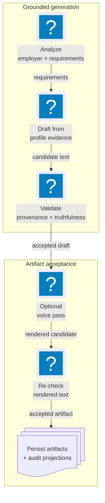

# Employer Analysis & Materials Audit

Materials turns job evidence and profile facts into generated artifacts, then
proves what each rendered claim came from. Generation mechanics and response
schemas live in the [Tailoring Contract](tailoring.md); this page owns the audit
model.

**Read this if** you are changing employer analysis, provenance, fabrication
checks, voice, coverage, interview prep, or the artifact inspector.

## At A Glance

The invariant is simple: the text audited for provenance and coverage is the
same text rendered into the accepted artifact.

An explicit low-fit request is retained as `allow_low_fit_override` in the
accepted generation and resume metadata. The preparation suppression reader
joins only that active tenant/job/generation and accepts only a literal JSON
`true` for the threshold exception. Current missing-score and hard-blocker
suppression remains unchanged. Normal generations and later replacements do
not acquire an earlier generation’s exception.

Bounded resume and cover repairs also retain review continuity. Their audits
record the exact prior determination IDs and typed results supplied to each
later review, including changed-voice verification. These historical decisions
enter input fingerprints as context; they never enter the current factual
source or citation allowlist. Independent verdicts and immutable accepted
artifacts retain their authority. See the
[attempt-loop contract](tailoring.md#attempt-loop-and-candidate-selection).

When `default_llm_model` is configured, `LlmVoiceAdapter` uses the same resolved
core route as other default calls, including its lane/spend admission and actual
provider/model provenance. Without a saved default, the legacy optional Claude
voice adapter remains available. A writing-pass failure retains the already
verified candidate; every proposed rewrite still receives the existing final
claim, quality and source-binding checks.
Codex adapters capture each model's saved reasoning effort when constructed.
An explicit choice takes precedence over the numeric thinking budget in a
tailoring policy and reaches both thread creation and the turn. Employer-analysis
configuration fingerprints and semantic determination identities include that
choice. Determination envelopes persist optional `reasoning_effort`; legacy
envelopes remain valid. A later preference edit cannot change the metadata or
execution parameters of an already constructed adapter.

Generation, analysis and voice use the shared
[agent-runtime-kit execution boundary](agent-runtime.md). Reusing a Codex
process creates a fresh ephemeral thread for every semantic request; a judge
never inherits the generator's conversation. Model, effort, source bindings,
review ordering and accepted-artifact authority remain owned here.

## Canonical Employer Analysis

Enabled ready providers produce strict, independently grounded and verified
drafts. With exactly one admitted draft adapter, JobCtrl promotes that draft's
exact content into the strict canonical analysis schema, excluding only its
per-model identifier. The use-case boundary still verifies the canonical and
records its determination reference; unchanged verification inputs reuse the
same durable determination as the draft. Job interpretation and persistence
remain required.

With multiple admitted adapters, a provider-neutral synthesizer reconciles the
healthy drafts through a ready provider, including when one draft survives a
partial failure. Optional-leg failures remain in the degraded audit. No surviving
draft is a hard error.

Composition excludes perspectives whose providers are unavailable and supplies
the selected ready provider as a draft when necessary. Every draft uses that
provider's saved preferred model, as synthesis does. The effective draft/model
set, synthesis model and analysis execution-policy revision participate in cache identity. A typed SDK availability
failure stops retries of that failed leg and excludes its route from the next
automatic attempt; a failed semantic or structural judgment does not.
Claude SDK query and iteration exceptions receive a safe availability envelope
before response parsing. A generic SDK execution exception therefore leaves
the bound leg after one call. Returned structure, semantic verdicts, budget
errors and cancellation retain their own behavior; provider text never enters
the availability envelope. Neutral core calls and optional voice use the same
collection boundary.

The canonical, generation-versioned analysis stores:

- role framing, inferred seniority, and the ideal-candidate narrative;
- must-have/nice-to-have requirements with priority weights;
- reasoned keywords linked to requirements; and
- quoted posting evidence for every claim, plus per-leg output/failure and
  agreement metadata.

Agreement is diagnostic. A single surviving draft records no comparison and
makes no agreement call. With multiple drafts, a model compares their meaning;
an unavailable agreement call records its safe failure without blocking an
otherwise verified canonical analysis.

### Grounding Gate

Code checks requirement/evidence ID membership and verbatim employer spans. Every draft and synthesis receives source-bound claim verification, including candidate facts and process narration. The separate model quality judge remains where used. There is no process-subject grammar, protected-class phrase screen or fabrication lexicon. Job interpretation records requirement scope and protected-class flags before consumers use the analysis. Invalid or unsupported output enters repair/failure without replacing accepted analysis.

Grounding retries include the rejected span and its requirement/keyword reference
as explicitly untrusted repair data. Grounding and semantic-verification retries
also receive the rejected typed analysis for targeted correction of the identified
fields. The same posting remains the authority;
the membership gate and retry bound stay unchanged for drafts and synthesis.
An unavailable route is skipped before a kit-dispatched SDK draft. Provider, budget,
cache, persistence and invalid canonical-source failures leave the current bound
attempt instead of causing another paid draft through this repair loop.
The same boundary applies to exhausted verifier JSON, schema, ID, quote and
numeric-binding repairs: these failures belong to the verifier's existing
three-call budget and do not start a new analysis draft or synthesis. A valid
`claim_verification_failed` verdict still supplies its recorded findings to the
bounded analysis revision loop. When every leg fails with a typed determination
failure, the ensemble retains the first terminal code, or a transient provider
code if a leg can recover, alongside every leg's safe diagnostic. A healthy peer
still permits a degraded, fully verified analysis.

### Reuse And Lifecycle

Analysis is cached by posting snapshot, prompt version, and SDK-set version.
Re-tailoring reuses that record; an explicit force recompute writes a superseding
generation instead of deleting history. `AnalyzeJobUseCase` can run as the first
tailoring step or through the standalone `analyze_job` method. Prompt
`employer-analysis-v4-determinations` fences every active analysis read, including
projections, interview context, review and cache reuse. Older generations remain
untouched as history and cannot become current inputs; absent current analysis
requires a new determination. Both projection builders rebuild older cached
analysis shapes by prompt version even when all events are already folded.
The native v13 cutover withdraws those cached shapes, and API reads enforce the
same version boundary. Canonical history and accepted artifacts stay intact.
Even a same-version cache hit is checked for
invalid candidate prose before reuse. A standalone `analyze_job` request with
`tenantId`, `jobId`, and `force: true` regenerates one affected analysis. Failed
validation or provider execution leaves the last accepted generation intact.

## Per-Line Provenance

Every rendered experience bullet, executive-profile line, and skill line gets a
stable provenance row. It records:

- section and rendered text;
- source profile fact and canonical evidence IDs;
- verifier-declared served requirement IDs and generation-time source anchors;
- a closed transform type and control rule; and
- a human-readable rationale.

The builder operates on the selected candidate's rendered text. Evidence and
requirement identifiers are real foreign keys, not model-authored labels. An
accepted generation writes provenance transactionally with its artifacts; a
failed or forced generation never destroys the previous accepted rows.

## Source-Bound Claim Verification

A strict model determination extracts each final proposition, classifies candidate fact/hypothetical/target-role/employer/advice, and judges support from allowed evidence. Findings cite exact line IDs and verbatim spans. Code verifies IDs, quotes and exact values; it does not classify English. Generators record anchors and the verifier affirms source contributions. Resume, cover letter, outreach, interview and analysis use the shared port, with separate artifact quality review. Failed refreshes preserve accepted artifacts. See [Tailoring Contract](tailoring.md#validation-layers).

The shared determination owner permits at most two correction calls after a
mechanical response failure, including invalid citation spans, line/requirement
bindings, missing stated-pay citations or inconsistent aggregate verdicts. Each
call repeats lane/spend admission and all existing validation. A valid semantic
rejection remains a rejection and goes back to the generator for revision.
Supported candidate-fact citation IDs must also appear in the line's declared
source contributions. An inconsistent inventory is repaired as a structural
binding failure; code never infers contribution from wording.
Corrections receive the immediately rejected response as explicitly untrusted
data so they can repair individual bindings against the original source inputs.
Citation validation reports all current mechanical failures across typed model,
sequence and mapping fields, with structural paths and the exact canonical
sources needed for correction. Scoring inventory validation likewise identifies
every invalid field and its canonical requirement target. The first safe error
code and legacy first-citation slots remain available. This request-local
feedback never enters public exception text or persisted failure-state fields.
Code neither normalizes a rejected quote nor substitutes a source; every
corrected response must pass the same strict checks within the existing budget.
Supported-claim numeric mismatches identify every affected claim path, missing
literal and line-specific source allowlist in the same request-local correction
packet. The packet includes the canonical allowed source text so the model can
correct its citation or support judgment. It does not change validation order,
infer support, increase the correction budget or enter public failure messages.
Cover-letter generation also supplies its exact candidate-evidence allowlist and
the single `posting` requirement ID. Draft schema, duplicate-line and foreign-ID
failures consume the existing generation retry budget and return the rejected
draft plus exact invalid IDs for correction. Every new call repeats lane/spend
admission; provider and budget failures leave the loop. Code never remaps invented
IDs, and repaired drafts still require independent claim and quality review.
Exact citation/value failures also identify the rejected citation or compensation
row in request-local correction data; exception text and persisted failure state
remain code-only. Rejected resume reports retain only verifier-affirmed anchors,
while preserving the failed gate, original candidate and missing-ID findings.
Numeric binding accepts complete comma-grouped amounts with an attached
three-letter prefix, without deciding the prefix's meaning or matching a fragment
inside a larger token. A sentence-ending period delimits a complete number;
a period joining word characters remains part of a numeric or dotted token.
The same grammar guards supported claim values on both sides of the binding.
The model still determines whether the amount is pay.
Quality/persona findings bind to rendered line citations; saved-evidence repairs
use the separate candidate-evidence slot. Both namespaces are explicit in the
prompt/schema, and malformed findings receive exact slot feedback within the
same bounded correction loop.
The typed owners list known compatible historical quality/persona prompt
versions. Readers validate those recorded receipts against the same strict
schema, entity, lane and verdict bindings; current-only reads still require the
current prompt version. Unknown versions are refused rather than treated as
compatible by default.
Provider, budget, cache and persistence failures do not enter this response
repair loop. A failed repair never replaces the accepted envelope or artifact.

## Stored Interview Preparation

Materials owns explicit, job-scoped interview preparation and independently
revisioned personal notes. Operations owns reads; `/interviews` is a composing
view, not a new bounded context. Public authored guidance, generated outlines,
and user statements keep separate authority and lifetimes.

### Shared Catalog Authority

The canonical authored package is
[`docs/research/interview-preparation/`](../research/interview-preparation/README.md).
Its checked structured metadata assigns stable IDs, responsibility/competency
tags, role lenses, answer formats, and source relationships. The deterministic
compiler emits one tracked `jobctrl/assets/interview/catalog.v1.json`; both
Python and TypeScript load that same packaged asset. Production never infers
role applicability from prefixes/titles or parses prose headings at runtime.
Installed loaders require the payload asset and fail closed when it is absent;
repository docs and plugins are not fallbacks.

The catalog carries schema/catalog revisions and a semantic `catalogDigest`;
raw-byte SHA-256 is a separate packaging equality check. Cards and rubrics have
independent revisions/digests. All 121 active cards remain `research_draft`.
C08 stays reserved/retired. Source records expose actual reading coverage and
attribution kind: direct interview guidance, practice extrapolation, or
editorial synthesis. Guidance and rubric anchors do not establish author
endorsement, personal factual support, readiness, or validated assessment.

### Selection, Evidence, And Acceptance

Explicit selection accepts 1–16 unique active question IDs. Catalog, ownership,
profile version and the per-question eight-evidence limit are checked before
spending. Omitted selections use a cached model selection determination.
Evidence relevance and direct versus transferable support also come from a
model determination. An explicit empty evidence selection remains empty.

Each question is drafted separately with only its selected canonical evidence.
The drafting prompt contains no other question's personal evidence. Structured
parsing checks IDs and the declared support/ID shape. A separate claim-verifier
call determines the meaning and support of every final line, including headings,
gaps and probes. It cites line IDs and evidence spans. The existing quality
judge remains a separate call. C07 negotiation guidance has its own semantic
rubric; code never infers speech acts, personal authority, salary guidance or
hypothetical status from grammar.

The immutable generation context records the profile, analysis, fit, catalog,
selected evidence and determination IDs. Accepted material inputs use registered
artifact bindings and byte hashes. Notes and new recollections cannot supply
confirmed personal facts. Failed refreshes preserve accepted preparation and
independently revisioned notes. The activity owns calls, lane accounting,
heartbeats and retries; completed-run reuse spends nothing.

### Immutable Inputs, Independent Notes

`generationContext` preserves the catalog binding and selected-card snapshots,
selected IDs/order/reasons and per-question evidence-selection mode/ordered IDs,
profile ID/version and relevant evidence excerpts,
job title/company/description excerpt and the full canonical description hash,
employer-analysis binding plus relevant role/requirement excerpts, fit status,
approved-material references/hashes, context digest, and model/prompt/gate
versions. A profile version alone cannot
reconstruct a historical snapshot, so relevant generation-time data is retained.
Older prep remains inspectable when current inputs change. Current-state reads
derive stale reasons without rewriting the stored context; regeneration is
explicit.

Accepted, failed, and superseded generations remain history. Replacement is
accepted only after its owning gates and persistence succeed; pending or failed
refreshes leave the prior accepted prep visible. Existing theme/STAR/gap/company
items remain readable as explicitly unbound legacy output, with no fabricated
question or rubric association. Both projection builders carry the same
nullable context and question metadata.

User notes are tenant/job/question scoped, independent of item replacement, and
append revision history with an expected-revision comparison. A conflict cannot
overwrite a newer edit. Input cannot self-declare supported factual status;
new recollections default to `unverified_user_statement`, and `user_edited`
notes never inherit the generation audit. A source generation must retain the
same selected question; the server derives its catalog/card/context bindings
and rejects inconsistent client claims. An independent note carries no
generation context. Those bindings explain the draft's origin without promoting it to
Profile. Generation and note saving change no profile, fit, Discovery, approved
resume, or Apply state.

Ordinary edits preserve a valid origin. If its generation was deleted, the new
revision detaches to independent provenance while the archived revision keeps
its original binding; a newer prep never becomes the note's implicit origin.

Prep uses exact-schema v12; [Storage](storage.md) owns the stopped candidate
migration, admission, preservation, and rollback contract. Runtime startup does
not silently mutate a real database. Notes follow the job graph's tenant and
purge lifecycle. Private text remains at the canonical owner; generation and
note events contain safe IDs, versions, timestamps, and counts only. See the
[read-model contract](read-model.md#interview-preparation-and-notes) and
[complete API contract](../api/complete-contract.md#interview-catalog-preparation-and-notes).

Post-interview reflections remain manual Apply outcomes linked to a prep
generation. Reusable preparation without a job, typed rehearsal, calibrated
grading, and live assistance are future work. There is no practice-attempt,
transcript, microphone, streaming, or in-session state in this release.

## Voice Pass And Final Audit

A model chooses voice changes using stable line IDs. Any changed artifact receives fresh claim verification and separate quality review, plus the six-persona determination for a high-fit resume. Typed verdicts decide adoption; buzzword and structural-variety proxies are removed. An optional rewrite provider or shape failure records a rejected attempt and retains the already-verified candidate. Verification failures for changed text block the refresh. Accepted final text, source anchors and determination IDs commit together. Requirement coverage is arithmetic over verifier-declared served requirement IDs, never keyword appearance.

## Tailoring Explanation Read Model

Artifact projections expose validation/judge metadata plus canonical
provenance, coverage, and voice columns. A PDF resolves those audit fields from
its sibling tailored-resume row because both represent the same generation.

Job Detail and Artifact Detail resolve stored profile-evidence foreign keys
through the canonical Evidence Map read model before rendering them. A resolved
reference shows the evidence title plus a bounded outcome/action/scope excerpt;
Artifact Detail links to the owning Evidence entry. A missing legacy reference
renders an explicit unavailable state and keeps the raw key behind a technical
disclosure. The read layer does not invent a title, hide the missing reference,
or present a storage key as meaningful evidence.

Apply Review and Artifacts compare only stored audit data: coverage buckets,
template metadata, validation/judge fields, and review risk labels. If either
artifact lacks coverage, the UI reports `coverage not recorded`; it does not
turn missing audit data into zero coverage.

Requirement fit in Job Detail and Apply Review must belong to the current
employer-analysis generation and match both requirement ID and full text
(ignoring whitespace differences). Accepted-resume coverage has an independent
binding: the selected artifact's canonical `quality_plan.requirement_directives`
must record that ID and text, and its own artifact ID must own the bullet
provenance. A material generation number is not an analysis generation number.
Missing, duplicate, or changed source identities show `coverage not recorded`;
a fresh fit report cannot authorize unrelated evidence in an older resume.
These read guards preserve accepted artifacts and their original audit history.

Shared Python/TypeScript parity fixtures seed scores, stages, analysis,
provenance, and artifacts, then compare every dual-written projection column and
JSON shape. That is the drift guard for what the inspector displays.

## Accepted Editable Export

`domain/materials/editable_export.py` owns the `accepted-material-docx-v1`
projection contract. `infrastructure/materials/accepted_export.py` reads one
approved `job_materials_artifacts` text artifact selected by tenant, canonical
Job ID, artifact ID and expected generation. The accepted UTF-8 file and stored
metadata are the source snapshot. Export never reconstructs an older accepted
document from the current profile or reruns tailoring/semantic determinations.

The independent `docx_export.py` adapter writes deterministic WordprocessingML
using the standard library. Each source line becomes an editable paragraph;
tabs, blank lines, Unicode and bullet markers survive. CRLF/CR line separators
normalize to paragraph boundaries. Only the complete ordered heading inventory
emitted by `ResumeAssembler` receives section styles. Unrecognized edited or
legacy structure remains literal text with an explicit warning; no prose
classification or lexical semantic fallback is involved. Missing locale becomes
`und`, or an explicit user language label; a recorded locale cannot be overridden.
Single-column layout and A4/Letter are supported, independently of PDF layout.

The document's custom property records source identity, generation, source byte
and metadata SHA-256 hashes, contract version and resolved settings/hash. It does
not embed private prompt/verification payloads or local paths. The append-only
`job_artifacts` receipt (`stage=export`, `artifact_type=material_docx`) additionally
stores output SHA-256, creation time and formatting warnings. Original evidence
and determination IDs stay at the accepted source, bound by its metadata hash.

The CLI `material-export` and the runtime-bound `accepted_material_exports` RPC
invoke this owner synchronously. `accepted_export_api.py` lists canonical
approved, unsuperseded text sources and retained export receipts, excluding
private source metadata and file paths. The UI binds its request to the selected
source/generation plus source-byte and metadata hashes. Changes since that
selection fail before rendering; the CLI retains its original ID/generation
contract. Publication stages
an exclusive mode-0600 file under `generated/material-exports`, fences the full
source row and bytes before and after staging inside a SQLite writer transaction,
and commits only its new registry reference. Failure rolls back that reference
and removes only its newly created file. It neither saves the Materials aggregate
nor changes approval/application state. Export does not add an Apply input type,
schema migration or a tailoring-policy dependency.

The [API contract](../api/complete-contract.md#accepted-material-docx-exports)
owns history/export HTTP requests and registered DOCX downloads. The API checks
worker response bindings and allowlists safe errors. Downloads require a local
approved export receipt, an owned nonsymlink file under
`generated/material-exports`, and matching output SHA-256. They remain available
after the source is later superseded. The Materials hook retains accepted
history across failures, invalidates related job/artifact queries on settlement,
and refreshes on material events and a bounded 15-second poll. Browser downloads
go through `ArtifactDownloadPort`; no feature component accesses browser APIs.

## Reviewed Locale Variants

Materials also owns source-linked translations of accepted resumes and cover
letters, separate from application approval. The separately versioned contract
uses the existing schema-14 artifact registry and semantic determination bindings;
it does not replace source generations or require a companion branch. See
[Material Locale Variants](material-locale-variants.md) for authority, independent
reviews, version fences, failure preservation and export ownership.

## Reviewed Screening Answer Ownership

Materials owns the source-bound generator, claim/quality determinations and immutable reviewed library revisions described in [Reviewed Screening Answers](reviewed-screening-answers.md). Apply separately owns question/context versions and application-bound review/use snapshots.

## Optional Company Briefings

Materials owns reusable public company context independently of posting analysis. Explicitly confirmed canonical JobIds link to a hash of the exact normalized public company URL; names never merge identities. Operations reads accepted snapshots in Job Detail, Interviews and the existing digest. The company artifact does not alter role analysis, scoring, preparation inputs or approvals.

`company_briefing` is a source-bound determination on the enrichment lane. Strict claim kinds separate company facts, reported events and hypotheses; every claim has uncertainty and verbatim citations. Literal event dates must belong to cited exact values. Source observations retain selected/final URL, UTC time, bounded text and its SHA-256. Ambiguous identity prevents acceptance. A company-level lock coalesces refreshes, while an atomic configuration/link comparison fences replacement. Failed fetches, model determinations or commits preserve the accepted revision and observation clock. Reads derive seven-day and configuration staleness without provider work. See [Company Briefings](../user/company-briefings.md) for limits and controls.

## Cover-Letter Print Acceptance

Apply Review uses `cover-letter-review.ts` to select the latest approved canonical
text, hash the complete UTF-8 file, and bind a render to tenant/job, source ID and
original generation, normalized settings, accepted version and renderer version.
The registered worker `render_cover_letter_pdf` delegates to
`PlaywrightHtmlPdfAdapter`'s HTML scaffold with bounded settings. Chromium honors
CSS `@page` dimensions. No semantic determination is introduced by formatting.

Preview renders have immutable attempt-owned files and manifests; they do not
write accepted artifact rows. Explicit acceptance appends a material generation
with a fresh lineage token, retaining all current approved slots, layout boxes,
anchors and determination bindings. The new cover PDF inherits content
provenance from the accepted text. Resume draft promotion also carries unchanged
cover slots forward. Historical rows and PDFs remain intact. The immediate save
transaction revalidates the full source and preview hashes plus accepted version;
concurrent writers cannot promote a superseded snapshot.
After the last promotion write, it checks the final source/PDF binding and
submitted manifest before commit. Drift rolls back the material generation,
provenance copies and event, retaining prior accepted bytes and decision rows.
A newer canonical source file survives that rollback and correctly stales the
older PDF until the new source is rendered and explicitly accepted.

Carried slots retain artifact IDs in each complete generation. DOCX exports
select the exact artifact/generation pair; artifact projections select one
canonical occurrence and its matching layout/provenance generation. Copies do
not concatenate audit rows. A new PDF takes metadata, anchors and determination
bindings from the accepted text, including when there was no earlier PDF.
Cover-only acceptance reuses Apply Review's resume selector and copies the exact
selected text/PDF pair and its aggregate metadata. Newer text-only or PDF-only
generations remain historical rather than being combined with another version.
Legacy and review-required selections keep their existing authority. Cover-text
aliases retain their current generation and row order; displayed cover text joins
the canonical source ID and verifies its full-text hash instead of choosing an
alias independently from projections. An unreadable canonical source never falls
back to a different alias.
The cover accepted-version hash includes source, PDF bytes/ID, normalized settings
and renderer identity; rejected material attempts affect generation allocation
only.

The Apply decision event stores the accepted cover binding. Approval preparation,
API checks and the worker launcher compare it to current source/PDF identities.
A formatting save advances the material generation and stales earlier approval;
opening a preview and failed operations leave that binding unchanged.
Acceptance records the existing `PdfRendered` event in the same transaction as
the PDF and copied slots. Warm projections and SSE invalidations discover the
accepted artifact; retrying an already committed preview emits no second event.

Acceptance uses the persisted PDF digest, not a new digest adopted from the live
file. Reads compare actual bytes with that receipt; a mismatch preserves the
durable identity and blocks approval and accepted download. Default generation
also records `cover_letter_text_sha256`, `cover_letter_pdf_sha256`, validated
settings, renderer version and the source artifact/generation occurrence. Both
API and launcher require that proof. Generation equality cannot validate a
historical PDF's content relationship. Such PDFs remain inspectable when readable
but require explicit rendering and acceptance before approval.

Cover source, manifest and PDF reads reject symlinks beneath the trusted workspace
and bound regular-file reads through descriptors. The worker opens owned attempt
directories relative to descriptors and writes Chromium's returned PDF bytes
exclusively; Chromium receives no output filename from RPC input.

## Default resume print fit

The uncustomized built-in Modern HTML template first renders its balanced layout.
When the physical PDF has exactly two pages, the adapter tries the existing
compact spacing with the same base font, margins and complete approved content.
It adopts that candidate only if it has one physical page and its ordered
whitespace-normalized extracted text exactly matches the original. Other page
counts, empty/unverifiable text and a still-multipage or text-mismatched candidate
retain the original rendering. Custom templates, any explicit theme and the
shared supplied-HTML print entry point retain their selected layout.

The chosen HTML sidecar, PDF bytes and DOM layout boxes come from the same render.
Artifact metadata records the `default-single-page-v1` fit policy, original/final
page counts, chosen density and physical text conservation. A compact render
failure propagates before artifact acceptance; it leaves the original rendered
bytes intact. This mechanical pagination policy performs no model call and
changes no authored claim, factual/quality determination or accepted source.
The DOM boxes remain the existing pre-pagination approximation; the fit decision
does not establish accurate physical highlights for multipage documents.
