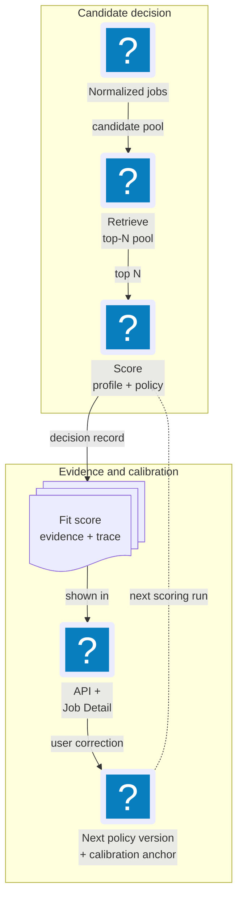

# Scoring Policy

How a discovered job becomes a defensible fit score: profile retrieval feeds a
deterministic, versioned scoring policy over structured evidence. Execution-level
detail lives in the [Stage Walkthrough](pipeline/stages.md); the domain model is in
[Tactical Design](domain-model/tactical.md).

**Read this if** you need to know how the fit score is produced, what it is based
on, and what it must not be used for.

Retrieval narrows the candidate pool before any LLM call; a user correction feeds
back as a new score version and a calibration anchor on the scoring policy.

## Posting Freshness Before An Attempt

New scoring work captures literal exact-title exclusions from the saved
Discovery row before availability checks, stage admission, or provider work.
It validates the row and those exclusions without requiring unrelated Discovery controls; an
unreadable row or malformed exclusions stops the attempt, while an absent row
uses first-use defaults. The captured exclusions remain the source for that
attempt even if settings change during analysis. The accepted score, report,
binding, stale markers and stage ownership remain unchanged on refusal.
Reusing a saved score does not read those controls. It still checks availability
and ownership; if the score disappears before reuse, the caller must retry rather
than start unvalidated scoring.

Single-job and batch scoring require successfully verified active posting
evidence no more than six hours old. Acquisition occurs outside the writer.
The short stage claim checks the original canonical URL and freshness again
before recording an attempt, then releases the writer before provider analysis
and scoring. A changed URL, unavailable posting or uncertain latest observation
defers work without replacing accepted scores or recording a stage attempt.
The acquisition and scheduling policy is owned by
[saved posting availability](../user/enrichment-and-extraction.md#saved-posting-availability).

## Activity Ownership Across Entry Points

Global explicit sweeps and legacy profile continuations honor the same Score ownership
as per-job preparation. They skip canceled rows, foreign pending/running owners
and queued automatic reservations before acquisition, then recheck under the
writer lock before claiming work. Score publication and terminal stage writes
also check the current owner. A revoked job records a skipped result without
replacing its successor, accepted score or attempt count; independent jobs keep
running. Distinct canonical Job IDs each use a source-bound scoring decision;
similar posting content does not authorize copying another job's score,
determination, or requirement report. A repeated unchanged request for the
same job may reuse its existing determination receipt.

Selected batches handle only the typed reservation-loss signal as a skip and
report its job IDs and count. Other exceptions and failed determinations remain
failures. The global stage wrapper propagates its failed-job count and safe
semantic failure codes through the normal activity error boundary; accepted
peer results stay saved when that activity fails.

Resetting stale score work changes only eligible, distinct jobs to pending under
a writer transaction without resolving any marker. Already-pending, queued and
running stages retain their owners; responses identify work already pending and
active work to retry after completion. Before inference, scoring captures the accepted score identity and
unresolved marker identities. The score, determination binding, requirement-fit
report and resolution of captured, source-matching policy markers commit in one
transaction. A changed policy or ownership fails the publication fence. A
marker introduced after capture is left unresolved for a later replacement,
even when it targets the policy used by the in-flight assessment. Reused scores,
failed or canceled work, and uncommitted publications resolve no markers. A
still-stale score does not reconcile downstream eligibility or threshold states,
and preparation does not suppress an accepted artifact based on that score.

## Profile Edits And Explicit Refresh

Profile persistence records the new version and ProfileUpdated event atomically.
It never admits scoring or material preparation, including during API startup.
Previously recorded continuation events remain historical; startup does not drain
them. Work already admitted keeps its immutable profile snapshot. Saved target
sources are formatted from that snapshot rather than reread from the live profile.

Each new score stores its minimized canonical candidate/target/condition source
catalog, profile identity/version, posting hash and scoring guidance privately in
trace_json. Public trace DTOs do not expose that source text. Explicit per-job and
batch refreshes of an older-profile score use the configured Scoring lane and
BR-050 preflight for a strict score_profile_impact determination. The model compares
both source catalogs against the job and saved assessment, decides significant or
insignificant, and supplies rationale and verbatim citations. There is no prose
heuristic or fallback. Batch compute runs these reviews in its existing bounded
pool; unchanged inputs reuse the persisted receipt without another provider call.

Only an insignificant verdict with unchanged posting, policy, prompt/schema, model, guidance
and scoring sources may retain the score. The score trace stores an exact fingerprint
of employer-analysis generation and requirement inputs plus the job interpretation
and its determination ID. Changed or missing historical source identity requires
a fresh assessment; profile significance cannot override changed job requirements. Retention preserves its version, date, requirements and accepted
materials, charges no new Score attempt and admits no material work. The review
binds to the exact previous score/determination and reviewed profile version under
the Score ownership and latest-score writer fence. New profile versions invalidate
that review binding. Significant changes proceed through normal full scoring and
preserve the old score on failure. Independent policy changes require a full
assessment even when profile changes are cosmetic.

Missing historical comparison sources, an unavailable provider, spend denial and
invalid model/binding responses remain distinct safe failures; none means the
profile is insignificant or the old score is current. Jobs GET compares canonical
versions and joins only the recorded review ID. Its statuses are not_scored,
unknown, current, profile_updated and reviewed_unchanged. A retained score keeps its
old source version visible rather than being relabeled newly scored.

## Retrieval Before Scoring

`PendingJobSelector` orders eligible work mechanically by recency and stable job ID. `--limit` applies a spend/work cap to that order. No vocabulary overlap, BM25 or embedding fallback decides which pending jobs are relevant. Provider searches execute saved settings directly. Fetched listings enter canonical ingestion without a separate model admission gate; scoring uses the full posting and current canonical job interpretation.

Job interpretation offers separately citable metadata fields only when their
stored text is nonblank. It preserves exact nonblank text, including literal
zero values. Missing metadata does not establish absence in the full posting:
the model still decides stated and unknown values from the canonical posting.
Source IDs and exact quotations remain validated, with the existing bounded
three-call correction budget. The request fingerprint includes the actual source
catalog; accepted older interpretation bindings remain readable.

## Scoring Fit Assessment

The Scoring context keeps `FitScore` as a 1..10 applicant-side triage signal,
but each persisted `job_scores` row also stores the criteria snapshot and trace
used to produce it. `criteria_json` records the saved score criteria, target
criteria, minimum score, and structured profile preference fields used for the
prompt. `trace_json` records non-sensitive audit metadata: prompt/schema
versions, model name, criteria version, profile snapshot version, parser
warnings, and correction history.

The prompt's evidence inventory is the same canonical source inventory used
for citation validation. Only confirmed achievements enter it. Education and
other structured facts retain their exact source serialization; a second text
adapter cannot advertise foreign IDs or reconstruct different citation text.
Profile evidence appears once in canonical `sources[]`; the existing
`candidate_evidence_ids` selects its inventory. The requirement-fit context
retains the analysis generation and each requirement's ID, text, tier, weight
and posting span, without a second aliased profile-evidence copy. This reduces
request representation size without removing facts or changing citation,
model/effort, admission or score-resolution rules. Prompt versioning and the
full input fingerprint distinguish the revised representation; accepted
historical scores remain intact. The generated reader registry accepts v10
results under the unchanged strict schema while current-only reads require v11.
Smaller payloads alone do not establish a latency or model-quality improvement.

### Deterministic Score Resolution

When the accepted employer analysis provides explicit requirement IDs and the
scorer returns requirement assessments, `requirement-fit-v1` owns the persisted
score. The scorer response supplies each assessment's requirement identity,
text, tier, weight, posting-evidence span, fit classification, and profile
evidence IDs. The parser validates field shape and ranges and requires at least
one non-empty evidence ID for matched and transferable rows. It does not
accept foreign evidence IDs, duplicated or missing requirement IDs, or posting
spans absent from the canonical requirement. Citations bind to the supplied
source IDs and contiguous verbatim quotes, including literal value checks.
The model owns the fit assessment; code applies arithmetic to the accepted
typed verdicts. Invalid determinations block the refresh while preserving the
last accepted score.

`job_evidence_span` must be non-empty and copied as one contiguous exact span
from the canonical requirement source matching `requirement_id`. Rewritten
requirement descriptions cannot substitute for that evidence. Invalid inventory,
span, evidence-ID and eligibility-status fields receive a complete mechanical
repair report with exact IDs and canonical targets. Scoring uses prompt revision
`score-fit-assessment-v11-single-evidence-source`; the scoring formula and independent
semantic decisions are unchanged. Bounded repair never accepts invalid output,
increases its call limit or replaces an accepted score on failure.

Employer-analysis failures preserve that same safe determination protocol through
the scorer and Temporal activity. An exhausted verifier binding failure blocks
the stage with its exact semantic failure code; it cannot become an
`llm_transient` error that repeats the entire Score. A classified transient
provider error retains normal activity retry behavior. Per-leg diagnostics
remain separate from source prose and raw model output.

For each parsed requirement assessment:

- `max_points = requirement weight × tier multiplier`, where must-have is
  `1.25` and nice-to-have is `1.0`;
- direct match has fit value `1.0`, strong match `0.85`, transferable evidence
  `0.6`, and missing, blocked, or not-assessed `0.0`;
- `awarded_points = max_points × fit value`.

The resolver rounds each row's `max_points` and `awarded_points` to four
decimal places, then computes
`weighted_fit = sum(awarded_points) / sum(max_points)` and then
`score = 1 + floor(9 × weighted_fit + 0.5)`, clamped to 1–10. One or more
blocked requirement rows cap the result at 4. The report separately records
must-have coverage, blocker count, and the number of missing or blocked
requirements whose saved weight is at least `0.75`.

Requirement-led resolution runs only when at least one valid assessment row is
returned and the employer-analysis generation is greater than zero. Otherwise,
the compatibility policy resolves three 0–10 model-classified dimensions with
a deterministic weighted mean: technical fit `0.45`, experience fit `0.30`,
and role fit `0.25`. It uses nearest-integer half-up rounding, clamps the final
score to 1–10, and applies the same bands: excellent at 9, strong at 7,
plausible at 5, stretch at 3, and poor at 1. Confidence and eligibility are
trace-only policy inputs rather than numeric adjustments. The Discovery
minimum-fit threshold gates downstream materials but is not an input to either
score formula.

The score breakdown separates soft fit from hard eligibility. `fit_band`,
`confidence`, matched/missing/transferable signals, warnings, and hard blockers
are exposed through the TypeScript API and Job Detail route workspace. User corrections create a new
score version, preserve the correction rationale, publish `ScoreCorrected`, and
can be read back as transparent feedback signals alongside existing job actions.
They also create a non-sensitive correction signal that is persisted as a
calibration anchor on the next `scoring_policies` version. The current policy
keeps rubric weights and fit-band thresholds stable; subsequent scores load the
latest policy version and include the active anchor IDs in `trace_json`.

Compensation range is always a soft preference. A parsed posted salary below
the profile range is retained as a sourced warning and never becomes a hard
eligibility blocker or prevents downstream material generation. The scoring
policy enforces this after model parsing as well as in deterministic checks,
so a model-supplied compensation blocker cannot cross the persistence boundary.
Downstream state reconciliation and every materials queue selector enforce the
same rule independently, which keeps historical or imported salary-only
`blocked` payloads eligible for tailoring without requiring a re-score.

::: warning Applicant-side triage only — not an employer hiring system
This is not an employer-side candidate selection system. If JobCtrl is ever
used to rank people for hiring decisions, the architecture needs a separate
governance layer for validation, bias audits, notices, adverse-impact review,
and human-review procedures before production use.
:::

## Selected-cohort comparison stays outside scoring

`domain/operations/career_learning.py` owns the strict
`career_demand_comparison` determination. It groups posting requirements by
model meaning and compares them only against confirmed Career Evidence Map
achievement IDs. Code validates source membership, verbatim quotes, exact
values and capability/proposal bindings; it counts distinct cited posting IDs.
No lexical grouping, skill matching, readiness formula or score-policy effect
is present. See the [user workflow](../user/scoring-and-employer-analysis.md#selected-job-demand-and-learning-milestones).
