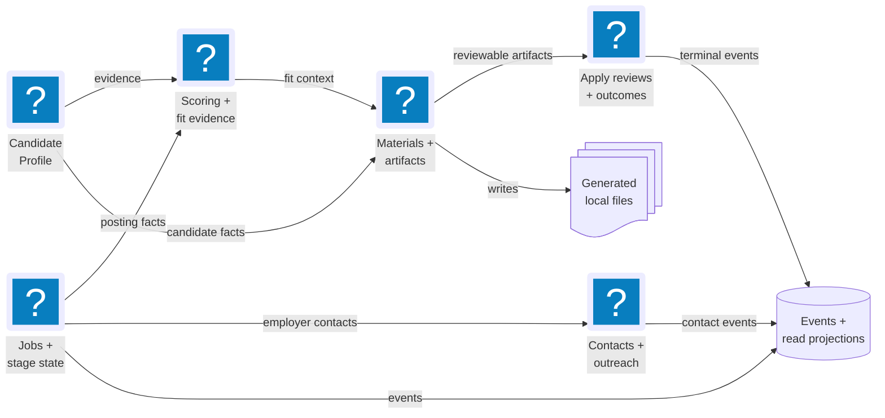
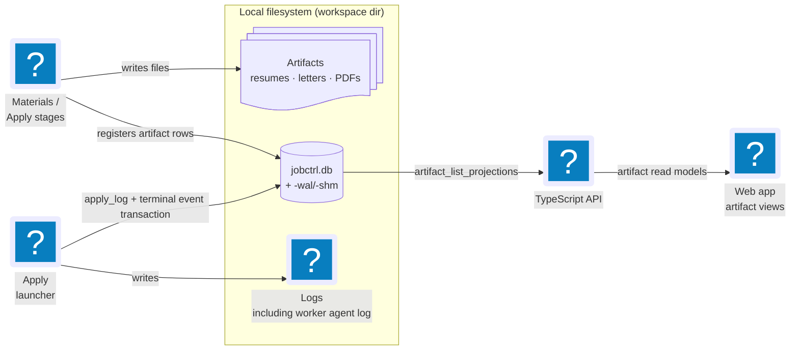

# Storage

Durable data lives on the user's machine in local SQLite stores, workspace
files, the native OS credential store, and vendor-managed authentication stores.

A fresh `jobctrl.db` is initialized as a closed exact-schema SQLite file in a
private staging directory alongside the workspace, then published without
replacing an existing path. Concurrent initializers either admit the published
exact database or fail without deleting it. If database sidecars exist without
their main file, creation refuses to adopt or remove them. Interrupted or
unfamiliar staging directories are preserved for inspection rather than swept.
When publication did not finish and its retained staged file still names the
same database, a later start refuses to open it until the interrupted publication
is investigated; the database, companions, and staging directory must be
preserved for diagnosis.

**Read this if** you need to know which table or file owns a piece of data, or
where generated artifacts land on disk.

## Local Authority Inventory

Unless overridden by `JOBCTRL_DIR`, the local authority root is
`~/.jobctrl/`:

| Path | Authority |
| --- | --- |
| `jobctrl.db` plus WAL/SHM | Canonical profile, jobs, discovery settings, events, projections, materials metadata, reviews, contacts, outcomes, and workflow rows. |
| `temporal.db` plus WAL/SHM | Bundled Temporal history; native lifecycle treats it and `jobctrl.db` as one restore pair. |
| `config.json` | Non-secret Settings values including spend/capacity, scoring guidance, provider metadata, provider-scoped model IDs, AI execution policy, compensation source policy, and explicitly adopted browser metadata. Transient detected-browser candidates are not persisted. |
| `.env`, `gmail/` | Legacy plaintext environment configuration until migration, and Gmail OAuth client/token state. |
| Native OS credential store | Allowlisted provider/CapSolver secrets; macOS Keychain, Windows Credential Manager, or Linux Secret Service. Not part of workspace database backups. |
| OS-user home `.jobctrl-credential-mutations.sqlite3` and `.inflight` | Secret-free cross-process credential mutation lock and temporary helper birth-identity record, shared across workspaces. Do not remove the lock while any API process may use it; unlinking it while held breaks coordination. The in-flight record is removed only after verified exit or replacement. |
| `codex_home/` | Stable JobCtrl-owned Codex authentication; auth is outside the prompt-readable `workspace/` subtree, whose private empty Git metadata bounds SDK project configuration discovery. Overlapping app-server clients share a temporary SQLite store per process and credential home; the last closed client removes it. Each client has separate temporary text logs, and generation chats are ephemeral. Private ownership records and OS leases allow reclamation of abandoned stores while preserving active or unfamiliar paths. Existing provider state is preserved. |
| `claude_home/`, `provider-packs/`, `provider-runtime/` | Isolated and separately acquired provider runtime state. |
| `tailored_resumes/`, `cover_letters/`, `logs/` | Generated material and logs registered by SQLite metadata where applicable. |
| `apply-invocations/<requestId>/` | Private native Apply result and launcher diagnostic log; the fixed child writes the result and the parent verifies exact native completion before reading outcome counts. |
| `apply-runs/<launcherId>/owner.lock` | Stable per-run logical lifetime lease. It does not serialize other jobs or prove descendant exit; source recovery requires the exact existing recorded inode and preserves known failures. |
| `apply-runs/<launcherId>/custody.json` | Private durable Apply job and birth custody, bound to the physical workspace and native execution. Records contain only resource/run identifiers, never applicant materials. Exact lifetime state fences the logical source owner; its best-effort settlement never certifies escaped-tree retirement. Native retirement uses actual completion proof. |
| `browser-profiles/`, `extension-capability-token`, `chrome-workers/`, `apply-workers/` | Consented copied profiles for separate compatibility capabilities, extension pairing, and browser/apply execution state. Integrated Discovery uses the current Chrome profile through the extension and never stores a copy; its bridge task bodies/results are API-process-memory-only. Browser-adoption metadata is in `config.json`. |

Gmail authentication and refresh serialize a valid token into an exclusive
same-directory stage, set its permissions before writing, flush the file, and
atomically replace the canonical token. Failures before replacement preserve
accepted bytes; handled failures remove their owned stage. New authorization
requires its own nonblank refresh token and never borrows one from an unproven
account identity. On POSIX the stage is
mode `0600`. On Windows a protected DACL grants access to the current user and
LocalSystem from file creation, and a filesystem without persistent ACLs is
refused; a volume whose ACL support cannot be determined is also refused. A
process killed before replacement can leave its private stage behind.
| `backups/` and legacy `resume.*` / style files | User-created database snapshots, guarded job-data-purge recovery bundles, and pre-migration resume inputs. |

Developer supervisors additionally use checkout-local `.dev/` process, log,
and Temporal files; those are not installed-user authorities but remain
sensitive.

Installed release retention collects references before pruning. The current
workspace comes from the resolved instance; other managed instances are mapped
through runtime state records whose canonical workspace path hashes to the
instance ID. Paired-backup metadata in any regular subdirectory of each
workspace's `backups/` keeps its referenced build. The recorded pair ID may name
a different local directory; its path components are checked and watched.
Unrelated directories without `pair.json` are left in place and watched for a
new reference. Active and controller releases, journal references, the
eligible prior release, live instance releases, non-stable releases and foreign
directories are preserved. A live installed instance must bind its payload path,
build and manifest digest to an installed receipt. A source registry must bind
the unchanged checkout launcher to its exact source execution scope and live
kernel identities or a verified stopped completion. Unknown or changed ownership
stops cleanup. An independent installed Apply receipt also needs its exact native
completion; an unresolved receipt prevents pruning even when the supervisor has
stopped or the current workspace has no supervisor registry. The receipt does
not identify a build, so cleanup preserves all candidate releases when it cannot
establish completion. This check does not stop processes or change restart.
Older execution receipts require matching completions and must have no live
scope. A scope born on the current boot also requires verification
on that boot; a prior-boot scope may have been verified on a later boot. Paired
backup references remain protected in both kinds of
workspace. Reference
directories and files are read through anchored handles and rechecked during
cleanup. Cooperative native backup writers use the runtime transition lock;
concurrent writers outside that lock can still race the reference checks.
Cleanup binds the store and releases directory to
their identities at store open, reads entries through anchored directory handles,
and atomically claims each candidate without replacing another path. A candidate
is pruned only when its sequence, build and descriptor match recorded channel
state, its installed release evidence authenticates and its complete tree
matches the signed payload inventory and expected release metadata. Releases
without a recorded sequence binding are preserved.
Unrecorded files, links and empty directories, modified payload files and
unverifiable releases are preserved. Generated receipt and policy files are not
independently signed; a structurally valid edit to them is not necessarily
detectable as an edit. A changed root or entry refuses deletion. A claim that
cannot be safely returned is kept under its private `.retention-*` name for
inspection; an interrupted cleanup can leave a partially removed owned tree
there. An actively concurrent writer with access inside a claimed directory can
still race the final pathname check and individual unlink. Unsupported platforms
refuse pruning. Unreadable, linked, missing or malformed managed
ownership/reference authority prevents all pruning; absent `backups/` is an
empty set. External `backup --output` locations are not discovered. Retention
does not bypass channel revocation, protocol compatibility, or pair digest checks
for rollback.

The proposed [sensitive-artifact retention and cleanup
contract](../plans/sensitive-artifact-retention.md) inventories these authorities
and defines reference protection, preview, containment, recovery, and future
manual cleanup gates. It is unshipped: current JobCtrl has no unified retention
command, schedule, or implicit TTL deletion.

## Schema At A Glance

The API's job-list query index is app-owned SQLite TEMP state on its retained
list connection. It adds no table, index, schema-version stamp or migration to
the canonical exact-v15 database. Python and TypeScript projection ownership
and exact-manifest admission remain unchanged. TEMP rows and freshness markers
are disposable and rebuilt after connection close, app restart or database
replacement; they are not a backup or a new source authority. See
[job-list selection](read-model.md#job-list-sqlite-selection) for snapshot,
failure and hydration boundaries.

Exact v15 adds `job_lifecycle_clock` and `job_lifecycle_revisions` as the
durable authority for removed-job selection freshness. SQLite triggers
advance a globally monotonic revision for job creation or identity changes and
for delete/hide tombstone writes, including writes from another connection.
Per-job rows cascade with their job; the clock retains no job identifiers.
Unrelated writes, such as worker heartbeats, do not advance a job's revision.
An already reviewed destructive selection is checked against that revision in
the same write transaction as deletion. The reviewed-selection receipt itself
is short-lived process memory, not a substitute for the durable revision.

V15 migration constructs and verifies a separate candidate from a stopped source
and binds activation to a WAL-aware application/Temporal backup pair. The new
authenticated installer upgrades an original protocol-1/schema-14 selection
without executing the predecessor. Exact-v14 activation applies the additive
schema to the live database in a single SQLite transaction without replacing
its inode; earlier supported source versions retain the sealed-candidate path
under a compatible controller. Runtime admission requires exact schema v15.

The forward-update journal records the authenticated source receipt and
selection generation, source schema, target, original backup and latest recovery
backup. Each retry first cleans up instance-owned processes and snapshots the
current live pair, including acknowledged WAL commits. Failed readiness and
interruption retain the live pair and resumable journal. Recovery reruns the
trusted new installer before selector replacement; after replacement, ordinary
`jobctrl update` continues forward. Neither automatic recovery nor a cross-protocol
rollback may restore the original backup over newer protected data. Configuration,
resume files, provider authentication and other external workspace authorities
remain outside the pair and are preserved separately. Initial install refuses
schema 14 without the original predecessor selection; exact-v15 reinstall may
preserve the pair after verified cleanup.

The database is easier to understand as a set of ownership families. The
diagram shows the main relationships; the table below names the exact tables.

Within the job-owned families, one `jobs` row keyed by `(tenant_id, job_id)` is
the hub: stage state, events, scores, analysis, materials, and Apply records
hang off the stable tenant-scoped `JobId`. A posting URL is an external locator
with a tenant-scoped uniqueness constraint, not an internal primary or foreign
key. Employer and Source observations are stored as independent facts.

The remaining tables group by owner:

| Owner | Tables |
| --- | --- |
| Candidate Profile | `candidate_profiles` plus 12 `candidate_profile_*` child tables (experience, bullets, skills, education, achievement evidence, required-content sets, resume constraint metrics) |
| Interview preparation | `job_interview_prep`, `job_interview_prep_items`, independent `job_interview_notes` and immutable `job_interview_note_revisions` |
| Resume templates | `resume_templates`, `resume_template_versions`, `resume_template_defaults`, `resume_template_refresh_attempts`, `job_resume_template_assignments` |
| Compensation | `job_posted_compensation_facts`, per-job `job_market_compensation_estimates`, versioned `compensation_role_families` and mappings, immutable direct/price-level/extrapolated benchmark facts, relational extrapolation inputs, and `compensation_market_refresh_state` |
| Scoring | `job_scores`, versioned/indexed `job_score_keywords`, `scoring_policies`, `job_score_staleness` |
| Read-model projections | `job_list_projections`, `job_detail_projections`, `dashboard_projections`, `apply_run_projections`, `workflow_run_projections`, `pipeline_step_projections`, `artifact_list_projections`, `event_watermarks`, `digest_state` |
| Discovery & preparation | `discovery_runs`, `discovery_execution_jobs`, `discovery_execution_recoveries`, `discovery_search_units`, `discovery_search_unit_jobs`, `discovery_search_unit_filtered_events`, `discovery_settings`, `discovery_feedback`, `discovery_quarantine_entries`, `job_canonical_identities`, `job_source_observations`, `job_duplicate_links`, legacy `preparation_work_items`, `manual_capture_queue`, `posting_snapshot_sets`, `source_registry_entries`, `source_locator_candidates` |
| Apply review, repeat protection, and outcomes | `application_review_decisions`, `application_repeat_overrides`, `application_repeat_override_consumptions`, `application_repeat_audit`, `application_outcomes`, `application_email_evidence`, `application_outcome_suggestions` |
| Explicit-feedback learning | `tailoring_feedback_signals`, `tailoring_feedback_signal_reviews`, `tailoring_feedback_signal_contradictions`, `learning_recommendations`, `learning_recommendation_evidence`, `learning_recommendation_evidence_jobs`, `learning_recommendation_jobs`, `learning_recommendation_reviews`, `learning_recommendation_tombstones` |
| Policies & operations | `tailoring_policies`, `llm_spend`, `worker_runtime_heartbeats`, `jobctrl_deleted_jobs` |

SQLite in `~/.jobctrl/jobctrl.db` is the local source of truth for jobs,
stage states, events, artifacts, normalized Candidate Profile data, profile
rendering settings/template text, run visibility, apply-review decisions,
application outcomes, linked email evidence, and outcome suggestions. The
projection tables (above) are also stored here. Discovery-page controls remain
SQLite-backed. `config.json` owns non-secret Settings values: the daily
budget, capacity controls, scoring guidance, provider configuration, AI execution policy,
preferred model IDs, and Levels.fyi/Glassdoor enablement, access-basis, and
licensed-feed coverage policy. Public Levels.fyi Markdown needs no credential.
Credentials, feed paths/URLs, feed contents, and provider payloads do not belong
in the settings file.

The guarded job-data purge uses aggregate ownership rather than table age. The
Job graph, generated Materials, Apply/job projections, and the job/Discovery
execution ledger (runs, search units, membership/recovery rows, pipeline steps,
job-workflow projections, lifecycle/stage events, source-quality summaries, and
operational-attempt metrics whose stage is `discover`, `enrich`, `score`,
`tailor`, `cover`, or `apply`) are one deletion boundary because retaining the
latter can recreate a projection, bias source scheduling, or retry work for a
deleted Job. Candidate Profile, Discovery settings, source registry,
templates/policies, contacts/outreach, unrelated workflow history, and
operational-attempt metrics from non-job stages are separate authorities and
remain. Bundled Temporal history is outside this command; the pre-purge
database and archived files remain recoverable under `backups/`.

The purge inventory separately reports retained auxiliary/history rows, including
on a no-op. These are outside the deletion boundary and can still cite removed
jobs, runs, or feedback signals:

| Retained rows | Remaining references or effect |
| --- | --- |
| `manual_capture_queue` with `job_id IS NULL` | Includes pending Discovery captures and their `retry_context_json`; they can still appear as required on the Discovery page. Job-linked captures cascade with their Job. |
| `source_locator_candidates` | Retains discovered source URLs and manual-action reasons, including deduplicated history proposals. |
| Source-control `job_events` with null `job_id` | History-proposal `SourceLocationCandidateDiscovered` receipts retain origin JobIds/URLs, source-observation/run IDs, extraction/snapshot hashes and saved samples. `SourceLocationCandidateReviewed` retains coordinate-scoped promotion/rejection/reset decisions. These are retained source-control authorities, not job-owned rows; suppression survives Job deletion and job-data purge. |
| `learning_recommendation_jobs`, `learning_recommendation_evidence_jobs` | Immutable learning provenance retains historical JobIds. |
| `learning_recommendation_evidence`, `tailoring_feedback_signal_reviews`, `tailoring_feedback_signal_contradictions` | Append-only evidence/reviews retain signal/review references and historical JobIds even after source signals cascade away. |
| `learning_recommendation_tombstones` | Append-only tombstones retain `affected_signal_id` after a Job-owned source signal cascades away. |
| `role_match_feedback_suggestions` | Retains `evidence_json`, which may cite purged jobs or runs. |
| Non-job `workflow_run_projections` | All unrelated workflow history remains and is counted. In particular, `ContactResearchWorkflow.input_summary_json.jobId` can retain the purged JobId it was asked to research. |

Counts cover local rows in these retained sets, not only rows whose referenced
source still exists. The command does not rewrite immutable learning history or
dismiss pending captures. “Nothing remains in the purge boundary” therefore
does not mean this auxiliary/history data is empty.

The exact-v10 `job_application_locators` table is Job-owned and cascades with
its Job. The exact-v11 lane-scoped `llm_spend` ledger contains no Job or run
reference; it is a separate authority that the purge fingerprints and preserves.

Post-commit reporting distinguishes optional compaction from preservation and
integrity verification. If `VACUUM` or its checkpoints fail but all purge
invariants still verify, the command reports the committed purge, recovery
bundle, and free-space/compaction guidance. A failed post-commit invariant keeps
the stronger stop-and-restore guidance because the live result was not verified.

### Historical v10–v12 cutovers

The v12 cutover migrated admitted v6, exact-v7, exact-v8, exact-v9, exact-v10,
and exact-v11 installations while the application was stopped. It first created
a paired backup of `jobctrl.db` and Temporal state.
A v6 source retains the Temporal quiescence proof and identity rewrite through
private exact-v7/v8/v9 intermediates; newer sources start at their next schema
step. The final exact-v12 candidate was the activation target at that cutover.
Intermediate databases and their sidecars are removed after success and during
failure recovery. Current v15 source and installed runtime requirements are
described above.

V10 removes `jobs.application_url`. `job_enrichments.application_url` is the
canonical application target. A nonempty canonical value wins; otherwise the
migration promotes a nonempty legacy value. A missing enrichment receives a
pending row, without claiming that enrichment succeeded. Other enrichment fields,
lifecycle state, tenant/job identities, dependent rows, and sequences stay intact.
Null and empty values are absent; retained strings keep their exact bytes.

`job_application_locators` retains the union of nonempty legacy and canonical
URLs under a tenant/job/URL key. These aliases support historical lookup only;
clearing the canonical target does not make projections or approval validation
read an old alias. New enrichment saves retain their application URL as an alias.
Discovery can fill an absent canonical target and retain an observed alias, but
cannot replace a nonempty canonical enrichment URL. Posting locator uniqueness
remains unchanged. Application endpoints may be shared, so application lookup
returns a job only when exactly one job in the requested tenant matches. Posting
identity takes priority over an application alias. Deleting a job cascades only
its own aliases.

Activation requires exact-manifest, retained-data, exact URL-transfer,
foreign-key, integrity, source-preservation, permissions, digest, and paired-state
verification. The receipt's comparable data digests cover every retained cell and
sequence; the complete changed enrichment rows and alias set are verified
separately before sealing. Earlier cutovers restored the paired backup on failure;
the current controller instead retains the live pair when an automatic restore
could overwrite newer committed data, and leaves the transition for recovery.
V11 replaces the global `llm_spend` primary key with `(day, lane)`. Historical
v10 rows move byte-for-value into the migration-only `legacy` lane. Global
totals sum all lane rows, including legacy; new runtime writes accept only the
nine named product lanes.

V12 adds nullable `generation_context_json` and `question_metadata_json` to the
prep generation and item respectively. They retain the generation-time catalog,
question/rubric revisions, context snapshots and evidence links. Old rows keep
null bindings and project `legacy_unbound`; migration never invents associations.
The comparable migration digest includes every old column and sequence, and the
new columns must remain null while both new note tables start empty.

Notes belong to `(tenant_id, job_id, question_id)`, independently of generation
and item replacement. Saving with `expectedRevision = 0` creates revision 1;
later saves compare the exact current revision and atomically append the same
row to history. A stale comparison changes neither row. User edits always carry
`user_edited` and default to `unverified_user_statement`; the save boundary
rejects self-assigned supported facts. Note text is bounded at 20,000 characters.
Both note tables cascade with their tenant-scoped Job and never promote profile,
fit or Apply facts. Events carry only safe identities, revision and time, never
note text or retained context.

Before native activation, the live source must match the paired source's exact
schema and retained cells. A private binding seals its file identity/state and
candidate digest. Activation requires a quiescent transition to DELETE journal
mode, then rechecks those bindings under SQLite's exclusive lock. For exact-v14
the additive v15 schema is committed on the existing inode, preserving every
existing table and sequence; the verified candidate is not used to replace live
data. Sources before v14 retain the locked atomic rename and source-sidecar
cleanup. These checks refuse a WAL reader that prevents the exclusive cutover;
they do not independently prove that every detached runtime process has exited.
An unmanaged writer or a commit after backup refuses activation. When the candidate has not changed the live database,
recovery preserves the live source, including an independent committed write,
instead of restoring an older backup over it. After activation or candidate
startup, the current controller retains both live databases on a failed readiness
check rather than automatically replacing them with an earlier pair.
A private intent receipt binds preactivation source preservation to the exact
journal, backup and source version, and survives interrupted old-runtime restart.
An old schema header during partial paired restore cannot bypass Temporal recovery.

The v12-era TypeScript API and Python worker accepted exact v12 and rejected
direct v6/v7/v8/v9/v10/v11 operation; runtime constructors did not migrate
schema or commit caller work.
Each projection refresh owns only derived writes and its consumer cursor inside a
transaction or the caller's savepoint. Refresh compares existing projected targets
with canonical enrichment even without a new event, so preserved projection rows
and watermarks cannot hide a URL promoted during migration.

The remaining URL consumers are classified in the
[application URL authority inventory](application-url-authority.md). Historical
v6 preparation and v7/v8/v9/v10/v11 schema/executor definitions remain frozen to admit
previous installations, and do not provide a current-runtime fallback.

V9 adds one optional per-position summary to normalized Candidate Profile
experience rows. Existing rows receive the empty-string default; empty values
render nothing, while non-empty values appear between the role heading and its
achievement bullets.

V8 adds a versioned JobCtrl role-family taxonomy plus physically separate
authorities for directly observed market benchmarks, price-level inputs, and
geographically extrapolated benchmarks. Direct and extrapolated records cannot
be confused by a nullable discriminator. Their evidence rows and input links
are append-only, content-addressed, source-dated, and protected against update,
delete, `INSERT OR REPLACE`, and conflicting UPSERT paths. The existing
`job_market_compensation_estimates` table remains the per-job materialized
output; it is not the reusable benchmark authority.

### Repeat-application authority retained in v7

Historical application facts remain owned by the existing job events, reviewed
outcomes, and compatible applied status. The three repeat-decision/audit tables
introduced in schema v6 are retained in v7 without reinterpreting those facts:

- `application_repeat_overrides` stores the target, selected prior job,
  relationship, immutable evidence snapshot and SHA-256 fingerprint, reason,
  actor, and confirmation time.
- `application_repeat_override_consumptions` binds one override to one apply run
  and consumption time. Primary and unique constraints prevent reuse by either
  override or run during concurrent claims.
- `application_repeat_audit` stores idempotent warning/block assessments plus
  override-recorded and override-consumed actions with the bounded evidence
  snapshot that justified each decision.

The evaluator reads canonical job/source identity and accepted
`job_duplicate_links`, then joins only confirmed application facts. Pending
suggestions, notes, dry runs, failed attempts, and intent checkpoints are not
promoted into history. The v6-to-v7 migration copies these exact application
facts into the JobId-keyed schema and verifies their references before
activation.

For a live run, the Python launcher opens `BEGIN IMMEDIATE`, recomputes the
current evidence, performs the existing active-run and approval checks, and
consumes a matching one-attempt override before transitioning Apply to running.
The consumption and stage claim commit together. A stale approval does not
consume the override; a competing claim cannot consume it twice. The later
submit-intent and `needs_verification` checkpoints retain their existing
ownership and semantics.
The `digest_state` projection table stores the local daily digest review
watermark; passive Dashboard and CLI reads do not update it, and only explicit
acknowledge actions advance it.
Posted compensation facts live in the canonical
`job_posted_compensation_facts` table. The parser consumes only bounded salary
source text such as `jobs.salary`, records explicit parse states and warnings,
and keeps `jobs.salary` unchanged as a compatibility/raw fallback. It does not
store full descriptions, provider raw payloads, credentials, local paths, or
licensed-source salary data.
The selected input is the first nonempty salary, current enriched description,
full description, or short description. Discovery commits its intake before
model extraction; before binding the result and emitting its update event, the fact writer
reselects that source under a short write reservation. A changed source field or
normalized text, including an enrichment status transition that changes the
preferred source, rejects publication and retains the last accepted fact and event.
Market compensation estimates live in the canonical
`job_market_compensation_estimates` table. The estimator consumes deterministic
local compensation observations keyed by company, role, location, and trimodal
company tier, including imported reported-compensation observations and
employer-posted salary facts captured by JobCtrl. It records explicit non-range
states only when required inputs or usable sources are missing. When sparse real
evidence exists, it emits the best available estimate by falling back from exact
company-role evidence to same-location role evidence, same-company adjacent
roles, trimodal company-tier evidence, and finally a broad market baseline. Each
estimated range also stores confidence interval bounds that widen as the fallback
tier weakens, sample support drops, locations mismatch, or source agreement gets
weaker. Estimates persist sanitized selected evidence rows for the observations
that drove the range, including row-level company, role, location, level,
component, EUR/year range, sample count, release year, safe source URL when
available, and match scores.
Employer-posted salary observations can emit low-confidence ranges with
low-sample warnings. High-value posted base-salary text with an omitted period
can be treated as annual evidence for market estimation, but bonus-only and
one-sided rows are rejected. The `jobctrl compensation-refresh` command
reparses existing posted salary text, imports explicit local
observations, tokenless public Levels.fyi salary pages, configured licensed
Levels.fyi and Glassdoor feeds, and public Euro Top Tech observations
additively, writes estimates for existing jobs, and
refreshes projections without running the job pipeline. It
does not alter raw `jobs.salary`, scoring, ranking, filtering, apply readiness,
or apply dispatch behavior.
Operations projections materialize compensation read data from those canonical
tables into `job_list_projections.compensation_summary_json`,
`job_detail_projections.compensation_summary_json`, and
`job_detail_projections.compensation_audit_json`. TypeScript exclusively writes
the detail family; list summaries remain shared pending their own cutover.
See the [writer inventory and recovery contract](data-events-and-projections.md#projection-ownership-and-consistency). The list/detail API deserializes
those projection columns only; it does not parse raw salary text on read.
`JobSummary.salary` remains the compatibility raw string.

### Discovery lineage and operations state

`DiscoveryResultPlanFrozen` and `DiscoveryNewJobAdmitted` are operational
authorities in `job_events`. Their Job foreign key is null: the plan binds exact
tenant/workflow/run, bounded or unbounded mode, cap, source-ID allowances and an
integrity digest; each admission binds the canonical JobId through `entity_ref`
and its structured payload, plus exact source-observation/run IDs. Neither
contains posting text, queries or private search configuration. Ordinary Job
deletion preserves these rows, so it cannot replenish a consumed execution
allowance. The explicit full job/Discovery-data purge backs up and clears them
with the execution ledger. Source-control events keep their separate retention
authority.

`discovery_execution_jobs` is the durable execution-membership authority. Its
primary identity is tenant + Discover workflow ID + Temporal run ID + stable
JobId. It stores `observed_this_run` or `existing_backlog`, the first safe
source metadata, explicit work-plan state, immutable required steps when
planned, a bounded reason for not-eligible/failed plans, and the preparation
workflow ID. Link writes are idempotent; a swept job can be promoted when this
run later observes it, but cannot be duplicated or demoted.

`discovery_search_units` is the caller-owned authority for resumable
JobStreaming work. Each row belongs to one exact Discover execution and stores
an immutable query/location/board request plus its fingerprint, ordered
lifecycle state, current activity owner/attempt, monotonic lease epoch,
recovery count, opaque provider checkpoint and revision, bounded typed failure
fields, and cursor-reset intent. A reset also records the checkpoint revision
that must be reached by acknowledging the provider error; reclaim cannot clear
the cursor before that revision is durable.

`discovery_search_unit_jobs` is the idempotent acceptance-receipt set keyed by
execution, unit, and stable JobId. The job/source/event writes and receipt
commit before provider acknowledgement. Durable unit-level new/existing counts
are derived from these receipts, so replay cannot count a posting twice. A newer activity attempt reclaims only `running`/`pending` units
and increments the lease epoch; every checkpoint or accepted-job write fences
on that epoch. `completed`, `failed`, `skipped`, and `canceled` units are
terminal.

`discovery_search_unit_filtered_events` is the matching fenced receipt set for
provider results excluded by literal user-authored whole-title filters. It stores only a
SHA-256 digest of the provider event key. Filtered-result progress is aggregated
from these receipts, so an acknowledged result remains counted after recovery
without exposing provider payloads or counting replay twice.

`pipeline_step_projections` is rebuildable read state keyed by that exact
execution, bounded step kind, and item key. It folds the four `PipelineStep*`
events into attempt, state, queue/start/finish timestamps, duration, safe
detail/error code, retryability, and last-event metadata. The attempt-aware fold
ignores late lower attempts and preserves the first terminal result within an
attempt. Canonical `job_stage_states`, not this projection, remains the owner of
per-job enrich/score/tailor/cover lifecycle.

`worker_runtime_heartbeats` is current runtime telemetry rather than durable
domain history. A row identifies the worker/runtime boundary, configured and
active slots, executor threads, bounded allowlisted active detail and duration
summaries, and one typed Temporal task-queue observation. The operations reader
derives the expected application directory from the configured database path,
filters rows to that resolved database/app-dir identity, selects the queue from
the newest matching heartbeat, and aggregates fresh schema-valid rows on that
queue. It never treats stale/invalid rows as zero capacity.

The heartbeat interceptor does not read activity arguments. Detail is capped,
unsafe identifiers are stored only as non-reversible local opaque references,
and raw URLs, descriptions, profile data, prompts, provider output, artifact
paths, payloads, credentials, and exception text are excluded. Runtime rows are
still local operational metadata and belong inside the same sensitive
`jobctrl.db` backup boundary.

## Files And Registration Flow

A file and its database registration are written together; the read model serves
the `job_artifacts` / `job_materials_artifacts` rows, never the raw files.

Generated resumes, cover letters, PDFs, logs, and imported PDFs stay on the
local filesystem. They are registered in `job_artifacts` and
`job_materials_artifacts` and surfaced via `artifact_list_projections`. Profile
data and rendering settings live in SQLite after explicit profile saves or
resume imports. Resume templates are Profile-owned style/layout configuration
with versioned rows and default selection, while per-job template overrides and
render-only refresh attempts are Materials-owned because they affect generated
artifact generations. Template edits use profile data only for preview styling;
they do not persist candidate facts into template payloads.
The apply launcher records each per-worker agent log
(`LOG_DIR/worker-{worker_id}.log`, written by `ClaudeCodeCliAdapter`) as a
`job_artifacts` row of kind `apply_log` in the same transaction as the
terminal `ApplicationSubmitted` / `ApplicationFailed` / `DryRunCompleted`
event.
Every run also persists the agent's raw output as `apply_agent_output`, and
successful live results persist confirmation evidence as `apply_confirmation`.
Verification confidence is derived from the evidence: `1.0` only when a
structured applied result and confirmation evidence are present, `0.6` for the
structured result alone, and `0.2` for inferred/unstructured outcomes.

Dry-run Chrome launches install a CDP guard in addition to the prompt
instruction. The guard attaches to page targets, blocks non-local
POST/PUT/PATCH requests with `Fetch.failRequest`, and injects a form-submit
interceptor that marks `window.__jobctrl_dryrun_blocked` when a hostile page
tries to submit.

## Enrichment Availability Ledger

Schema v12 is unchanged. Enrichment persists `JobAvailabilityObserved` and
internal `AvailabilityLeaseChanged` rows in indexed `job_events`, scoped by
`tenant_id`, `entity_kind`, `entity_ref` and latest `event_id`.
The `posting_availability_request` reference records
coalesced explicit deferred command reason/request time/retry time independently
of observation clocks; automatic/preflight refusals do not write user requests; job-scoped records also notify detail/list reads. Other entity kinds are
`posting_availability` (canonical JobId), `availability_lease` (job/actual host), `availability_request` (outbound request
lineage), `availability_acquisition` (one hourly quota charge per posting check), and
`availability_sweep` (minimum admission interval).

Attempts, latest verdict and successful-verification clocks are separate from
accepted snapshot content and job enrichment. Five-minute lease owners fence
late completion after a crash or changed posting URL. Observation success can
update availability on `posting_snapshot_sets`; unchanged positives advance
only the observation clock. No availability path writes hide/delete tombstones,
application outcomes, approvals, scores or materials. A location-policy finding
keeps its separate gate when external availability becomes active.

Reviewed locale variants use `job_artifacts` with a separately versioned
`material-locale-v1` metadata contract, plus the existing semantic determination
and entity-binding tables. Original Materials rows and legacy registry metadata
remain unchanged. Locale revision text and four export formats use unique owned
files under `generated/locale-variants`; failed publication removes only newly
staged files. See [Material Locale Variants](material-locale-variants.md).

## Screening Answer Ledger

Exact-v14 screening answer revisions use existing indexed `job_events` entries with `screening_question`, `screening_library`, `screening_failure` and `screening_notification` entity kinds. Private snapshots and supporting facts are exposed only by the screening owner; general activity/SSE retain references. The [owning contract](reviewed-screening-answers.md) defines atomic revision comparisons and source/version fences. No schema migration is introduced.

## Company Briefing Ledger

Materials stores immutable `company_briefing_config`, `company_briefing_link`, `company_briefing_accepted` and `company_briefing_attempt` records in the existing indexed exact-v14 `job_events` table. `entity_ref` is the explicit company URL hash or canonical JobId; tenant and event ID select the current revision. Accepted snapshots retain bounded public text and join their recorded `semantic_determinations` ID. Configuration and company history have no JobId foreign key and survive removal of the last linked job. Job link rows use the canonical JobId foreign key. No schema migration or separate store is introduced. See [Company Briefings](../user/company-briefings.md).

## Cover-Letter Review Previews

Cover-letter review previews live under
`generated/cover-letter-previews/<preview UUID>/` with a full source snapshot,
`letter.pdf` and a private identity/settings manifest. Preview files are separate
from registered accepted Materials. Explicit acceptance registers that same PDF
path in a new `job_materials_artifacts` generation and persists the print identity
in `metadata_json.cover_letter_review`; the aggregate metadata retains the same
receipt. This uses the existing exact schema. Historical generations, resume
slots, layout boxes and source-bound records are retained. Failed acceptance
never deletes a preview or previously accepted files. A committed receipt permits
retry/reload reconciliation after a lost response. These local generated files
are private material and must not be committed.
The final source/PDF/manifest fence runs inside the promotion transaction after
its last insert. A mismatch rolls back the new rows without restoring externally
changed source files or changing prior accepted PDF files and authorization rows.

Unchanged slots reuse their artifact IDs across generations. Readers that need
an exact source, including DOCX export, bind both ID and generation. Artifact
projections use the newest canonical occurrence with only that generation's
layout and provenance rows; retained copies are history, not additional lines.
Cover-only carry-forward binds both selected resume IDs to their original
coherent generation, using the same selector as Apply Review. It never combines
a newer partial resume generation with another PDF/text version. Cover aliases
retain same-generation row order. Older aliases and partial generations remain
historical. Cover-text display reads the canonical source ID and checks its hash;
unreadable or changed source bytes cannot substitute another alias.

The persisted review PDF digest remains authoritative if a file disappears or
changes. Default generated cover PDFs store source-text and PDF digests in their
artifact metadata with the source ID/generation, print settings and renderer.
Unbound historical PDFs are never inferred current from generation alone.
Owned source/preview/PDF I/O rejects symlink components, hard-linked files and
nonregular or oversized inputs. RPC render output is a new exclusive file in its
UUID attempt; failed cleanup removes only the original owned attempt directory.

## Career-learning snapshot ownership

Selected-job cohorts, failed comparison attempts and user-chosen milestones use
scoped `career_cohort`, `career_attempt` and `career_milestone` records in the
existing exact-v14 `job_events` table. Semantic envelopes remain in
`semantic_determinations`. A milestone retains its immutable origin and later
activity revisions; user completion evidence never changes Candidate Profile
rows. These private snapshots can retain posting text and confirmed achievement
excerpts after a source changes or a job is deleted. Job-data purge preserves
these records and discloses `career_learning_records` in retained-reference
counts. There is no new schema migration or automatic retention cleanup.

## Private Offer Ledger

Actual offer terms and accepted/declined corrections use immutable
`job_events` rows with `entity_kind = offer`, `entity_ref = JobId` and
`event_type = OfferRecordChanged` on the existing exact-v14 schema. Payloads
contain a `termsRevision` or `decision`, including user-confirmed source
reference/quotation and recorded timestamps. These scoped rows are canonical
private state, following the existing screening ledger pattern; they are not
public event payloads. SSE strips the private payload to reference IDs before
publication. Job deletion follows the existing tenant/JobId foreign key.

`outreach_drafts.gate_results_json.sourceContext` retains the offer binding,
source snapshot and fingerprint used for review; semantic determinations remain
in their existing canonical tables. No new database, profile copy, file store
or runtime migration is introduced. Offer writes are transactional and retain
all prior revisions and decisions.

Provider pack installation directories include the SDK version and signed
specification hash. Activation schema 2 records that identity; readers derive
it from the signed payload and retain schema-1 compatibility for verified
legacy directories. Updating a closure preserves the prior installation and
never repurposes a version-only directory. The [runtime contract](agent-runtime.md)
keeps wheel/tree integrity and core-overlap refusal mandatory.

Native lifecycle snapshots require the instance's durable execution ownership
receipts and a completed zero-member kernel census. Process-group emptiness or
a dead leader alone cannot certify the pair. Stop publishes its verified state
before retiring those receipts, so an interrupted metadata cleanup can resume
without losing the process boundary. Missing or legacy-untracked ownership
blocks automatic backup/restore and preserves the live databases and registry.

Native Apply crash recovery consumes the original execution's exact completion
attestation from the runtime home's
`instances/<instanceId>/completed-executions/<scopeId>.json`. Native cleanup
writes it only after verified scope exit and before retiring the matching
execution receipt. It contains the complete original receipt and its exact-byte
SHA-256, verification boot and completion time; it survives later starts and
binds no user application/profile facts. A missing, changed, linked or foreign
proof preserves the Apply journal and refuses recovery. Source-only custody has
no implicit equivalent of that native proof.

## Legacy achievement confirmation history

The v12-to-v13 transform preserves every retained achievement cell and records
original rows before dropping the obsolete inferred seniority column. Legacy
booleans have no author receipt, so all legacy confirmed records enter explicit
review. No prose, identifier pattern or partial/exact value shape proves
provenance. The same transform is used by every supported v6–v12 composite
cutover to the current exact schema; no additional schema version is introduced.

Private `LegacyEvidenceReviewRecorded` rows use the existing `job_events` ledger,
null `job_id`, `entity_kind=legacy_achievement_evidence` and a JSON-array entity
reference `[profile_id, entry_id, evidence_id]`. Version-1 payloads retain the
complete original row, tenant/profile/evidence identities, unknown-authority
reason and migration-inventory or explicit-human authorship. Stable
idempotency keys keep repeated inventories unchanged; event IDs link human
decisions to the prior inventory. A deterministic inventory uses the recorded
profile source time (or explicit unknown), and separately states that its own
creation time is unknown. These are structural provenance records, never model
or semantic-determination envelopes. Generic SSE excludes their private payloads.

Readers preserve the saved confirmation and add computed
`confirmation_review_required` from that journal. Unresolved authority fails
canonical source generation explicitly, preserving accepted artifacts. A human
review token binds the current complete evidence inventory, profile version and
latest event ID under a SQLite writer lock. Confirmation changes only the
boolean, advances the profile version and appends history. Its resulting row
fingerprint prevents later changed cells from reusing that authority. Review
never restores strength/confidence or text from an old backup.

The row fingerprint encodes only `claim_confidence` as a big-endian IEEE 754
binary64 hex string. Original/current cells and review history retain their
numeric values; Python and TypeScript decimal/exponent formatting cannot change
authority for an unchanged value. Nonfinite confidence cannot publish a human
review. An original-zero inventory clears review only while the current row is
unique and still has exact integer-zero confirmation. Later confirmed, malformed
or duplicate rows stay visibly pending; current confirmation drift needs a new
fingerprint-bound human decision, including during paired-backup recovery.

Already-migrated recovery validates a native `pair.json` and both immutable,
private database files before recording originals. It rechecks backup bytes
before commit, preserves newer edits/deletions, exposes duplicate/missing/source
conflicts, and refuses their mutation. Explicit missing-authority inventory
retains current cells as uncertain. Run these local commands only after stopping
all workspace processes; SQLite locks additionally refuse active writers.
See [Candidate Profile](../user/candidate-profile.md#review-legacy-confirmations)
and [Auditability Checks](../developer/qa/regression-catalog.md#auditability-checks).
