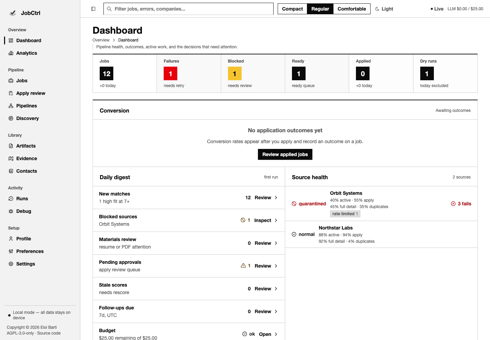

# How JobCtrl Compares

**Assessment date: 2026-10-19 (Europe/Madrid).** JobCtrl is a strong fit for
people who want a local, inspectable workflow from discovery through reviewed
materials and application decisions. Its clearest distinction is the combination
of durable execution, versioned evidence, preserved accepted artifacts, and
approvals bound to exact inputs. That is an architectural assessment, not evidence
of a higher interview or offer rate.

This review covers **19 alternatives**: six public repositories and thirteen
commercial products. The detailed matrix compares the three closest previously
reviewed workflows; the wider market tables cover the other sixteen. Repository
claims use [immutable source snapshots](#snapshot-and-delta-method). Commercial
rows describe current official product or help pages, with their implementation
and outcome claims explicitly unverified.

JobCtrl's latest published release at review time is
[v0.3.1](https://github.com/ebarti/JobCtrl/releases/tag/v0.3.1), published on
2026-10-19. The source review and the published release are recorded separately
below.

## Four operating models

  <article class="jh-compare-card jh-compare-card--featured" role="listitem">
    

      
Local application

      <h3>JobCtrl</h3>
      Supported web UI
    

    
A React control plane backed by a local API, Python worker, Temporal workflows, and a supporting CLI.

    <ul>
      <li>Scores and generated claims retain source bindings and model determinations.</li>
      <li>Durable work and accepted-artifact history support recovery.</li>
      <li>Browser forms are completed and submitted manually; owned Gmail sends need exact approval.</li>
    </ul>
    
<strong>Why JobCtrl leads:</strong> its strongest case in this source comparison is the integrated evidence, recovery, and approval model. The bundled release requires an Apple-silicon Mac.

    <a href="./user/product-tour">Explore the product tour →</a>
  </article>

  <article class="jh-compare-card" role="listitem">
    

      
Files + coding CLIs

      <h3>Career-Ops</h3>
      Web UI: opt-in alpha
    

    
Human-readable files and AI coding CLIs provide a broad research, application, and coaching toolkit.

    <ul>
      <li>Public ATS scanning, liveness checks, local-model options, and optional scheduled web scans.</li>
      <li>Interview practice, debriefs, contact research, and offer preparation.</li>
      <li>Autofill leaves final submission to the user; the Next.js UI still labels itself alpha.</li>
    </ul>
    
<strong>Gap versus JobCtrl:</strong> file and batch recovery does not provide Temporal-style execution history. Its fact gate covers selected claim types rather than proving every reformulation; its coaching breadth is a strength.

    <a href="#appendix-evidence-backed-capability-matrix">Open the evidence matrix →</a>
  </article>

  <article class="jh-compare-card" role="listitem">
    

      
Self-hosted web application

      <h3>JobOps</h3>
      Supported web UI
    

    
A Docker-oriented React and Express application with SQLite, an onboarding wizard, and an optional hosted service.

    <ul>
      <li>Multi-board search, fit scoring, resume tailoring, PDF export, and Gmail tracking.</li>
      <li>Official sponsorship registers and OpenAI-compatible local-model endpoints.</li>
      <li>The user applies manually; running and paused pipelines remain process-local.</li>
    </ul>
    
<strong>Gap versus JobCtrl:</strong> the inspected tailoring path relies on prompt constraints, and active pipeline execution does not survive restart. Docker deployment, provider choice, and sponsorship research are strengths.

    <a href="#appendix-evidence-backed-capability-matrix">Open the evidence matrix →</a>
  </article>

  <article class="jh-compare-card" role="listitem">
    

      
Claude Code workflow

      <h3>AI Job Search</h3>
      Generated HTML dashboard
    

    
Commands and skills coordinate portal utilities, a file-based tracker, and a document drafting and review workflow.

    <ul>
      <li>Batch ranking, company research, profile expansion, and skill-gap plans.</li>
      <li>A separate reviewer, PDF inspection, and optional Gmail and Notion sync.</li>
      <li>Submission is a user handoff; LaTeX is the default with custom toolchains supported.</li>
    </ul>
    
<strong>Gap versus JobCtrl:</strong> the generated dashboard is not a stateful operator app, and interrupted drafting has no evidenced durable execution engine. Adaptable templates and the review workflow are strengths.

    <a href="#appendix-evidence-backed-capability-matrix">Open the evidence matrix →</a>
  </article>

## At a glance

  <table class="jh-compare-summary">
    <caption>Selected differences between four source-reviewed workflows, 2026-10-19</caption>
    <thead>
      <tr>
        <th scope="col">Capability</th>
        <th scope="col">JobCtrl</th>
        <th scope="col">Career-Ops</th>
        <th scope="col">JobOps</th>
        <th scope="col">AI Job Search</th>
      </tr>
    </thead>
    <tbody>
      <tr>
        <th scope="row">Primary surface</th>
        <td>Local web app; signed macOS bundle; CLI</td>
        <td>Files and coding CLIs; TUI; optional alpha web UI</td>
        <td>Docker web app; optional hosted instance</td>
        <td>Claude Code skills; generated offline dashboard</td>
      </tr>
      <tr>
        <th scope="row">Grounding mechanism</th>
        <td>Persisted model determinations, source IDs, quotes, and line anchors</td>
        <td>Source-aware prompts plus selected fact and PDF gates</td>
        <td>Prompt constraints and structured resume transforms</td>
        <td>Source-aware drafter and reviewer instructions; PDF checks</td>
      </tr>
      <tr>
        <th scope="row">Submission boundary</th>
        <td>Browser inspection only; manual forms; exact-approved Gmail send</td>
        <td>Assisted autofill; user submits</td>
        <td>Prepared materials; user applies</td>
        <td>Reviewed documents; user submits</td>
      </tr>
      <tr>
        <th scope="row">Interrupted work</th>
        <td>Temporal history, retries, and workflow identities</td>
        <td>Canonical files, locks, checkpoints, and resumable batch flags</td>
        <td>Stored run records; active execution is in memory</td>
        <td>Saved artifacts; no durable apply resumption evidenced</td>
      </tr>
      <tr>
        <th scope="row">Model and cost options</th>
        <td>Codex, Claude, Google; daily estimated-spend and lane controls</td>
        <td>Multiple CLIs, local models, spend tiers, caps, and run estimates</td>
        <td>Many providers and local endpoints; hosted action quotas</td>
        <td>Claude Code; no application-wide dollar ceiling evidenced</td>
      </tr>
      <tr>
        <th scope="row">Beyond documents</th>
        <td>Availability rechecks, screening answers, locale variants, offers, evidence milestones; interview prep in Beta</td>
        <td>Interview practice and debriefs, offer prep, research, and networking</td>
        <td>Gmail outcome inbox and sponsorship-register research</td>
        <td>Interview prep, outcomes, learning plans, and optional sync</td>
      </tr>
    </tbody>
  </table>

These differences concern inspected mechanisms. A source check or a model
verdict cannot guarantee that an application is accurate or will succeed. The
[evidence matrix](#appendix-evidence-backed-capability-matrix) gives the supporting
paths and limitations.

## What changed since the August comparison

| Project | Current evidence | Effect on the assessment |
| --- | --- | --- |
| **JobCtrl** | The [published v0.3.1 notes](https://github.com/ebarti/JobCtrl/releases/tag/v0.3.1) cover accepted DOCX export, company briefings, offer records and communications, posting-history source proposals, and evidence milestones. Current source also includes saved-posting revalidation, model-owned semantic determinations, reviewed screening answers, and locale variants. | Several old breadth gaps have narrowed. The case for JobCtrl now includes lifecycle continuity and inspectable evidence across more tasks, while platform and browser-entry limits remain. See the [source delta](https://github.com/ebarti/JobCtrl/compare/b4063e1a3227d31eebacbc7d2c620ae5236f744b...198d399d33d2bb527c8cd49cc43dd27e3203b36b). |
| **Career-Ops** | The repository now lives under `career-ops-hq`. Its [web README][career-web] still says alpha but documents scheduled scans, assisted apply, editing, and analytics. Current [modes][career-readme] include interview practice/debriefs and contract/offer preparation. | Describing it as merely a prompt scaffold or terminal viewer understates its breadth. Its current fact gate and file-based recovery still differ from JobCtrl's determination and workflow model. [Source delta](https://github.com/career-ops-hq/career-ops/compare/03fc92bb04e1fc8821ff4ec71b26bcc6f0da1182...0b35a138fffa5335340070c2d13e0c8d1b804a2b). |
| **JobOps** | Current source documents [sponsorship registers][jobops-sponsors], broader provider routes, and the [Gmail review workflow][jobops-tracking], alongside its application UI. | A close graphical alternative with useful deployment and provider flexibility. The source remains newer than its latest published release; the snapshot table keeps that distinction. [Source delta](https://github.com/DaKheera47/job-ops/compare/c834c6502bf4685904b6abc3d5a008294b8b7020...4a5e52b76a729aa2f57e4e9171216cf9621140a0). |
| **AI Job Search** | The current [apply command][ai-apply] defines a separate reviewer with restricted tools and verify-before-use research. Its [command set][ai-readme] includes ranking, profile expansion, gap plans, outcomes, and optional sync; v1.7.3 was published today. | Stronger preparation and continuity than the older comparison suggested; still a CLI and files workflow with a manual submission handoff. [Source delta](https://github.com/MadsLorentzen/ai-job-search/compare/670d30ae7e9709bbf624deb2d9962ba5733331f5...d621ebe63549dffb291edea7f7621cd00e67ddb1). |

## Where competitors have the stronger offering

- **Convenience and reach.** Simplify offers browser autofill and an iOS flow;
  AIApply offers mobile auto-apply management; JobOps and JobSync offer Docker
  deployment. JobCtrl's public bundled installer is early access for
  Apple-silicon macOS 15+, and its browser path leaves form entry and final
  submission to the user. See [Getting Started](user/getting-started.md) and
  [Apply](user/apply.md).
- **Local inference.** Career-Ops can use CLI-supported local models, JobOps
  accepts OpenAI-compatible endpoints, and JobSync supports Ollama. JobCtrl
  supports Codex, Claude, and Google routes; [local/custom endpoints remain
  unavailable](user/configuration.md#llm-providers). Local
  storage does not mean offline processing, and JobCtrl's database and generated
  artifacts are [not encrypted](user/security.md#what-stays-on-your-machine).
- **Career memory and relationship context.** Teal Pro markets a persistent
  career vault and a Google contacts/calendar graph. Applyd markets proof-backed
  skills and a story bank. JobCtrl has a versioned profile, contacts, an Evidence
  Map, and [selected-job demand and reviewed milestones](user/scoring-and-employer-analysis.md#selected-job-demand-and-learning-milestones);
  these do not amount to the same integrated relationship graph. Milestone
  activity is user-attested and never proves a skill or readiness score.
- **Interview practice.** Career-Ops provides practice and debrief modes, and
  commercial products market spoken mock interviews and delivery feedback.
  JobCtrl provides a local question library and source-bound job preparation
  **in Beta**; its guidance remains a research draft, and it does not provide
  live interview assistance or validated rehearsal grading. See
  [Interview Preparation](user/materials-and-tailoring.md#interview-preparation).

The competitor sources for these comparisons appear in the tables below. No
shared trial of setup time, generation quality, cost per application, ATS parsing,
or hiring outcomes was run, so this page does not rank those results.

## Other source-reviewed alternatives

The same 2026-10-19 review date applies to these three repositories. Read the
snapshot table for exact source and release identities.

| Alternative | Inspected offering | How it compares with JobCtrl |
| --- | --- | --- |
| **[ApplyPilot][applypilot-readme]** — original public project | A Python discovery → enrichment → scoring → tailoring → PDF → browser application pipeline. The [launcher][applypilot-launcher] supports dry runs and autonomous submission. | The closest volume-oriented local automation alternative in this set. SQLite statuses and retries are useful, but the inspected launcher does not evidence JobCtrl's exact-approved artifact/send-intent model. This is the public repository, distinct from unrelated services using the same name. |
| **[JobSync][jobsync-readme]** | A self-hosted tracker with scheduled ATS discovery, resume review and job matching, cover letters, contacts, companies, interview questions, MCP tools, and backup/restore. It supports Ollama and cloud models. | A broader personal search organizer than the old watchlist description implied, with a local-inference option JobCtrl lacks. Its [cover-letter grounding prompt][jobsync-cover] and [discovery persistence][jobsync-persist] do not evidence the same source-bound material acceptance or guarded submission lifecycle. Configured cloud providers can receive data; self-hosting alone is not an offline guarantee. |
| **[Proficiently skills][proficiently-readme]** | Public Claude skills for setup, search, tailoring, networking, browser apply, and a Telegram loop. The [apply instructions][proficiently-apply] propose field answers for approval; uploads can require manual handling. | A lighter agent-based route with useful network discovery. Prompt instructions are not a product-level enforcement guarantee. The separate [commercial service](https://proficiently.com/) markets managed search, applications, and hiring-manager outreach; its server implementation and advertised results were not verified. |

## Commercial alternatives

**Evidence label for every row: vendor documentation, reviewed 2026-10-19.**
These pages establish what is currently offered or claimed. No paid account,
private backend, live application, or interview session was tested. Missing
source evidence for a guarantee means **unknown**, not absent. Free tiers,
subscriptions, credits, supported sites, and availability can change.

| Product | Current official offering | Implication for JobCtrl |
| --- | --- | --- |
| **[Simplify / Copilot](https://simplify.jobs/copilot)** | Browser autofill, tailoring, and automatic tracking. Its paid [Autopilot](https://help.simplify.jobs/articles/1784339-getting-started-with-autopilot) completes and submits selected supported jobs **without a final review step**; Copilot leaves Submit to the user. The [iOS app](https://help.simplify.jobs/help/articles/3745882-getting-started-with-the-simplify-ios-app) supports both flows. | Strong browser/mobile convenience. It can no longer be described as autofill-only. JobCtrl instead exposes manual browser completion and exact-approved Gmail sends; choose according to the control boundary you want. |
| **[Huntr](https://huntr.co/)** | Resume tailoring, a job/contact tracker, and browser clipping/autofill. Its [Application Packets](https://help.huntr.co/en/articles/14367332-application-hub-and-packets) bundle a tailored resume, cover letter, and follow-up template for each job. | A direct organization and application-materials alternative. Bundled materials and a usable tracker are shared capabilities; JobCtrl's comparison should focus on recorded source authority, acceptance history, and recovery. |
| **[Teal / Teal Pro](https://www.tealhq.com/pro)** | Alongside Teal's resume/tracker tools, Pro markets career memory, opportunity fit, resume/prep, a people graph from optional Google contacts/calendar access, follow-up guidance, and an iPhone app. | Competitive pressure extends beyond resume optimization into continuing career support. JobCtrl's evidence and contact records overlap, while that connected relationship and mobile workflow remains a gap. |
| **[Jobscan](https://www.jobscan.co/)** | ATS matching, a tracker, discovery, and auto-apply advertised with review before sending. Its [AI Resume Coach](https://www.jobscan.co/ai-resume) asks about experience, offers editable suggestions, and exports PDF/DOCX. | Review, evidence-oriented writing, and Word export are not unique to JobCtrl. Jobscan's ATS score is not the same measure as JobCtrl's requirement-evidence fit assessment; no hiring-outcome comparison was run. |
| **[LoopCV](https://www.loopcv.pro/)** | Continuous search, automated applications and recruiter emails, analytics, company/source filters, and optional manual review. The vendor offers free and paid tiers. | A stronger offering for someone seeking hosted, ongoing application automation. Optional review exists; that alone does not establish exact-artifact approval, send deduplication, or the same recovery guarantees. |
| **[LazyApply](https://lazyapply.com/)** | Browser-based automated applications and referrals, application analytics, and resume/cover-letter tools. | Primarily competes on application throughput and convenience. Advertised volumes and success claims were not tested; the public page does not establish equivalent evidence and submission guarantees. |
| **[Sonara](https://www.sonara.ai/)** | A current BOLD-branded site with signup, a public job catalogue, and managed matching/auto-apply. It states that its system checks jobs daily and that employers can close postings between updates. | Treat it as a current marketed alternative, not simply a historical shutdown. The live public surface does not prove submission quality or continuous revalidation of every saved job; JobCtrl exposes persisted availability and uncertainty. |
| **[JobCopilot](https://jobcopilot.com/automate-job-applications/)** | Hosted discovery and applications, with a tracker and application modes. [Personalized AI Apply](https://jobcopilot.com/ai-apply/) markets writing-style controls and learning from edits; adjacent tools cover interviews and negotiation. | More emphasis on delegated application work. Edit learning and review claims overlap with parts of JobCtrl's lifecycle, but their provenance, effectiveness, and exact submission guarantees remain unverified. |
| **[AIApply](https://support.aiapply.co/en/articles/14216708-how-auto-apply-works)** | Auto submits matches automatically; Hybrid auto-submits above its stated fit threshold and holds others; Review requires approval per suggestion. The [iPhone app](https://support.aiapply.co/en/articles/16764354-getting-started-with-the-aiapply-app) manages modes, history, and an employer-reply inbox. | A broader mobile and hosted submission offering. Review is a real documented mode; the threshold and vendor match ratings are not equivalent to JobCtrl's evidence model or an independent quality measure. |
| **[Applyd](https://applyd.io/)** | The rendered public page markets ATS checks, source-constrained resume copies, PDF/Word export, a tracker, proof-backed skill mapping, round-specific text/voice mock interviews, a story bank, and an optional public profile. | A direct challenge to a generic “truthful resume plus career evidence” pitch. Its no-fabrication and skill-proof claims are vendor claims, not independently verified equivalents of JobCtrl's recorded determinations. |
| **[Offerd](https://www.offerd.ai/)** | ATS scanning, AI video interviews, answer feedback, document generation, a tracker, and voice-profile claims. | More interview-practice functionality is advertised than JobCtrl currently ships. Interview scoring accuracy and advertised callback improvements were not verified. |
| **[Final Round AI](https://www.finalroundai.com/)** | Desktop live interview assistance, spoken practice, automatic debriefs, and screen help, organized around job-specific goals and materials. | Compare its practice and debrief offering with JobCtrl's Beta preparation. Hidden real-time assistance is a different operating model that JobCtrl does not offer; invisibility and outcome claims were not tested. |
| **[Kickresume](https://www.kickresume.com/en/)** | Resume/cover-letter creation, tailoring and translation, templates, career mapping, interview-question tools, mobile apps, and a [job tracker](https://www.kickresume.com/en/job-application-tracker/). | A broader document-design and career-tool offering than a resume builder alone. JobCtrl overlaps on tailoring and translation, with separate locale reviews and accepted source/version identity in the surrounding workflow. |

Human review, honest-writing claims, trackers, DOCX, and career tools are now
common competitive features. JobCtrl's defensible distinction in this review
is how those decisions bind to stored evidence and recoverable work. Public
commercial evidence is insufficient to claim that competitors cannot provide
similar controls internally.

## JobCtrl's UI is part of the product

The web app starts work, edits and approves materials, displays requirement
evidence, and follows durable runs. Its current lifecycle also includes reviewed
[screening answers](user/screening-answers.md),
[locale variants](user/locale-variants.md),
[offer records](user/outcomes-and-feedback.md#actual-offer-terms-and-decisions),
and [editable DOCX exports](user/materials-and-tailoring.md#editable-docx-export).

<ComparisonScreenshotCarousel />

All screenshots use synthetic sample data. They illustrate the operator
experience, not the results of a competitor usability trial. Open the
[Product Tour](user/product-tour.md) for the complete workflow.

## Semantic Determination Authority

JobCtrl uses source-bound model determinations for meaning, claim support, and
quality. Code validates canonical IDs, verbatim quotes, exact values, and
versions; readers join the recorded line anchors. Failed refreshes preserve
accepted artifacts. The model can still be wrong: provenance makes a judgment
inspectable, not infallible. See the
[semantic authority decision](decisions.md#_2026-10-07-semantic-judgments-are-llm-determinations)
and [Tailoring Contract](architecture/tailoring.md).

## Appendix: evidence-backed capability matrix

**Present** means an inspected command, runtime path, or documented product
surface exists. **Partial** states the narrower mechanism. **Not evidenced**
applies to the inspected paths and is not proof of universal absence. Source
inspection was not an installed-product or model-quality certification.

| Capability | JobCtrl | Career-Ops | JobOps | AI Job Search |
| --- | --- | --- | --- | --- |
| **Application surface and deployment** | **Present.** Supported local React app, API, worker, CLI, and signed Apple-silicon macOS 15+ release. [Setup](user/getting-started.md), [runtime](architecture/runtime.md). | **Present; web alpha.** Canonical files, coding CLIs, Go TUI, and an opt-in Next.js UI with actions and scheduled scans. [Architecture][career-architecture], [web][career-web]. | **Present.** React/Express/SQLite app, Docker self-hosting, and optional hosted instances. [Product and providers][jobops-readme]. | **Partial graphical surface.** CLI/skills and local files, with a generated offline HTML report. [Commands][ai-readme], [report command][ai-report]. |
| **Discovery and posting availability** | **Present.** Configured discovery plus bounded saved-posting checks while the worker runs; last success, latest attempt, unknown, and overdue remain distinct. This is not continuous universal monitoring. [Availability](user/enrichment-and-extraction.md#saved-posting-availability). | **Present.** Public ATS/board providers, pre-evaluation liveness checks, and explicit tracker rechecks; scheduled scans are optional. [Providers][career-providers], [liveness][career-liveness], [web][career-web]. | **Present discovery.** Multi-board search and detail import. Recurring revalidation of all saved postings was not evidenced in the inspected pipeline. [Boards][jobops-readme], [pipeline][jobops-pipeline]. | **Present discovery.** Portal utilities and `/rank` fetch and assess postings; deadline/expiry handling does not establish recurring saved-job monitoring. [Ranking][ai-rank]. |
| **Fit assessment** | **Present.** Models classify requirement fit with source citations; code resolves accepted typed verdicts to a versioned 1–10 score. Confidence and blockers remain inspectable. [Scoring](architecture/scoring.md#deterministic-score-resolution). | **Present.** Structured evaluations, requirement importance/evidence, gaps, and an agent-assigned fit score. [Evaluation][career-evaluation]. | **Present.** Profile/listing-based 0–100 suitability scoring and a reason. [Prompt definitions][jobops-prompts]. | **Present.** A profile-based evaluation framework and batch ranking with strengths, gaps, and deal-breakers. [Evaluation][ai-evaluation], [ranking][ai-readme]. |
| **Missing salary and actual offers** | **Present.** Posted facts, market benchmarks, and extrapolations retain separate authorities. Actual offer terms and accepted/declined attestations retain corrections; missing terms stay unknown. [Compensation](user/compensation-evidence.md), [offers](user/outcomes-and-feedback.md#actual-offer-terms-and-decisions). | **Partial overlap.** Evaluation skips detailed compensation rows if no salary is advertised; separate desired/advertised/actual observations and offer-prep modes provide useful later-stage support. [Evaluation][career-evaluation], [salary analyzer][career-salary], [offer prep][career-offer]. | **Partial.** Stores advertised salary/ranges and offers sponsor-register research. An automatic missing-range benchmark or JobCtrl-style actual-offer ledger was not evidenced in these paths. [Job fields][jobops-job-fields], [sponsors][jobops-sponsors]. | **Partial.** Optional salary lookup uses a user-supplied dataset; missing data skips benchmarking. Outcomes record offer stages. [Salary tool][ai-salary], [commands][ai-readme]. |
| **Documents and reuse** | **Present.** Reviewed resume/cover-letter snapshots, HTML/PDF and accepted DOCX export, separately reviewed locale variants, and source-bound screening answers. [Materials](user/materials-and-tailoring.md), [locales](user/locale-variants.md), [answers](user/screening-answers.md). | **Present documents.** Tailored CV, cover letter, PDF, and application-email drafts; templates and multiple language modes. Equivalent locale acceptance/reuse fences were not established. [Commands][career-readme], [PDF generation][career-pdf]. | **Present documents.** Structured resume tailoring and PDF rendering with local/Reactive Resume paths. [Prompts][jobops-prompts], [tailoring][jobops-tailoring]. | **Present documents.** CV and cover-letter drafting, a separate reviewer, and PDF compile/inspection. LaTeX defaults can be replaced with a registered custom toolchain. [Apply][ai-apply], [templates][ai-readme]. |
| **Claim grounding and accepted history** | **Present.** Persisted model findings bind final lines to canonical evidence; literal binding checks and a separate quality judge gate acceptance. Failed refreshes preserve accepted material. [Claim verifier][jobctrl-verifier], [tailoring](architecture/tailoring.md). | **Partial.** Source-aware prompts plus selected fact checks before generated PDFs. The gate's regex/phrase/fact checks are not semantic proof of every reformulation. [Fact gate][career-facts], [PDF generator][career-pdf]. | **Partial.** Prompt says not to invent experience and the transform constrains structured output; the inspected path does not evidence equivalent persisted line-level support determinations. [Prompts][jobops-prompts], [transform][jobops-tailoring]. | **Partial.** Drafter and reviewer are instructed to audit dates, employers, titles, and metrics against profile sources; compiled PDFs are inspected. These instructions are not the same persisted determination/acceptance mechanism. [Apply][ai-apply], [reviewer][ai-reviewer]. |
| **Browser and email submission** | **Present, bounded.** Model browser work is transport-locked inspection; the user fills and submits forms. Owned Gmail sends require exact recipient/attachment approval and durable send intent. [Submission boundary](user/security.md#approval-and-control-gates). | **Present assistance.** Autofill/preparation leaves final submit to the user; application emails are drafts. [Autofill][career-autofill]. | **Manual application.** Materials and the application link are prepared for the user. [Boundary][jobops-readme]. | **Manual application.** `/apply` prepares documents and hands them to the user. [Workflow][ai-apply]. |
| **Recovery** | **Present durable execution.** Temporal histories, activity retries, workflow identities, and ambiguous-send verification. [Runtime](architecture/runtime.md), [at-most-once guide](guides/at-most-once-job-application-submission.md). | **Partial.** Canonical files, integrity checks, locks, scan checkpoints, and resumable batches retain progress; not equivalent to replayable activity histories. [Architecture][career-architecture], [budget/batches][career-budget]. | **Partial.** Run summaries persist, but the code explicitly states that restart kills running or paused pipeline execution. [Pipeline][jobops-pipeline]. | **Partial artifact retention.** Archives, tracker state, and sync commands retain completed work; durable resumption of interrupted drafting was not evidenced. [Workflow][ai-apply]. |
| **LLM boundary and cost** | **Present controls.** Daily estimated-spend preflight and per-lane controls; provider accounting is still an estimate. Local/custom model endpoints are unavailable. [Configuration](user/configuration.md), [spend ceiling](user/security.md#daily-llm-spend-ceiling). | **Partial cost overlap; broader routing.** Spend tiers, local-model paths, batch caps/resume, and recent-run estimates. An application-wide dollar ceiling was not evidenced in these controls. [Budget][career-budget], [run estimates][career-cost]. | **Broader routing.** Local/OpenAI-compatible endpoints and many cloud providers; hosted action quotas. The inspected configuration does not establish a self-hosted daily spend ledger/ceiling. [Providers and quotas][jobops-readme]. | **CLI-managed cost.** Claude Code usage and token-efficiency instructions; no application-wide spend ceiling evidenced. [Apply][ai-apply]. |
| **Career and post-application support** | **Present, with limits.** Reviewed email outcome suggestions, source-cited company briefings, outreach drafts, actual offers, selected-cohort evidence milestones, and interview preparation in Beta. [Outcomes](user/outcomes-and-feedback.md), [briefings](user/company-briefings.md), [career demand](user/scoring-and-employer-analysis.md#selected-job-demand-and-learning-milestones). | **Present, broad toolkit.** Outcomes, follow-ups, contact/company research, story bank, interview practice/debriefs, and offer/negotiation modes. [Commands][career-readme], [interview modes][career-interview]. | **Present tracking.** High-confidence Gmail matches update timelines automatically; uncertain matches enter a review inbox. This differs from JobCtrl's reviewed suggestions. [Tracking][jobops-tracking]. | **Present, agent-driven.** Outcome archives, job/stage-specific preparation, optional mock interviews, gap plans, and approval-based Gmail-sync proposals. [Commands][ai-readme]. |
| **Source and local storage** | **AGPL-3.0-only.** Local SQLite/files and no hosted account; configured workflows send necessary data to providers and integrations. [License][jobctrl-license], [data boundaries](user/data-and-safety.md). | **MIT.** Canonical local files with a derived SQLite index; selected CLI/model and plugin calls can cross the local boundary. [Architecture][career-architecture], [license][career-license]. | **Source available with Commons Clause.** AGPLv3 text plus an additional selling restriction. Local self-hosted state; optional hosted/integration/provider paths. [License][jobops-license], [product][jobops-readme]. | **MIT.** Local fork, tracker, and artifacts; chosen model and optional Gmail/Notion integrations make external calls. [Commands][ai-readme], [license][ai-license]. |

## Snapshot and delta method

All rows were reviewed on **2026-10-19**. Competitor repository heads were
resolved at approximately **20:13 UTC (22:13 Europe/Madrid)**, with JobCtrl
reviewed at the PR base shown below. These are frozen source observations, not a
promise that upstream branches will stay at these commits.

| Project | Reviewed default-branch source | Latest published release observed | Review date |
| --- | --- | --- | --- |
| JobCtrl | [`198d399`](https://github.com/ebarti/JobCtrl/tree/198d399d33d2bb527c8cd49cc43dd27e3203b36b) | [v0.3.1](https://github.com/ebarti/JobCtrl/releases/tag/v0.3.1), published 2026-10-19; tag source [`dfa5a3e`](https://github.com/ebarti/JobCtrl/tree/dfa5a3e8e56a01ed54a6035f777aa9cb00dbea5e) | 2026-10-19 |
| Career-Ops | [`0b35a13`](https://github.com/career-ops-hq/career-ops/tree/0b35a138fffa5335340070c2d13e0c8d1b804a2b) | [career-ops-v1.37.0](https://github.com/career-ops-hq/career-ops/releases/tag/career-ops-v1.37.0), published 2026-10-16 | 2026-10-19 |
| JobOps | [`4a5e52b`](https://github.com/DaKheera47/job-ops/tree/4a5e52b76a729aa2f57e4e9171216cf9621140a0) | [v0.13.1](https://github.com/DaKheera47/job-ops/releases/tag/v0.13.1), published 2026-09-17 | 2026-10-19 |
| AI Job Search | [`d621ebe`](https://github.com/MadsLorentzen/ai-job-search/tree/d621ebe63549dffb291edea7f7621cd00e67ddb1) | [v1.7.3](https://github.com/MadsLorentzen/ai-job-search/releases/tag/v1.7.3), published 2026-10-19 | 2026-10-19 |
| ApplyPilot | [`4a8d521`](https://github.com/Pickle-Pixel/ApplyPilot/tree/4a8d521f67f5139811c0a910ef37410f8e6d836a) | [v0.3.0](https://github.com/Pickle-Pixel/ApplyPilot/releases/tag/v0.3.0), published 2026-02-21 | 2026-10-19 |
| JobSync | [`2bd2284`](https://github.com/Gsync/jobsync/tree/2bd2284879d2037883cbd21ee3283cf27138a671) | [v1.1.22](https://github.com/Gsync/jobsync/releases/tag/v1.1.22), published 2026-10-11 | 2026-10-19 |
| Proficiently skills | [`9bc1f6f`](https://github.com/proficientlyjobs/proficiently-claude-skills/tree/9bc1f6fd7af532fe0cd4a1843e06ab2b474d0d53) | [v1.2.0](https://github.com/proficientlyjobs/proficiently-claude-skills/releases/tag/v1.2.0), published 2026-03-12 | 2026-10-19 |

For public repositories, the review read current documentation and the owning
implementation or command instructions. Links above pin those files to the
resolved source. The JobCtrl capability review includes source newer than the
published tag; the intervening main-branch changes update release CI and its
runbook without adding a product capability. Competitor default-branch features
may likewise be newer than their published packages. A release timestamp is not a
feature launch date, and an open issue or proposal does not count as implemented
functionality.

Commercial evidence uses the official pages linked in each row. Applyd's
JavaScript-rendered public page was also read in the browser. This establishes
visible descriptions, not the correctness of private services. No repository
application was installed or executed, no candidate data was uploaded, and no
job application or outreach message was sent. JobCtrl was assessed from current
source and published release information, without rerunning its product workflows
for this assessment. Marketing outcome figures and ATS compatibility
claims are not independent measurements. The nineteen alternatives form the
named comparison set, not an exhaustive inventory of the market.

[career-readme]: https://github.com/career-ops-hq/career-ops/blob/0b35a138fffa5335340070c2d13e0c8d1b804a2b/README.md
[career-architecture]: https://github.com/career-ops-hq/career-ops/blob/0b35a138fffa5335340070c2d13e0c8d1b804a2b/ARCHITECTURE.md
[career-web]: https://github.com/career-ops-hq/career-ops/blob/0b35a138fffa5335340070c2d13e0c8d1b804a2b/web/README.md
[career-providers]: https://github.com/career-ops-hq/career-ops/blob/0b35a138fffa5335340070c2d13e0c8d1b804a2b/providers/README.md
[career-liveness]: https://github.com/career-ops-hq/career-ops/blob/0b35a138fffa5335340070c2d13e0c8d1b804a2b/check-liveness.mjs
[career-evaluation]: https://github.com/career-ops-hq/career-ops/blob/0b35a138fffa5335340070c2d13e0c8d1b804a2b/modes/oferta.md
[career-facts]: https://github.com/career-ops-hq/career-ops/blob/0b35a138fffa5335340070c2d13e0c8d1b804a2b/verify-cv-facts.mjs
[career-pdf]: https://github.com/career-ops-hq/career-ops/blob/0b35a138fffa5335340070c2d13e0c8d1b804a2b/generate-pdf.mjs
[career-autofill]: https://github.com/career-ops-hq/career-ops/blob/0b35a138fffa5335340070c2d13e0c8d1b804a2b/docs/APPLY_AUTOFILL.md
[career-budget]: https://github.com/career-ops-hq/career-ops/blob/0b35a138fffa5335340070c2d13e0c8d1b804a2b/docs/RUNNING_ON_A_BUDGET.md
[career-cost]: https://github.com/career-ops-hq/career-ops/blob/0b35a138fffa5335340070c2d13e0c8d1b804a2b/web/src/lib/run-cost-estimate.mjs
[career-salary]: https://github.com/career-ops-hq/career-ops/blob/0b35a138fffa5335340070c2d13e0c8d1b804a2b/salary-gap.mjs
[career-offer]: https://github.com/career-ops-hq/career-ops/blob/0b35a138fffa5335340070c2d13e0c8d1b804a2b/modes/offer-prep.md
[career-interview]: https://github.com/career-ops-hq/career-ops/tree/0b35a138fffa5335340070c2d13e0c8d1b804a2b/modes/interview
[career-license]: https://github.com/career-ops-hq/career-ops/blob/0b35a138fffa5335340070c2d13e0c8d1b804a2b/LICENSE
[jobops-readme]: https://github.com/DaKheera47/job-ops/blob/4a5e52b76a729aa2f57e4e9171216cf9621140a0/README.md
[jobops-tracking]: https://github.com/DaKheera47/job-ops/blob/4a5e52b76a729aa2f57e4e9171216cf9621140a0/docs-site/docs/features/post-application-tracking.md
[jobops-prompts]: https://github.com/DaKheera47/job-ops/blob/4a5e52b76a729aa2f57e4e9171216cf9621140a0/shared/src/prompt-template-definitions.ts
[jobops-pipeline]: https://github.com/DaKheera47/job-ops/blob/4a5e52b76a729aa2f57e4e9171216cf9621140a0/orchestrator/src/server/pipeline/orchestrator.ts
[jobops-tailoring]: https://github.com/DaKheera47/job-ops/blob/4a5e52b76a729aa2f57e4e9171216cf9621140a0/orchestrator/src/server/services/rxresume/tailoring.ts
[jobops-sponsors]: https://github.com/DaKheera47/job-ops/blob/4a5e52b76a729aa2f57e4e9171216cf9621140a0/docs-site/docs/features/visa-sponsors.md
[jobops-job-fields]: https://github.com/DaKheera47/job-ops/blob/4a5e52b76a729aa2f57e4e9171216cf9621140a0/shared/src/types/jobs.ts
[jobops-license]: https://github.com/DaKheera47/job-ops/blob/4a5e52b76a729aa2f57e4e9171216cf9621140a0/LICENSE
[ai-readme]: https://github.com/MadsLorentzen/ai-job-search/blob/d621ebe63549dffb291edea7f7621cd00e67ddb1/README.md
[ai-apply]: https://github.com/MadsLorentzen/ai-job-search/blob/d621ebe63549dffb291edea7f7621cd00e67ddb1/.claude/commands/apply.md
[ai-reviewer]: https://github.com/MadsLorentzen/ai-job-search/blob/d621ebe63549dffb291edea7f7621cd00e67ddb1/.claude/agents/application-reviewer.md
[ai-report]: https://github.com/MadsLorentzen/ai-job-search/blob/d621ebe63549dffb291edea7f7621cd00e67ddb1/.claude/commands/html-report.md
[ai-rank]: https://github.com/MadsLorentzen/ai-job-search/blob/d621ebe63549dffb291edea7f7621cd00e67ddb1/.claude/commands/rank.md
[ai-evaluation]: https://github.com/MadsLorentzen/ai-job-search/blob/d621ebe63549dffb291edea7f7621cd00e67ddb1/.claude/skills/job-application-assistant/04-job-evaluation.md
[ai-salary]: https://github.com/MadsLorentzen/ai-job-search/blob/d621ebe63549dffb291edea7f7621cd00e67ddb1/tools/README_SALARY_TOOL.md
[ai-license]: https://github.com/MadsLorentzen/ai-job-search/blob/d621ebe63549dffb291edea7f7621cd00e67ddb1/LICENSE
[applypilot-readme]: https://github.com/Pickle-Pixel/ApplyPilot/blob/4a8d521f67f5139811c0a910ef37410f8e6d836a/README.md
[applypilot-launcher]: https://github.com/Pickle-Pixel/ApplyPilot/blob/4a8d521f67f5139811c0a910ef37410f8e6d836a/src/applypilot/apply/launcher.py
[jobsync-readme]: https://github.com/Gsync/jobsync/blob/2bd2284879d2037883cbd21ee3283cf27138a671/README.md
[jobsync-cover]: https://github.com/Gsync/jobsync/blob/2bd2284879d2037883cbd21ee3283cf27138a671/src/lib/ai/prompts/cover-letter/system.ts
[jobsync-persist]: https://github.com/Gsync/jobsync/blob/2bd2284879d2037883cbd21ee3283cf27138a671/src/lib/scraper/automation-run/persist.ts
[proficiently-readme]: https://github.com/proficientlyjobs/proficiently-claude-skills/blob/9bc1f6fd7af532fe0cd4a1843e06ab2b474d0d53/README.md
[proficiently-apply]: https://github.com/proficientlyjobs/proficiently-claude-skills/blob/9bc1f6fd7af532fe0cd4a1843e06ab2b474d0d53/skills/apply/SKILL.md
[jobctrl-verifier]: https://github.com/ebarti/JobCtrl/blob/198d399d33d2bb527c8cd49cc43dd27e3203b36b/workers/automation/src/jobctrl/domain/materials/claim_verification.py
[jobctrl-license]: https://github.com/ebarti/JobCtrl/blob/198d399d33d2bb527c8cd49cc43dd27e3203b36b/LICENSE
