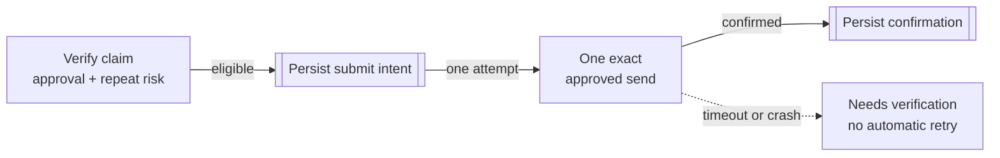

# At-most-once Job Application Submission

At-most-once submission means automation must never create a second
employer-facing attempt merely because the first attempt returned an ambiguous
result. JobCtrl combines durable submit intent with binding approval, repeat
protection, and human verification—and keeps final browser submission manual.

## Why Ordinary Retries Are Dangerous

Retries are useful for read-only work. If a source times out while fetching a
posting, trying again can be safe. A submission is different: the employer may
have received the application even when the local process did not receive a
confirmation.

Consider a crash immediately after an email provider accepts a message:

Solid arrows show the confirmed path. The dashed arrow is an ambiguous outcome:
the system preserves uncertainty instead of converting it into permission to
try again.

## At-most-once Is Not Exactly-once

“Exactly once” would promise both that the application happens and that it
happens only once. A distributed system cannot always prove both after a crash
or network partition unless the remote destination provides a compatible
idempotency contract.

At-most-once chooses the safer failure mode:

- before durable submit intent, a failed claim can remain eligible for a later
  reviewed attempt;
- after intent, JobCtrl will not automatically repeat the employer-facing
  action;
- when confirmation is missing, the run stops in `needs_verification`;
- the user checks the destination or provider history and records the real
  outcome.

The result may require manual recovery, but it avoids turning uncertainty into
a duplicate application.

## Local Stops Do Not Resolve External Uncertainty

Manual Skip prevents later targeted, batch and standing claims. Automatic recovery
events cannot release it: a validated explicit reset binds its release to the
existing Skip history, and waits for any admitted owner to acknowledge settlement.
For an owner that died before cleanup, recovery checks the recorded source
owner lifetime or the exact native completion. A root PID exit alone cannot
release custody. It preserves Skip until a separate safe reset; missing or
uncertain custody remains blocked. See [Skip and safe reset](../user/apply.md#skip-and-safe-reset)
for the recovery command and limits.
It is a local disposition, not confirmation that an in-flight provider operation
stopped.
Claim selection checks it before expensive work and under the claim lock after
availability refresh. The final intent writer also requires the original run
and a running stage, so a Skip committed before that boundary prevents intent.
After intent, one overlapping external attempt may still complete.

All recorded submit intents for the exact tenant and job remain retry blockers,
regardless of the latest run projection or stage label. Failed settlement,
connection restart, Skip and generic reset cannot establish that no send occurred.
The audit keeps the original run IDs inspectable. A retained Needs verification
stop also survives Skip when its intent receipt is absent. Verify the provider outcome;
manual Mark Applied can record a confirmed application. There is no generic
reset-based permission to retry an uncertain submission.

## Approval Is Bound At The Mutation Boundary

With approval required—the default—the latest Apply Review decision must bind
the current job, profile version, application URL, material generation, and
qualifying rehearsal evidence. Email applications additionally bind the exact
recipient and attachment.

The worker checks that binding while atomically claiming work in SQLite. It is
not only a disabled button in the web app, so a stale page, direct API call,
standing loop, or concurrent worker cannot bypass the claim-time decision.

The owned email path checks again immediately before durable intent. In one
SQLite writer transaction it rereads current approval, profile, URLs, accepted
material and cover binding, rehearsal evidence and email preview, comparing them
with the run's captured sources and actual outgoing candidate. A second writer
must commit its authority change before this transaction or wait until intent
commits. A changed profile or attachment followed by a fresh approval still does
not authorize a delayed run using the older inputs. Refusals preserve accepted
history and the claim record, create no intent and call no sender. The owning
settlement or recovery restores that claim's attempt allowance.

The claim captures source identities before committing. The approval decision
retains fingerprints of the complete reviewed email and accepted material bytes;
the final guard checks those fingerprints as well as the claim snapshot. A later
rehearsal with a different subject/body or a same-generation file replacement
therefore needs fresh approval, even when recipient and attachment IDs match.
Recipient/attachment-only historical approvals cannot authorize an email send.
The final authorizer captures the approved attachment bytes and rechecks source
files after intent persistence, before commit. A detected replacement rolls back
the intent. The sender encodes the validated byte copy rather than reopening a
mutable path, so a later replacement cannot alter the admitted email. The private
copy is not stored in events; only its hash accompanies the intent.
Recording approval also compares the complete preview supplied by the caller
with the current preview. A changed subject/body needs fresh review rather than
silently becoming the approved message. At tied decision timestamps, defer/reset
keeps sending blocked regardless of random ID order; a later fresh approval is
required. Approval-reader failures preserve an approval-authority refusal.

Turning the general approval wait off does not create generic submission
authority. Browser final submit remains manual, and repeat-application protection
still runs. The Gmail client checks `gmail.send` after intent commits and before
the HTTP send. If that scope is missing, no HTTP send occurs, but the durable
intent remains and the attempt is parked in `needs_verification` for manual
verification, without automatic retry. Once intent commits, later decisions
cannot retract an admitted message; uncertainty remains a manual-verification
boundary.

## Repeat Protection Answers A Different Question

At-most-once protects one submission attempt from retry duplication. Repeat
protection asks whether the candidate already has a confirmed application to
the same opening.

Before each live claim, JobCtrl combines canonical job identity with confirmed
application facts. The same opening is blocked. A conservative match for the
same employer and an equivalent role requires explicit reasoned confirmation
bound to the current evidence. A one-use override is consumed in the same
atomic claim transaction.

Pending Gmail suggestions, notes, dry runs, failed pre-submit work, and submit
intent without confirmation do not become application history. Keeping these
gates separate prevents a similarity guess from creating a fact while still
blocking a known duplicate.

See
[Apply → Repeat-Application Protection](../user/apply.md#repeat-application-protection)
for the current evidence and override states.

## Browser And Email Have Different Submission Boundaries

JobCtrl does not give a page-reading model final browser-submit authority. A
browser-form claim stops before the model-driven session begins, and the user
completes the final employer action manually. The browser extension can capture
and autofill whitelisted fields, but it has no submit capability.

The owned Gmail path is different because JobCtrl controls the mutation
adapter. It can compare the exact recipient and attachment with the approval,
persist submit intent immediately before the send, restrict the live activity
to one attempt, and preserve a validated provider receipt. A successful Gmail
response must contain a nonblank string `id`; optional `threadId` must be a
nonblank string when present. Other optional Message fields are discarded,
but malformed JSON, including nonstandard `NaN` and infinity constants, is
rejected throughout the response.
See Google's [messages.send response contract](https://developers.google.com/workspace/gmail/api/reference/rest/v1/users.messages/send).

Before transport admission, the durable intent binds tenant, canonical job,
run/intent identity, material generation and a hash of the exact preview fields
and material reference. After the availability check completes, the sender
verifies that the intent committed; an inherited caller transaction is never
committed to make a send possible. Confirmation must match that binding and the current
run owner. Malformed success and lost transport acknowledgements remain
uncertain, with no automatic resend. A previously persisted valid confirmation
can settle its original operation after restart; repeated settlement cannot
create another submitted fact or replace a successor's state. This does not
establish remote exactly-once delivery. Recovery rechecks ownership,
terminal state and confirmation under the SQLite writer lock before parking.
Settlement resolves the durable current owner under that lock even when the
caller omits its run identity; a foreign run cannot settle the email operation.
Confirmation and submitted-fact notifications wait for the owning commit;
rollback does not publish a success, including within a caller transaction.
A competing invocation of the same run cannot consume the original receipt's
sequence or publish a competing failure. Exact saved events replay idempotently;
changed event identities are refused. Losing the admission acknowledgement
reconciles the recorded operation before parking uncertainty, without sending.

These are not interchangeable promises. “At-most-once” does not mean a model
may click any web submit button once.

## Dry Runs Exercise The Boundary Without Submitting

A dry run grants one exact read-only navigation to the reviewed application
URL. Browser-level interception blocks form submission, mutating requests,
navigation replay, URL changes, redirects, and other write-bearing channels.
The agent also lacks generic typing, artifact upload, saved credentials, and
verification-code tools.

The receipt records which bounded inspection occurred. A model saying
`RESULT:DRY_RUN` is not by itself proof of complete rehearsal, and
`RESULT:APPLIED` is never accepted as authoritative submission evidence.

Dry runs help you inspect an application path. They do not consume a live
application fact or grant a later submit.

## What To Do When Verification Is Required

If a run reaches durable submit intent but lacks trustworthy confirmation:

1. do not start another live application;
2. inspect the sent-mail or employer-side history outside the model;
3. record the actual outcome in JobCtrl;
4. retry only if the evidence establishes that no employer-facing action
   occurred and the current controls allow a new claim.

This is intentionally less convenient than blind retry. The audit trail keeps
the original intent and ambiguity so recovery does not rewrite what happened.

For the full user workflow, read [Apply](../user/apply.md). For enforcement
details, read [Security](../user/security.md#approval-and-control-gates).

Related reading:

- [Open-source Job Application Tracker](open-source-job-application-tracker.md)
- [Local-first Job Search Automation](local-first-job-search-automation.md)
- [JobCtrl Guides](index.md)
