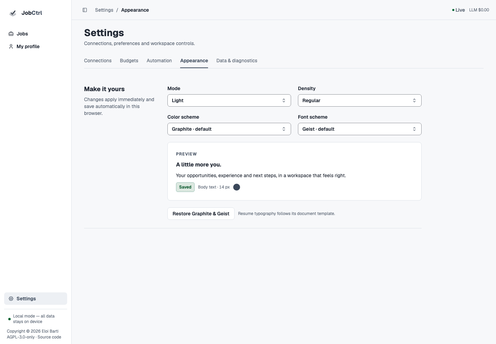

# Configuration & Credentials

Use **Settings** for shared connections, budgets, automation, appearance and
workspace diagnostics. Feature-specific saved targets and source scope live in
**My profile → Search preferences** and the Jobs search task. Those screens
compose the existing owners; they do not establish a second business authority.

This page follows the Original redesign source candidate. Its
[acceptance ledger](../plans/2026-11-11-original-app-redesign.md) records actual
implementation and verification. The
[published release](https://github.com/ebarti/JobCtrl/releases/latest) establishes
installed availability, not a source build or demo illustration.

Shared non-secret runtime settings are revisioned `app_settings` records in
`jobctrl.db`. Profile, Discovery, Compensation and other features retain their
own SQLite settings. Secrets use the native credential/provider boundary.
Appearance and presentation preferences save in this browser. The historical
`config.json` file is not an alternate current Python settings authority.

::: info Command spelling
Commands use `jobctrl <command>`. The native executable handles installed
lifecycle and domain commands; contributor commands are in
[Local Development](../local-development.md).
:::

## Start Here

| You want to change… | Use |
| --- | --- |
| Candidate facts, evidence and exact wording | **My profile → Experience**, **Skills**, **Education** or **Personal details**; [Candidate Profile](candidate-profile.md). |
| Target roles, career tracks/levels, locations/work arrangements, boards and search limits | **My profile → Search preferences**, or **Edit search preferences** from Jobs; [Discovery](discovery.md). |
| Application/writing preferences and document templates | Retained Profile/search preference tools and the actual resume editor; template appearance is document-local. |
| Provider credentials/cloud mode, live preferred models or browser/extension | **Settings → Connections** (`/settings`). Existing `/settings/credentials`, `/settings/models` and `/settings/browser` deep links reveal their corresponding panel. |
| Daily spend, per-application budget and exact-model pricing quotes | **Settings → Budgets** (`/settings/budgets`). |
| Deliberate standing work, runtime capacity, scoring guidance or compensation-source policy | **Settings → Automation** (`/settings/automation`). Saving does not grant a new application approval. |
| App mode, density, color or fonts | **Settings → Appearance** (`/settings/appearance`); browser-local presentation only. |
| Workspace controls, retained history or operational inspection | **Settings → Data & diagnostics** (`/settings/data`). |

### How a setting becomes effective

The effective owner applies explicit per-action input, its saved value and its
packaged default in that order where that field supports overrides. A saved
revision is not proof of effective dispatch or provider readiness. Read the
field's saved/effective/pending state; normal schedule edits are reconciled by
the worker rather than requiring a restart. Worker activity slots remain a
process-start capacity setting.

<script setup>
import SettingsPrecedence from "../.vitepress/theme/SettingsPrecedence.vue";
</script>

<SettingsPrecedence />

A nonempty environment secret can remain authoritative for a running process.
Hard deny switches can force a feature off; they cannot enable it. Credentials
are never ordinary settings. A stale save refuses rather than overwriting a
newer revision; failed saves retain the draft and previous saved state.

| Surface | Authority | When it applies |
| --- | --- | --- |
| Connections, Budgets and shared Automation policy | Revisioned SQLite settings plus separate credential/capability owners | New work or owning reconciliation, as labeled; process-start capacity is explicit. |
| Profile and Search preferences | Profile or Discovery's versioned SQLite records | Next explicitly admitted task; reads/saves launch no search or matching. |
| Compensation-source permissions | Compensation-owned records | Next explicitly authorized refresh or enabled reconciliation. |
| Appearance | Browser UI preferences | Immediately in this browser; no Profile/document mutation. |

## Appearance



The default is **Graphite + Geist**. Color choices are Graphite, Cobalt, Teal,
Forest, Indigo, Plum, Rose, Terracotta, Amber and Ocean. Font choices are Geist,
Inter, Manrope, DM Sans, IBM Plex Sans, Source Sans 3, Work Sans, Lato,
Merriweather + Inter and Newsreader + DM Sans. The app loads actual font resources;
the choice is not just a renamed CSS fallback.

Light/dark mode, compact/regular/comfy density and scheme changes apply
immediately and save automatically in this browser. **Restore Graphite & Geist**
restores the defaults. Resume typography, template layout and accepted export
bytes stay under the document owner, independent from app appearance.

## Configuration Sources

| Source | Purpose |
| --- | --- |
| `~/.jobctrl/jobctrl.db` | Profile, Discovery controls, sources, Compensation permissions, jobs, events, projections and document metadata in their owning feature tables. |
| [`app_settings` in `~/.jobctrl/jobctrl.db`](../api/profile-and-settings.md#config-json-field-reference) | Shared non-secret budgets/capacity, application runtime, scoring guidance and provider/model policy with one settings revision. Other feature preferences retain their own public owner. |
| This browser's UI preferences | Appearance, density, table presentation and separately scoped private recovery drafts. These are not shared runtime settings or accepted documents. |
| `~/.jobctrl/.env` | Legacy plaintext provider keys until migration, plus runtime environment configuration. |
| repo `.env` | Development-only overrides for the current checkout. |
| shell environment | Ephemeral overrides for commands, CI, and headless operation; not the normal persistent credential store. |
| `workers/automation/src/jobctrl/config/*.yaml` | Packaged employer and site behavior registries (`employers.yaml`, `sites.yaml`). The dynamic source registry lives in SQLite. |

The development launcher loads `$JOBCTRL_DIR/.env` (default `~/.jobctrl/.env`),
repo `.env`, and `JOBCTRL_USER_ENV_PATH` (default `~/JobCtrl/.env`) before
starting local services.

**Settings → Connections** is the preferred guided provider setup. It stores
API keys in macOS Keychain, Windows Credential Manager, or Linux Secret Service.
Non-secret provider-mode settings are stored in revisioned SQLite settings. Codex uses an
authenticated Codex CLI, and AWS, Google, and Azure credentials stay in their native CLI-managed stores; JobCtrl records only
the activation flags and non-secret identifiers needed to select those routes
in revisioned SQLite settings.

The in-progress Python target resolves native-store credentials for each new
provider execution. A nonempty value in the launch environment takes precedence
and is read-only in Settings; changing that launch environment requires
restarting the affected process. An in-flight request retains its existing
credentials. Integrated provider verification is still required.

Environment ownership is scoped to the active secret or auth route, not to the
whole provider card. While an environment-owned route is active, its secret
field and provider-removal control remain read-only, but Settings still lets you
prepare another supported auth route. Saving that alternative does not override
the active environment value. Remove the environment value and restart the
relevant process before expecting the saved route to become effective.

The Credentials screen groups readiness, ownership, secret input, and actions
as one responsive row for each supported route. At narrow widths those actions
move below the field instead of squeezing it. Stored secret values are never
rendered; the screen shows a human-readable configured/readiness state and a
sanitized error when inspection fails. Settings section headers likewise use
their product names and explanations rather than internal context tags or raw
configuration keys as decorative metadata.

Windows and Linux use their native credential-store adapters. A host without
a usable native store reports unavailable; it does not save submitted secrets
to a plaintext fallback. `jobctrl doctor` reports the effective source without
printing secrets. **Status unknown** (`inspection_failed`) is distinct from
**not configured**: it means JobCtrl could not inspect the native store. Provider-mode
replacement is all-or-nothing from the web contract; a failed change preserves
the previous configuration or reports an explicit sanitized recovery failure.
If credential inspection fails during an open provider edit, JobCtrl keeps the
unsaved form and its save or removal result visible. Guided changes stay paused
until credential inspection succeeds again.
If you enter a newer CapSolver value while a save or removal is pending, it
remains in the form as an unsaved edit.
Credential updates from JobCtrl API processes for the same OS user are
serialized. If another update or its native helper is still active, retry
after it finishes. A timed-out update whose helper has not stopped reports an
incomplete recovery; inspect the credential status before retrying.
If JobCtrl cannot verify a previous helper's process identity, it reports
`ownership_unverified` and preserves its coordination record. Restore the
packaged Python runtime, or the prepared worker virtual environment in a source
checkout, and retry. If inspection remains unavailable, stop all JobCtrl API
processes, verify that the recorded helper has exited, and only then remove
the `.jobctrl-credential-mutations.sqlite3.inflight` record in the OS user's
home. Do not signal a process solely because its PID matches the record.

Linux requires `/usr/bin/secret-tool` and an accessible Secret Service in the
current user's D-Bus session, with its collection unlocked. Windows requires
Windows PowerShell and a logon session with access to Credential Manager. A
headless session without a native store can use inherited environment values;
JobCtrl does not create an unencrypted store as a substitute. macOS continues
to use `/usr/bin/security` and the user's Keychain.

Native writes enforce each helper's byte limit before changing a stored value:
128 UTF-8 bytes on macOS, 2,560 UTF-16 bytes on Windows, and 8,191 UTF-8 bytes on
Linux. A character can occupy multiple bytes. Oversized input is rejected,
never truncated. Migration refuses such a value and preserves its source.

### Migrating legacy plaintext secrets

Migration is an explicit one-time operation. Stop JobCtrl before running it and
restart after completion: already running services can retain values inherited
from their old launch environment. Startup and status reads do not migrate
files silently.

For the installed app, migrate the active JobCtrl-owned environment file:

```bash
jobctrl credentials migrate
```

The installed command defaults to the active runtime's owned `.env` file and
does not search the current directory. To include another persistent file,
repeat `--env-file /absolute/path/to/file` in the intended precedence order;
later assignments win. Select the complete source set on the first run. The
secret-free `.native-credentials-migrated.json` marker under `JOBCTRL_DIR`
makes a completed migration a no-op on subsequent runs. This marker is not a
backup of credential values.

If the directory for a configured JobCtrl-owned environment file does not yet
exist or cannot be locked, migration stops without writing its completion
marker. Configure a provider with `jobctrl setup`, or create the directory or
correct its permissions, then retry the migration.

A migration lock prevents overlapping invocations using the same completion
marker. Do not run migrations with different markers concurrently or edit
credentials while migrating. A malformed marker fails closed. If a process is
interrupted and leaves its lock behind, confirm that it has stopped and inspect
the recovery state before removing only that stale migration lock; elapsed
time alone does not establish that a migration is inactive.

From a source checkout, use `uv --project workers/automation run --locked
--all-extras jobctrl credentials migrate` with the same workspace selection as
the development stack. Without explicit `--env-file` arguments, it considers the
workspace-owned environment file, the checkout's `.env`, and the configured
user environment file. Select the complete intended set explicitly when those
defaults differ from your launch configuration. The [source guide](../local-development.md#native-credential-migration)
describes the credential context and QA isolation boundary.

Only the guided secret allowlist moves: `OPENAI_API_KEY`, `ANTHROPIC_API_KEY`,
`GEMINI_API_KEY`, and `CAPSOLVER_API_KEY`. Other settings and secret families,
including Langfuse and Gmail files, remain where they were; this is not a
promise to remove every plaintext secret from the machine. Native provider
logins and cloud credential files are not imported. Inherited shell values are
never copied into persistent storage.

The migration verifies every native write before removing its source
assignment. An existing equal native value is safe to reuse; a different value
is a conflict that must be resolved deliberately. An unavailable store,
unsupported input, changed source file, or failed write must not be reported as
success. Errors and the completion record contain no secret values. Do not
paste `.env` contents or raw native-store output into a support report.

Migration removes selected assignments from the current source files; it does
not securely erase old filesystem blocks, backups, shell history, or copies in
other locations. Protect those separately.

## Local Data

JobCtrl stores its local database and feature settings, provider environment file,
generated artifacts, logs, and browser state under `~/.jobctrl` by default.
Most users should leave this location unchanged. Advanced users can set
`JOBCTRL_DIR` before starting JobCtrl to relocate the entire local data
directory. See
[Data, Privacy & Safety](data-and-safety.md) for what stays local and what may
leave the machine. Contributors who need custom data paths, ports, Temporal
settings, API/Vite proxy targets, or isolated stacks should use
[Local Development → Runtime Overrides](../local-development.md#runtime-overrides).

## LLM Providers

Local/custom endpoints are not currently supported or configurable. The
[design-only local/custom provider contract](../plans/local-custom-provider-contract.md)
defines the containment, capability, accounting, and product proof required
before any such provider can become available; it does not enable one.

Choose one provider in **Settings → Connections** and check its readiness. The pipeline model spec defaults to `default`, which resolves
through a ready provider. Explicit model specs use `codex:`, `claude:`, or
`google:`; `gemini:` remains an alias for the Google SDK route.

After first setup or whenever provider authentication changes, run:

```bash
jobctrl setup
jobctrl doctor
```

`jobctrl setup` detects existing authentication before prompting and writes
only local configuration; it never commits or ships credentials. `jobctrl
doctor` then reports which providers are ready without printing their secrets.

Model selection becomes available only after the corresponding provider is
ready. Codex, Claude, and Google choices come from the same authenticated
provider runtimes that execute the work: Codex App Server `model/list`, Claude
Agent SDK initialization metadata, and the Google SDK model list. JobCtrl does
not maintain a second hard-coded model registry. The picker shows the exact
runtime model ID alongside a friendly name when they differ. Only provider and
model IDs are written to revisioned SQLite settings; credentials remain on the credential
boundary. A model absent from the active runtime catalog is intentionally not
selectable, even if that model exists in the provider's broader product lineup.
Use **Refresh model catalog** to check current provider availability. A saved ID
missing from that catalog remains visibly saved/unavailable; displaying it does
not claim that the active runtime can use it. A pinned provider client can expose a different catalog from a newer
installed client using the same account; check the active JobCtrl runtime before
concluding the account lacks a model.

Model preference and AI execution-policy controls pause editing while their
save is pending. After a failed save, the chosen values remain available to
review and retry.

Provider setup forms let you continue editing during a save. A later key,
service-account path, or mode choice remains in the form for a separate save;
an acknowledged key or path is cleared only if it still matches the submitted
value. A provider-status change does not replace a form with unsaved edits.

A saved preference is scoped to its provider and cannot change which provider
JobCtrl selects. Newly constructed adapters use this precedence:

1. explicit non-default workflow model;
2. **Default model** saved under Settings → Connections → Models and providers;
3. saved preference for the selected ready provider;
4. that provider's default.

A saved default is a provider-qualified route such as `codex:gpt-6.1-sol`.
Clear it to restore automatic provider selection. A pinned default fails visibly
on provider failure rather than silently selecting a different model.

**Reasoning effort** appears for each selected Codex model whose live catalog
reports supported efforts. Options come from that model's
`supportedReasoningEfforts`; JobCtrl does not invent options from another model.
The selected effort applies to every new call using that model, including
analysis, generation and review. Higher efforts may take more
time and tokens. The provider's option description is shown beside the choice.

**Existing call settings** clears the override and preserves the earlier policy:
High for Codex analysis and ordinary model calls, and Low for tailoring drafts
whose generation policy supplies a zero thinking budget. A selected effort
overrides that numeric-budget mapping. Existing adapters retain their captured
effort; newly acquired adapters use the saved choice without a worker restart.
Determinations record an explicit effort and bind their cache identity to it;
changing effort never relabels or erases an accepted result. Other providers
retain their existing SDK controls.

Without a saved default, provider selection keeps the readiness order Claude, then
Codex, then Google. Explicit `provider:model` workflow values select the named
provider. Existing adapters and in-flight work keep their resolved model. Newly
started work rechecks the effective selection when it acquires the shared
adapter and receives a new adapter object when the saved preference changed; no worker
restart is required for a preferred-model edit. The initially selected ready
provider stays process-stable on warm acquisitions so status checks do not rerun
for every workflow until a real SDK call reports an availability failure.
Authentication rejection excludes that provider from subsequent automatic
attempts in the same process. An explicit exhausted usage allowance or an
unavailable SDK execution excludes the failed model route. Temporary rate
limits, overloads, server errors and connection failures do not exclude it:
the failed call stays visible and existing bounded retries may use the same
provider/model again. This also preserves concurrent jobs and explicit model
pins after a temporary failure. When a route is unavailable, an automatic
durable retry can acquire another ready route. Claude SDK query and
message-collection
exceptions are classified at that execution boundary, including otherwise
untyped SDK exceptions; the current analysis leg stops after that failure.
Parsing and reviewing returned content remain outside this boundary. The
retry's recorded provider/model identify the call that actually ran. Existing
adapters and accepted determinations are never relabeled. Explicit model pins
remain bound and fail visibly when their
route is unavailable. Response/schema/citation failures and spend denial do
not discard a provider. Restart or an explicit adapter reset clears observed
availability failures.

The **Employer analysis perspectives** selection is also saved here. Its
execution behavior belongs to the Discover preparation workflow and is
documented under
[Discovery → Employer Analysis Perspectives](discovery.md#employer-analysis-perspectives).

### Codex

JobCtrl requires an already authenticated Codex CLI and reuses that
authentication. Install Codex CLI and complete its supported sign-in flow
before verifying it in JobCtrl.

The explicit reuse action refreshes JobCtrl's private auth cache from valid
local CLI credentials, including when an older cache already exists. It writes
and validates a private temporary file before replacing the cache. Missing or
invalid source credentials leave an existing login intact; write failures report
failure without exposing credentials. Status checks do not import credentials,
and ordinary generation only enrolls them when JobCtrl has no cache. Verification
checks CLI login status; a later provider request can still report expired or
revoked credentials.

Advanced operators can set `JOBCTRL_CODEX_BIN` to override the Codex runtime.
By default, JobCtrl uses its pinned, bundled `openai-codex-cli-bin` binary.
Authentication reuse copies only `auth.json`. Generation chats are ephemeral;
provider databases and logs use private temporary storage removed when the
client closes, while authentication remains in the stable JobCtrl home.

### Claude

Choose exactly one Claude Agent SDK route. Consumer Claude CLI login/OAuth does
not count as provider readiness. The supported routes follow the official
[Agent SDK authentication guidance](https://code.claude.com/docs/en/agent-sdk/quickstart):

| Route | Settings stored by JobCtrl | Credential owned outside JobCtrl |
| --- | --- | --- |
| Anthropic API | `ANTHROPIC_API_KEY` | None |
| Google Vertex AI | `CLAUDE_CODE_USE_VERTEX=1`, `ANTHROPIC_VERTEX_PROJECT_ID`, `CLOUD_ML_REGION` | Google Application Default Credentials (`gcloud auth application-default login`) or `GOOGLE_APPLICATION_CREDENTIALS` naming an existing service-account JSON file |
| Amazon Bedrock | `CLAUDE_CODE_USE_BEDROCK=1`, optional `AWS_PROFILE` / `AWS_REGION` | AWS credential chain ([Bedrock setup](https://code.claude.com/docs/en/amazon-bedrock)) |
| Claude Platform on AWS | `CLAUDE_CODE_USE_ANTHROPIC_AWS=1`, `ANTHROPIC_AWS_WORKSPACE_ID`, optional `AWS_PROFILE` / `AWS_REGION` | AWS credential chain ([Claude Platform on AWS](https://code.claude.com/docs/en/claude-platform-on-aws)) |
| Microsoft Foundry | `CLAUDE_CODE_USE_FOUNDRY=1`, `ANTHROPIC_FOUNDRY_RESOURCE` | Azure credential chain (`az login`; [Foundry setup](https://code.claude.com/docs/en/microsoft-foundry)) |

The Vertex route is documented separately in the official
[Claude on Vertex AI guide](https://code.claude.com/docs/en/google-vertex-ai).

### Google

Choose one:

| Route | Configuration |
| --- | --- |
| Gemini API | `GEMINI_API_KEY` (the runtime also accepts `GOOGLE_API_KEY` from the environment) |
| Vertex AI | `GOOGLE_GENAI_USE_VERTEXAI=1`, `GOOGLE_CLOUD_PROJECT`, `GOOGLE_CLOUD_LOCATION`, plus valid Google Application Default Credentials |

Vertex project and location values select the target; they are not credentials.
If `GOOGLE_APPLICATION_CREDENTIALS` is set, it must name an existing regular,
loadable service-account JSON file. The path is write-only and is not shown again.
Otherwise JobCtrl checks the standard local gcloud ADC location, whose
officially loadable ADC types (including `authorized_user`) remain supported.

## LLM Spend Budgets

### Daily LLM budget {#runtime-setting-daily-llm-budget}

The daily LLM budget is stored in revisioned SQLite settings and edited in **Settings →
Budgets** (`dailyBudgetUsd`, default `25`; `0` means unlimited). Workflows that spend LLM tokens run a
budget preflight before their heavy activities and stop with a non-retryable
budget error once the estimated daily spend reaches the ceiling.

A finite monetary budget requires provider-reported cost or a sourced quote for
the exact selected provider/model. **Model pricing quotes** retains input/output
USD rates, source and revision; JobCtrl does not guess missing prices. Unknown or
unsettled cost remains unknown and may refuse new budgeted work. Per-operation
item/call/deadline limits are separate from an externally guaranteed charge cap.
`laneTokenLimits` adds an independent daily observed-token threshold for each
product lane: `discovery`, `enrichment`, `scoring`, `tailoring`, `apply`,
`contact`, `interview`, `profile`, and `compensation`. Omitted lanes and a value
of `0` are unlimited. Each value must be a non-negative integer; unknown lane
names are rejected. A lane stops admitting new provider attempts when its UTC
daily input-plus-output total is at or above its threshold. Other lanes remain
available while the global USD ceiling allows them.

Admission uses observations already recorded by providers. An admitted call may
therefore finish above its lane threshold because JobCtrl has no proven maximum
token cost for an in-flight call. The limit is not a reservation or strict
in-flight cap. `GET /v1/health` and `jobctrl doctor` report the global USD total
and each lane's observed tokens, configured threshold, and status.

While a provider call is in progress, spend may be shown as pending because its
usage has not yet settled. If accounting still shows as unresolved after active
calls finish, a provider observation or its database commit needs inspection.
The local digest still shows its other sections and marks the budget incomplete
without guessing the spend or remaining amount.
When both the global USD budget and the current lane's token limit are `0`,
unresolved past accounting does not block new model calls: those limits are
disabled. Spend reporting still shows incomplete totals, and the retained
receipts are preserved. A positive global budget or current-lane token limit
still requires resolved accounting before another model call. JobCtrl never
presents unknown usage as a complete zero or automatically repeats an ambiguous
ledger write. If a usage report
contains only some token counts, the known values are retained for inspection
and the missing values stay unknown. `jobctrl doctor`
reports the condition. Preserve the private `.jobctrl.db.llm-spend-pending`
receipts in the workspace and compare them with the ledger and provider records;
there is no automatic reconciliation command for an uncertain commit.

## Provider sessions

JobCtrl uses agent-runtime-kit to execute provider requests. Codex can keep its
SDK process warm while each request starts a fresh conversation. This preserves
independent generation and review. Saved models, reasoning effort, budgets and
provider availability still determine which requests run.

The runtime keeps a bounded number of idle clients. It does not add another
queue below the pipeline's configured concurrency. Model reasoning and required
artifact reviews can still take time even when the SDK process is already warm.

## Execution Concurrency

Settings separates pipeline parallelism from the worker capacity that executes
it. Increasing either value does not create provider quota or bypass the daily
budget.

In **Settings → Automation**, an edited draft is autosaved
after five seconds without an edit. If saving fails, the unsaved values and
error remain visible. JobCtrl does not automatically repeat the unchanged
draft; choose **Save changes** to retry, or edit it to schedule another attempt.

### Concurrent applications {#runtime-setting-concurrent-applications}

**Concurrent applications** (`applyConcurrency`, default `1`) limits how many
application jobs the standing Apply loop may process at the same time. The loop
re-reads the saved value from revisioned SQLite settings on its next poll. It does not control
Score, Tailor, or the number of Temporal activities the worker can run.

### Pipeline internal concurrency {#runtime-setting-pipeline-internal-concurrency}

This retained documentation anchor no longer denotes a separate
`pipelineInternalConcurrency` shared setting in the Python application. Bounded
preparation recipes, feature-owned item/call limits, lane concurrency and worker
activity slots govern their actual execution scopes. Ordinary preparation uses
one **Prepare resume** action rather than stage-by-stage concurrency setup.
Existing admitted work retains its own captured input and allowance.

### Worker activity slots {#runtime-setting-worker-activity-slots}

**Worker activity slots** (`workerActivitySlots`, default `4`) is the desired
total Temporal activity capacity for the Python worker. A saved change requires
a worker restart. The saved value is desired capacity; use the loaded worker's
readiness/diagnostic evidence to establish active capacity. Saving alone cannot
prove that a running worker adopted it.

This capacity is distinct from **Pipeline internal concurrency**:
activity slots bound how many activities can execute at once, while internal
concurrency bounds parallel work inside an activity or batch. Temporal queues
work above the active slot count.

## Compensation Sources

**Settings → Automation → Compensation sources** stores source and
access-policy choices in Compensation-owned SQLite records. Saving the setting changes policy only;
it does not connect to a provider or fetch a feed.

[Compensation Evidence](compensation-evidence.md) owns the source modes,
licensing boundaries, refresh behavior, provenance, normalization, and
confidence rules. Provider payloads, restricted datasets, and credentials are
not general settings and must never be committed.

## Observability

| Variable | What it does |
| --- | --- |
| `LANGFUSE_PUBLIC_KEY`, `LANGFUSE_SECRET_KEY`, `LANGFUSE_BASE_URL` | Enable OpenTelemetry export of LLM and workflow spans to Langfuse. |
| `LANGFUSE_DISABLE=1` | Disable export even when credentials are present. |
| `LANGFUSE_OTEL_TIMEOUT_SECONDS` | OTLP/HTTP export timeout, default `5.0`. |
| `JOBCTRL_TRACE_CONTENT=1` | Explicit debugging opt-in to capture LLM messages, returned output and adapter-supplied schema/runtime instructions at the configured tracing destination. Off by default; may contain private profile/job/material text. |
| `JOBCTRL_ENV` | Environment attribute stamped on exported traces, default `local`. |

When enabled, export defaults to provider/model identifiers, operation or stage,
success/failure, token counts and safe size metrics. Prompt/completion capture
requires the separate `JOBCTRL_TRACE_CONTENT` opt-in above. Credentials, arbitrary
parameters, runtime paths, logs, database content and exception messages remain
excluded; captured input/output text can itself contain private user data. See
[Telemetry](data-and-safety.md#telemetry) for the destination and retention boundary.
