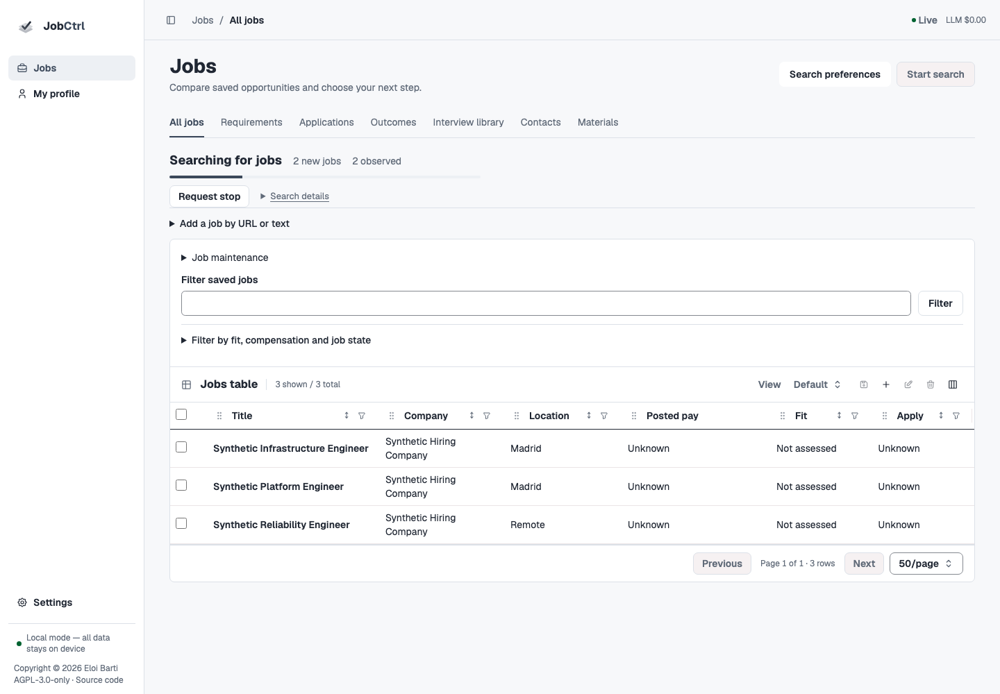

# Discovery & Sources

Use **Jobs → Start search** to run your saved preferences directly beside the
comparison table. The inline progress strip shows the actual search state, new
jobs and observed jobs; your filters and selected table context stay in place.
Use the secondary **Search preferences** action to edit criteria, then
**Back to jobs** to return to the same comparison-table context.
**My profile → Search preferences** keeps roles, career
tracks/levels, locations/work arrangements, boards and limits together.
**Filter saved jobs** only filters existing records; it starts no acquisition.

This guide describes the Original redesign source candidate. The
[redesign ledger](../plans/2026-11-11-original-app-redesign.md) records actual
implementation and verification, while the
[published release](https://github.com/ebarti/JobCtrl/releases/latest) establishes
installed availability. Source changes and the offline demo do not establish a
release or hosted deployment. Start with [Daily Workflow](normal-flows.md) for the
complete task sequence; use [Configuration](configuration.md) for providers and
shared spend policy.

<DiscoveryPipeline />

When saved tracks, levels or areas of interest need a fresh model-generated
query plan, **Start search** checks the selected model's recorded cost-accounting
capability. If a finite daily cap has no supported cost source, the action opens
an explicit setup dialog. **Review spending setup** opens Budgets and preserves
the originating Jobs filters or Search preferences view. Add an exact sourced
`provider:model` pricing quote, save, and use the return link to start deliberately.
The app does not guess a price, switch providers, remove the cap or retry the
search automatically. A saved quote establishes accounting configuration, not
provider sign-in or live model availability. Literal role queries and current accepted plans do not
need this query-planning setup. A prior `cost_accounting_unavailable` failure is
shown as a cost-tracking setup problem, before job-source acquisition.

## Saved Search Preferences

Add target roles as independent repeatable inputs; Enter adds a row and moves
focus to it. Choose career tracks and levels explicitly. Each location row keeps
its own work-arrangement selections. These are current search choices, not
preferences inferred from past employment or a suggestion accepted silently.
Source suggestions and target-role coaching remain explicit, source-bound work.

**Search map** sends only that location query to Photon and shows real results.
Select a result to bind its place identity, display name, coordinates, selection
time and user-selection provenance. Editing the label clears the binding;
existing free text stays unverified. Opening the page or typing makes no lookup
request. A selected place is not work authorization and does not establish that
a posting fits your location constraints.

Profile owns target facts/preferences and their optimistic Profile version.
Discovery owns boards, lookback, result/new-job limits, sources, schedules and
execution settings in its own SQLite rows. The connected screen composes those
public owners rather than creating another settings store. An incomplete or
conflicting save retains the draft; check saved state before retrying.

### How target search controls are used

Literal role queries and location/work-arrangement rows retain their authored
meaning. Track/function/seniority-based recall plans use explicit source-bound
model determinations with source IDs, revisions and persisted receipts; a
failed or stale plan preserves the prior accepted one. Search indexes, word
lists and token similarity cannot infer meanings or turn suggestions into
consent.

The ordinary **Start search** path uses the current Profile Search preferences
and saved Discovery board/limit policy. It explicitly sets empty one-run
query/location overrides so older explicit Discovery target rows do not take
precedence in that path. Existing explicit targets are retained for their
supported contextual/CLI uses, not rewritten. **Search-only overrides** can
supply literal queries and locations for one request without replacing saved
preferences. The displayed effective summary names the inputs used.

Search may make model-backed query preparation only after the explicit launch
admits that work. Preference saves, reads, navigation and connection remedies
start no query preparation, match refresh, scoring or resume generation.
Remote and posting age remain valid search preferences. Each board runs with
its own supported request and checkpoint. Indeed Remote requests retain Remote
and apply the age cutoff locally using the provider's reported publication date;
Glassdoor and ZipRecruiter whole-day requests are rounded up for acquisition,
then locally checked against the exact authored cutoff. Missing dates, ambiguous
cutoff dates and future dates are excluded rather than invented. Date-only
metadata can therefore reduce results, especially for short windows. The cutoff
reference is frozen for the run and retained after worker restart.

Glassdoor cannot verify a location together with Remote, so that board reports
an unsupported scope while compatible boards continue. This does not infer
remote-work eligibility from a location label. Missing credentials and other
provider failures are also recorded per board, with source-specific remedies in
the progress strip. Repeated failures with the same source identity, error code
and recorded message appear once with the number of affected query/location
combinations.
**Search details** retains every recorded failure and its query-unit identity;
different boards, codes or messages remain separate notices.
Source acquisition is partial when a source completes or the new-job limit ends
acquisition, and another source fails. If no source completes or fulfils bounded
work, acquisition is failed. Accepted jobs remain available in
either case. A result limit bounds fetched observations, including those later
excluded by the local date check; there are no extra requests to fill the limit.
The limit is not a promise of that many suitable or newly admitted jobs.

The primary launch also binds the saved `expectedProfileVersion`. Queued or
replayed planning refuses a changed Profile instead of silently absorbing new
criteria. A current accepted target plan can be reused without another model
connection. Otherwise the task shows known local blockers; provider auth,
lane/spend and dispatch checks run only after deliberate **Start search**, not
as navigation probes. Unsaved search drafts survive Preferences ↔ Search within
the same session, tenant and database incarnation; saved values persist through
reload. The offline demo clears those transient drafts on reset.

## Launch And Observe Discovery

Choose **Start search** directly in **Jobs**. It uses the last confirmed saved
roles/locations, board/source scope and limits. Pending preference edits block
launch until confirmed. **Search preferences** opens the connected editor when
you want to change those criteria. A specific blocker appears beside the search
when it cannot start; connection remedies return you to the same Jobs context.

The progress strip distinguishes queueing, queued/planning, running, completed,
partial, failed and stopped searches. An indeterminate indicator shows ongoing
work; the app does not invent a percentage or ETA when source totals are unknown.
Canonical counts and newly saved jobs update as work proceeds. Progress is
restored after navigation or reload, and another tab detects the active search
before offering another launch. An unavailable status check stays explicit and
blocks another launch until reconciled.
Finished feedback is labeled **Last search result**. **Dismiss result** hides
that exact terminal outcome in this browser and workspace across navigation and
reload. **Show last search result** and **Search details** keep its recorded
status, counts and failures available. New searches and changed outcomes appear
again. Acquisition, ongoing assessment and unresolved request recovery remain
visible until the outer search action settles.

Historical source remedies use the current saved board selection and source
registry for context. A deselected or disabled source's old setup error stays in
Search details with its current-disabled status, without a primary instruction
to configure that source. An unavailable current-source read remains unknown.
Dismissal changes presentation only; canonical outcomes and accepted jobs stay
recorded.
Discovery has no dry-run mode; the CLI rejects Discover with
`--dry-run` before admission.

The contextual **Search plans, schedules and source behavior** section keeps
independent targets, query-plan review, one-off searches, automation and source
execution controls available as separate disclosures. Job boards, posting age
and result limits have one ordinary editor in **Search settings**. Opening a
disclosure preserves its draft and starts no search or model work.

The task invokes the existing `discovery.search` action with a retained
idempotency key and database identity. Queued means Temporal accepted the request,
not that acquisition or person-fit assessment completed. The complete application
keeps that one action active while the preparation owner enriches each newly
saved job, records role context, extracts its requirements and assesses person
fit. Search does not prepare wording or generate resumes. Source counts remain
acquisition counts; source failures and per-job assessment failures are reported
separately. A job whose assessment fails stays saved with its explicit outcome,
and other jobs continue. A completed source alone cannot complete the overall
search or enable a second launch during assessment.
The Jobs progress changes to **Assessing saved jobs** while that work runs and
shows recorded assessed, failed and cohort counts when available. Selected job
details identify an active `search` or `assess` recipe as **Assessing fit**, with
its current stage; this task generates no resume. The ordinary **Prepare resume**
action is available again after assessment settles. If the preparation owner is
absent, the completed result explicitly says initial fit assessment is
unavailable rather than implying that saved jobs were assessed.
If every source eventually fails after saving jobs, those retained new jobs
still receive initial assessment. The overall search reports a partial outcome,
while its acquisition status and source failures remain failed and inspectable.

The cohort contains only jobs newly saved by this search. Existing accepted
scores are not reassessed because a Profile or catalog changed; use the explicit
affected-matches operation for that decision. Reads and preference saves start
no assessment. In a reduced application with Discovery but no preparation owner,
the action is acquisition-only and reports `preparationAvailable: false`;
acquisition success does not establish a person-fit result.

For already saved jobs that need initial assessment, deliberately submit
`preparation.run` with `recipe: "assess"`, `scope: "selected"` and the exact
`job_ids` (up to 1,000), or use `jobctrl assess --job-id JOB_ID --wait` with a
repeated `--job-id` for the reviewed selection. This runs the same enrichment,
role-context, requirements and Fit owners without another Discovery search,
wording preparation or resume generation. The receipt's run ID joins
`GET /v1/preparation/runs/{run_id}` for every stage outcome. A failed refresh
preserves earlier accepted posting, requirements and score records.
Recorded failed job stages also survive same-run worker recovery. A worker
restart does not silently retry them; use an explicit preparation retry. A
cancelled or failed action seals interrupted preparation status without altering
completed stages or inventing a receipt for uncertain model usage.

If a start reply is uncertain, choose **Check previous search** or **Retry the
same request** with the same inputs. A missing row is an observation at read
time, not permission to discard an unresolved request. A workspace identity
change refuses recovery into the replacement database.

### Stop Or Recover A Discover Run

**Request stop** records cancellation for the exact run. **Stop requested** is
separate from settled cancellation; source work may still be finishing. Accepted
jobs, source receipts/checkpoints and earlier materials remain available after
failure or cancellation. Use **Recent searches** for retained outcomes. Technical
inspection is available from **Settings → Data & diagnostics → Task history**
without making it part of ordinary search.

Unknown provider or worker state remains unknown. An event stream connection,
fresh wrapper process or unavailable probe does not prove provider readiness or
that all earlier work has stopped. Read the action's actual blocker and remedy.

### Optional live Chrome connection

A selected paired extension can supply bounded acquisition through the user's
running Chrome session on supported provider-owned hosts. Without it, supported
sources can use guarded public HTTP or anonymous managed browser acquisition.
An offline optional extension does not itself block every search. Site policy,
public destination checks and operation readiness still apply.

Transport is selected before acquisition; a failed site request does not
silently switch to another authority. Neither mode copies a personal browser
profile. Extension pairing/rotation, capability adoption and a configured
provider are separate explicit actions in **Settings → Connections**.

### Resumable Broad-Board Searches

Provider cursor/checkpoint state and the exact saved search fingerprint belong
to the durable search. Accepted or intentionally filtered receipts commit before
provider acknowledgement. A retry reuses valid checkpoints; a changed fingerprint
or invalid cursor/schema fails explicitly. Epoch-fenced writes prevent an
abandoned activity from publishing after cancellation or retry. Unknown provider
totals remain unknown rather than becoming an invented completion percentage.

## Capture A Known Posting

Use **Jobs → Import job**, the extension's user-mediated **Save job**, or the
contextual manual-capture queue for inaccessible content. Manual Jobs remains
usable when optional Discovery is absent. Exact canonical identity, source
snapshots, review lifetimes and import receipts prevent duplicate publication.
A changed submitted body requires a new capture review lifetime; an exact receipt
replay makes no additional model call.

Blocked/login-walled/unsafe content does not become a placeholder Job. Supply
reviewed content through the existing recovery path. Source refresh failures
preserve accepted posting text. [Enrichment & Extraction](enrichment-and-extraction.md)
owns canonical posting availability and capture provenance.

## Saved Source Review Views

Source controls retain literal URL-backed filters, sort and saved views for
review. Registry, locator candidates, quarantine, manual capture and source
history remain reachable in contextual source tools. Deliberately inactive or
rejected sources do not become actionable failures merely because they exist.
Reading a source, a proposal or its diagnostics never enables it.

## Runtime, Sources, And Schedule

Normal search starts from saved preferences and bounded source policy. Open
contextual **Source management**, **Search plan**, runtime or schedule detail
when needed; none requires a separate ordinary Pipelines visit.

| Control | Authority and effect |
| --- | --- |
| Roles, tracks/levels, locations/work arrangements and optional place bindings | Profile's versioned saved preferences; next explicitly started search. |
| Boards, result limits, lookback and new-job limit | Discovery settings with `expectedRevision`; captured for the admitted search. |
| Source enablement, locator, quarantine and capture review | Feature-owned review/registry records; disabled/rejected intent is retained. |
| Schedule | Explicitly enabled Discovery definition, reconciled by the worker; saving a schedule is not a manual search and does not normally require a restart. Saved and effective acknowledgement remain distinct. |
| Shared automation/fit policy | Canonical runtime policy with `expectedPolicyRevision`; Discovery has no competing application-approval authority. |

Only the applicable owner's settings may change. Shared provider/model, spend
and credential controls are in [Configuration](configuration.md). Normal forms
do not ask you to tune lane JSON, worker slots or inspect queues to decide
whether to search.

### Propose sources from saved posting history

Run `jobctrl source-proposals from-history` (optionally `--job-id JOB_ID` for one
saved job) to opt into proposals from saved
current posting URLs, canonical posting identities and current enrichment
application URLs. This is an explicit command; importing, capturing, applying,
opening Discovery or listing candidates does not trigger the history scan.
Historical application aliases are lookup evidence, not current targets, and
are excluded. The command checks public destinations through DNS but never
fetches a page, invokes a model or starts a Discover run.

Proposals enter the existing **Source controls → Source locator** review queue.
URLs for one recognized ATS board share a candidate coordinate, including
posting/API/apply URL forms. Literal board tokens, regional Lever hosts and
Workday site names retain distinct source identities; display slugs do not
merge them. Ordinary learning reuses a reviewed coordinate. Unknown hosts are proposed at host scope with no
verified board identity. Malformed, credential-bearing, local/private and
unresolvable destinations are not proposed. Public network policy still
applies when a reviewed source is later acquired.

Each proposal retains the original JobId and posting URL, the exact input URL
and its authority, recorded source-observation/run IDs, extraction tier and
time, snapshot version, hashes and recorded extraction evidence, and a bounded
saved-content sample. The
review panel shows board coordinates, existing registry overlaps, saved origin
samples and **Completeness unknown**: saved postings do not prove board
coverage or source availability. `jobctrl source-proposals list` reads all saved
receipts and decisions as JSON without writing or making network requests.

The proposal command and all review reads leave source enablement, schedules,
job identity, application targets and application records unchanged. Promotion
requires the existing explicit review control and rechecks the public
destination before enabling a source. An overlapping active registry
entry is reused with its reviewed configuration intact. A disabled or
quarantined overlap must be changed explicitly in the registry first; a proposal
cannot enable it. Normal worker reconciliation also preserves disabled sources. New Workday
coordinates require the employer/site to be configured first; regional Lever
coordinates remain review-only while the adapter supports global boards. The
queue explains these promotion limits without hiding their evidence.

Rejecting a candidate records durable suppression for its source coordinate,
including alternate posting URLs and ordinary automatic learning. Run
`jobctrl source-proposals reset CANDIDATE_ID` to explicitly clear that rejection,
then run `from-history` again if desired. Reset never enables a source or creates
a schedule. Pending, rejected and reset history coordinates cannot be promoted by normal
worker learning. Retries reuse unchanged evidence; failed persistence rolls back
the scan and retains the prior queue and receipts. Proposal evidence and review
decisions remain local source-control history, including after job-data purge.

### Runtime setting reference

These retained anchors support field help and existing deep links. Exact values
and editability come from the current feature-owned settings response.

**Job boards.** Selected providers run under their supported query/location/age
capabilities and saved source policy. Saving a choice does not fetch a page.

**Results per board.** Maximum requested for each query/location unit, not a
promise of suitable or newly admitted results. The shared new-job limit bounds
canonical new-job admission across source families.

**Posting lookback hours.** Requested age window where the provider supports it;
unsupported combinations are reported explicitly.

**Parallel source families.** Bounded intake concurrency, separate from shared
worker capacity and downstream preparation. It cannot bypass budgets or source
pacing.

**Crawler identity and browser headers.** Saved non-secret request identity
applies to new owned acquisition sessions. Connected Chrome keeps its own
headers/session. Identity selection does not grant access or bypass rate limits.

**Scheduled discovery.** Disabled until explicitly enabled. A saved cron/schedule
change is reconciled by the owning worker. Inspect reported saved/effective
state rather than assuming a successful acknowledgement; ordinary schedule
editing is not a worker-restart flow.

### Canonical identity and repeat applications

Canonical posting/source identities and accepted duplicate decisions identify
openings; a similar title or employer does not merge them. Identity alone does
not prove an application happened. Repeat protection joins confirmed application
facts and current exact approval. See
[Apply → Repeat-Application Protection](apply.md#repeat-application-protection).

## Employer Analysis Perspectives

Employer analysis uses shared provider/model policy under **Settings →
Connections** and retains source-bound selected posting spans, its recorded
perspectives and determination provenance. A ready provider is not a
promise that every operation or model is usable. [Scoring](scoring-and-employer-analysis.md)
owns how the accepted analysis supplies qualified requirements and person fit.

## Crawl Politeness

Discovery and Enrich do not request, evaluate, or enforce `robots.txt` in
extension or anonymous mode. This policy applies to broad boards, ATS/API,
Workday, Smart Extract, and detail acquisition. Older source records with
`honor` or `exempt_documented_api` values remain readable but cannot enable
robots enforcement. Historical robots-blocked jobs remain retryable.

Connected acquisition uses the selected live extension/profile; Chrome owns its
cookies, proxy, and user agent. Anonymous ATS/API and Workday use guarded HTTP,
while Smart Extract and Enrich use anonymous Playwright with the public route
guard. Public destinations, redirects, authentication boundaries, host pacing,
concurrency, request budgets, and cancellation remain enforced in both modes.
Broad-board traversal has the narrower accounting boundary below.

The **Use browser headers** option under **Discovery → Runtime settings**
selects the identity for non-extension gateways, including compensation lookups
and opted-in contact research. When off, the effective form remains
`<product>/<version> (+<contact>)`—for example
`JobCtrl/0.3 (+https://github.com/ebarti/JobCtrl)`. When on, controlled HTTP and
anonymous Playwright requests receive the generated User-Agent and client hints.
Integrated anonymous broad-board requests receive the selected User-Agent;
JobStreaming owns their remaining transport headers. `jobctrl doctor` prints an
identity for the selected mode. Connected Chrome retains its real browser identity.

Controlled HTTP and posting-browser acquisition record HTTP 429 and 503 as
server deferrals before extraction. After a redirect, the cooldown belongs to
the validated final response host; the original posting identity stays intact. They honor a valid `Retry-After` through the
shared host limiter; when the header is absent or invalid, they use a one-minute
cooldown. Connected rendered-page results do not carry response headers, so they
use that same fallback. Other hosts remain independent. Long server delays retain
the limiter's five-minute bound and explicit deferral behavior.

The rest of crawl policy also lives on the SQLite-backed Discovery boundary, so
per-source overrides ride the existing registry rather than a parallel config
surface:

- **Per-host rate/concurrency + per-run request budget** are fields on each
  source's `SourcePolicy` (`domain/discovery/source_registry.py`), with
  bounded defaults (a non-zero min-interval, a concurrency of one, and a finite
  run budget). Per-source overrides
  ride the existing `SourceRegistryEntry` rows; a registry policy editor is a
  planned addition, not yet in the UI.
- **Broad boards** (`indeed`, `linkedin`, `glassdoor`, `zip_recruiter`) are
  parsed by JobStreaming. Their sessions prefer the connected extension or use
  guarded Requests for anonymous acquisition, including providers normally
  using native tls-client. Initial requests, redirects, recreated search
  sessions and detail sessions all retain public URL/DNS checks. Direct sockets
  connect to validated public numeric addresses; public redirects retain normal
  Requests behavior. Provider headers, cookies, payloads and timeouts remain
  supported. JobStreaming owns internal traversal, so
  JobCtrl's crawl-policy pacing and budget apply at the invocation boundary;
  `jobctrl doctor` warns when those sources are enabled. This is not a claim of
  per-request budget accounting inside the library.
- Live-profile Discovery uses the proxy configured in Chrome or the operating
  system. It does not inject the SQLite `proxy` value into the user's browser.
  Anonymous integrated broad-board acquisition rejects HTTP(S) and SOCKS proxy
  routing, including environment proxies, because the worker cannot pin a
  proxy's destination DNS. It does not silently go direct after that failure.
  Connect the extension to use Chrome's configured proxy, or remove the proxy
  for anonymous direct access. Other compatibility paths that consume the
  JobCtrl proxy setting still reject malformed `host:port[:user:pass]` values.

## Contact Research

Supervised contact research has no configuration keys and no schedule — it runs
only when you start a run from the UI. Its posture is conservative by design:

- **No public source is auto-fetched.** A public page is fetched only when you
  supply its URL for that run (per-source opt-in); with no URL, the run fetches
  nothing and just records the source-attempt audit.
- **Login-walled / paywalled / bot-protected pages are never auto-fetched** — they
  are routed to the manual-capture path instead.
- **Fetching reuses the crawl-politeness gateway above** (per-host
  rate limit + per-run budget + the selected request identity).
- **LLM spend reuses the daily budget** (`dailyBudgetUsd`) and the same preflight
  as every other spendful workflow — there is no separate research budget.
