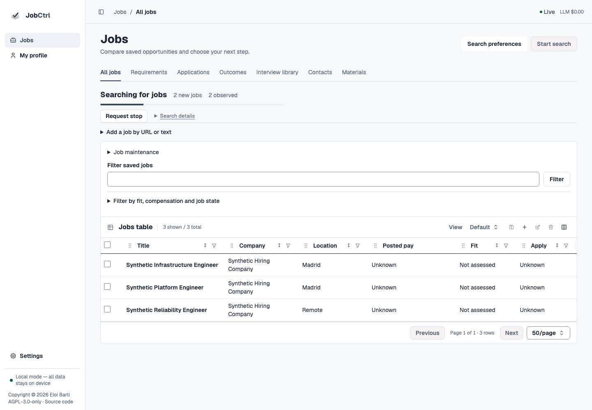

# Discovery & Sources

Use **Jobs → Start search** to run your saved preferences directly beside the
comparison table. The inline progress strip shows the actual search state, new
jobs and observed jobs; your filters and selected table context stay in place.
Use the secondary **Search preferences** action to edit criteria, then
**Back to jobs** to return to the same comparison-table context.
**My profile → Search preferences** keeps roles, career
tracks/levels, locations/work arrangements, boards and limits together.
**Filter saved jobs** filters existing records. JobStreaming supplies every board available to **Start search**. To save one posting you already know, use **Jobs → Import job → Import posting URL**.

This guide describes the Original redesign source candidate. The
[redesign ledger](../plans/2026-11-11-original-app-redesign.md) records actual
implementation and verification, while the
[published release](https://github.com/ebarti/JobCtrl/releases/latest) establishes
installed availability. Source changes and the offline demo do not establish a
release or hosted deployment. Start with [Daily Workflow](normal-flows.md) for the
complete task sequence; use [Configuration](configuration.md) for providers and
shared spend policy.

<DiscoveryPipeline />

## Saved Search Preferences

Add target roles as independent repeatable inputs; Enter adds a row and moves
focus to it. Choose career tracks and levels explicitly. Each location row keeps
its own work-arrangement selections. These are current search choices, not
preferences inferred from past employment or a suggestion accepted silently.
Target-role coaching uses your selected sources and requires an explicit request.
Open **Search preference suggestions** to review proposed roles and locations.
Edit your saved roles, locations and other criteria in the main preferences form.

**Search map** sends only that location query to Photon and shows real results.
Select a result to bind its place identity, display name, coordinates, selection
time and user-selection provenance. Editing the label clears the binding;
existing free text stays unverified. Opening the page or typing makes no lookup
request. A selected place is not work authorization and does not establish that
a posting fits your location constraints.

Profile owns target facts/preferences and their optimistic Profile version.
Discovery owns boards, lookback, the new-job limit, sources, schedules and
execution settings in its own PostgreSQL rows. The connected screen composes those
public owners rather than creating another settings store. An incomplete or
conflicting save retains the draft; check saved state before retrying.

### How target search controls are used

Each saved role title becomes a search query. The saved locations and work
arrangements supply the source filters. Tracks, seniority, areas of interest and
specializations guide the role match after a source returns a posting.

The ordinary **Start search** path uses the current Profile Search preferences
and saved Discovery board/limit policy. It explicitly sets empty one-run
query/location overrides so older explicit Discovery target rows do not take
precedence in that path. Existing explicit targets are retained for their
supported contextual/CLI uses, not rewritten. **Search-only overrides** can
supply literal queries and locations for one request without replacing saved
preferences. The displayed effective summary names the inputs used.

A new search from saved role preferences checks each provider candidate before it
uses one of the new-job places. It compares the offered role with the roles,
tracks, levels, functions and specializations saved for that search. The decision
cites both the posting and the relevant preference. A posting can use a different
title and still qualify. Unsupported or unresolved role scope stays outside the
new-job count. A LinkedIn card without a description receives a targeted detail
request before the role check. A missing description leaves role scope unresolved. Model or source failures remain visible
in the search result. A durable search waits when the model lane is occupied.
If the worker stops during a paid role check, recovery uses a completed receipt
or reports that its outcome is unresolved. Person Fit runs later and checks your qualifications
against the job's requirements. A search using explicit one-run query overrides
can still explore other roles.

When multiple board queries share a finite new-job limit, each query gets a
share of the remaining places. Previously saved jobs, duplicates and exclusions
leave places available. A query that exhausts its results releases its unused
places for the other queries. Recovery uses the run's committed admissions.

The run's `newJobs` counts newly created job identities. `observedJobs` includes
accepted observations of previously saved jobs. `roleTargetObservations` shows
the number of role checks by verdict and the count missing a posting description.
Filtered listings are recorded separately from observations admitted to Jobs.
During a saved-role search, JobCtrl finishes checking each page of LinkedIn
keyword matches before requesting the next page.
During a saved-role LinkedIn search, an exact match to a saved posting is
recorded as a listing observation. The search keeps the saved revision and
skips the detail request and role check. Use the job's manual checks to refresh it.
When several queries in one search return the same LinkedIn posting, JobCtrl
reuses a description it already fetched for that posting, even after a worker
restart. Each query still records its result. A new search can fetch fresh details.

Saved role titles are sent to the board as written. Model-backed role checks
begin when the search receives candidate postings. Before starting a new search
from saved roles, JobCtrl checks that the selected model can account for monetary
cost under a positive daily budget. If a pricing quote is missing, review
**Budgets** from the search feedback and start again after saving.
Remote and posting age remain valid search preferences. Each board runs with
its own supported request and checkpoint. Indeed Remote requests retain Remote
and apply the age cutoff locally using the provider's reported publication date;
Glassdoor and ZipRecruiter whole-day requests are rounded up for acquisition,
then locally checked against the exact authored cutoff. Missing dates, ambiguous
cutoff dates and future dates are excluded rather than invented. Date-only
metadata can therefore reduce results, especially for short windows. The cutoff
reference is frozen for the run and retained after worker restart.

Glassdoor cannot verify a location together with Remote, so that board reports
an unsupported scope while compatible boards continue. This does not infer
remote-work eligibility from a location label. Missing credentials and other
provider failures are also recorded per board, with source-specific remedies in
the progress strip. Repeated failures with the same source identity, error code
and recorded message appear once with the number of affected query/location
combinations.

New workspaces start with LinkedIn selected. To use Indeed or ZipRecruiter,
select them under **Search preferences → Job boards**.
Indeed uses the worker environment variable `JOBSTREAMING_INDEED_API_KEY`.
ZipRecruiter uses `JOBSTREAMING_ZIPRECRUITER_AUTHORIZATION`. If Search reports
a missing credential, configure that variable and restart the worker. An HTTP
401 or 403 means the board denied the request. Check that the configured
credential has access to its search API. A TLS or proxy diagnostic points to
the worker’s connection settings. Older runs may show a general access error.
A board that rate-limits a search appears by name in the progress strip and
Search details. A board that supplies a retry time pauses its own queries until
that time. LinkedIn searches also resume automatically when LinkedIn omits the
retry time. Other boards and assessments of saved jobs can continue during the
wait, which survives a worker or app restart. Other boards that omit a retry
time record a rate-limit failure and defer their remaining queries.

**Search details** retains every recorded failure and its query-unit identity;
different boards, codes or messages remain separate notices.
Source acquisition is partial when a source completes or the new-job limit ends
acquisition, and another source fails. If no source completes or fulfils bounded
work, acquisition is failed. Accepted jobs remain available in
either case. New searches use each connector's native page size and continue
past known or excluded listings until the shared new-job limit, confirmed source
exhaustion or an explicit provider/safety stop. A page safety limit or unknown
termination is recorded as an incomplete source, never as proof of exhaustion.
The new-job limit is not a promise that enough new or suitable postings exist.

The primary launch also binds the saved `expectedProfileVersion`. Queued or
replayed planning refuses a changed Profile instead of silently absorbing new
criteria. A current literal query plan can be reused. Model and spending checks apply when
a posting needs a role decision or assessment. Unsaved search drafts survive Preferences ↔ Search within
the same session, tenant and database incarnation; saved values persist through
reload. The offline demo clears those transient drafts on reset.

## Launch And Observe Discovery

Choose **Start search** directly in **Jobs**. It uses the last confirmed saved
roles/locations, board/source scope and limits. Pending preference edits block
launch until confirmed. **Search preferences** opens the connected editor when
you want to change those criteria. A specific blocker appears beside the search
when it cannot start; connection remedies return you to the same Jobs context.

The progress strip distinguishes queueing, queued/planning, running, completed,
partial, failed and stopped searches. An indeterminate indicator shows ongoing
work; the app does not invent a percentage or ETA when source totals are unknown.
Canonical counts and newly saved jobs update as work proceeds. Progress is
restored after navigation or reload, and another tab detects the active search
before offering another launch. An unavailable status check stays explicit and
blocks another launch until reconciled.
Finished feedback is labeled **Last search result**. **Dismiss result** hides
that exact terminal outcome in this browser and workspace across navigation and
reload. **Show last search result** and **Search details** keep its recorded
status, counts and failures available. New searches and changed outcomes appear
again. Acquisition, ongoing assessment and unresolved request recovery remain
visible until the outer search action settles.

Historical source remedies use the current saved board selection and source
registry for context. A deselected or disabled source's old setup error stays in
Search details with its current-disabled status, without a primary instruction
to configure that source. An unavailable current-source read remains unknown.
Dismissal changes presentation only; canonical outcomes and accepted jobs stay
recorded.
Discovery has no dry-run mode; the CLI rejects Discover with
`--dry-run` before admission.

The contextual **Search plans, schedules and source behavior** section keeps
independent targets, query-plan review, one-off searches, automation and source
execution controls available as separate disclosures. Job boards, posting age
and the maximum number of new jobs have one ordinary editor in **Search settings**.
Source fetch limits are automatic; there is no per-board results control.
Opening a disclosure preserves its draft and starts no search or model work.

A search receives one action ID. The worker saves each received listing alongside
the board's acknowledged position in PostgreSQL. The progress strip shows how
many listings were received, already saved, excluded or still pending. A newly
saved job and its independent assessment enter the database together. The worker
can begin checking that job while another page or query is still pending.
A previously saved job is counted as an observation and keeps its accepted Fit.

Each assessment uses the saved posting revision for enrichment, employer role
analysis, Requirements and Fit. It reuses the full LinkedIn detail when the
search's receipt identifies that exact posting revision. Requirements and Fit
reuse accepted work for the same source content, normalized demand and Profile
evidence. Changed inputs get their own determination. The same model lanes and
spending limits apply while other jobs run.

Select a job in **Jobs** to see its stage, current assessment and any failure
code. **Retry fit assessment for this job** retries its unfinished stages, even
while the source is waiting. Its completed stages and other jobs keep their
records. An unresolved paid request requires its receipt to be reconciled
before another attempt. A classified non-English posting shows its recorded skip.
The **Not assessed** filter includes jobs without an accepted score.

The search stays active until acquisition and the admitted assessments settle.
It verifies each score against the current posting, requirements and Profile.
Source failures and failed assessments are reported separately. Even if every
source subsequently fails, jobs already admitted still receive assessment.
Use **Request stop** to stop outstanding work. Accepted jobs, checks and scores
remain available. A reduced installation with only Discovery reports
`preparationAvailable: false` in its acquisition result.
[How Fit scores are calculated](scoring-and-employer-analysis.md#how-the-score-is-calculated).

For already saved jobs that need initial assessment, deliberately submit
`preparation.run` with `recipe: "assess"`, `scope: "selected"` and the exact
`job_ids` (up to 1,000), or use `jobctrl assess --job-id JOB_ID --wait` with a
repeated `--job-id` for the reviewed selection. This runs the same enrichment,
role-context, requirements and Fit owners without another Discovery search,
wording preparation or resume generation. The receipt's run ID joins
`GET /v1/preparation/runs/{run_id}` for every stage outcome. A failed refresh
preserves earlier accepted posting, requirements and score records.
Recorded failed job stages also survive same-run worker recovery. A worker
restart does not silently retry them; use an explicit preparation retry. A
cancelled or failed action seals interrupted preparation status without altering
completed stages or inventing a receipt for uncertain model usage.

If a start reply is uncertain, choose **Check previous search** or **Retry the
same request** with the same inputs. A missing row is an observation at read
time, not permission to discard an unresolved request. A workspace identity
change refuses recovery into the replacement database.

### Stop Or Recover A Discover Run

**Request stop** records cancellation for the exact run. **Stop requested** is
separate from settled cancellation; source work may still be finishing. Accepted
jobs, source receipts/checkpoints and earlier materials remain available after
failure or cancellation. Use **Recent searches** for retained outcomes. Technical
inspection is available from **Settings → Data & diagnostics → Task history**
without making it part of ordinary search.

Unknown provider or worker state remains unknown. An event stream connection,
fresh wrapper process or unavailable probe does not prove provider readiness or
that all earlier work has stopped. Read the action's actual blocker and remedy.

### Resumable Broad-Board Searches

Provider cursor/checkpoint state and the exact saved search fingerprint belong
to the durable search. Accepted or intentionally filtered receipts commit before
provider acknowledgement. A retry reuses valid checkpoints; a changed fingerprint
or invalid cursor/schema fails explicitly. Epoch-fenced writes prevent an
abandoned activity from publishing after cancellation or retry. Unknown provider
totals remain unknown rather than becoming an invented completion percentage.

## Capture A Known Posting

Open **Jobs → Import job → Import posting URL**, paste the public posting URL, and start the import. Jobs stores the request and extracts that particular posting. You can start an import while a search is running. If its model lane is occupied, the import waits. After capacity returns, the worker resumes the same request. Reloading the app or replaying its receipt preserves the job identity.

If a posting is inaccessible, the import reports the underlying problem. The extension's **Save job** and the historical capture review queue are separate, user-initiated controls. [Enrichment & Extraction](enrichment-and-extraction.md) describes posting availability and capture provenance.

## Saved Source Review Views

Source controls show JobStreaming boards, their saved states, and the outcomes of their recent runs. A preview reads previously saved observations for the board. A disabled or quarantined board retains its historical results. Changing its state requires the current saved revision.

## Runtime, Sources, And Schedule

Normal search starts from saved preferences and bounded source policy. Open
contextual **Source management**, **Search plan**, runtime or schedule detail
when needed; none requires a separate ordinary Pipelines visit.

| Control | Authority and effect |
| --- | --- |
| Roles, tracks/levels, locations/work arrangements and optional place bindings | Profile's versioned saved preferences; next explicitly started search. |
| Boards, lookback and new-job limit | Discovery settings with `expectedRevision`; captured for the admitted search. |
| Board availability and capture review | Discovery stores board states, run history and existing capture reviews. JobStreaming defines the list of boards. |
| Schedule | Explicitly enabled Discovery definition, reconciled by the worker; saving a schedule is not a manual search and does not normally require a restart. Saved and effective acknowledgement remain distinct. |
| Shared automation/fit policy | Canonical runtime policy with `expectedPolicyRevision`; Discovery has no competing application-approval authority. |

Only the applicable owner's settings may change. Shared provider/model, spend
and credential controls are in [Configuration](configuration.md). Normal forms
do not ask you to tune lane JSON, worker slots or inspect queues to decide
whether to search.

### Runtime setting reference

These retained anchors support field help and existing deep links. Exact values
and editability come from the current feature-owned settings response.

**Job boards.** Selected providers run under their supported query/location/age
capabilities and saved source policy. Saving a choice does not fetch a page.

**Automatic source limits.** New searches use each connector's native page size
and bounded pagination, without a separate total-emitted-results ceiling.
Search preferences and advanced settings have no per-board results control.
Legacy saved `resultsPerSite` values, API overrides and CLI `--results-per-site`
remain readable for compatibility but do not limit new searches. Already admitted
older searches retain their frozen finite request and checkpoint semantics.
The shared maximum-new-jobs setting counts canonical new admissions across all
selected boards. The worker saves received listings with their provider
acknowledgements. Admitting the final job consumes the last place and stops
acquisition. Additional listings already received on the page stay recorded. Budget
exhaustion, user cancellation and confirmed provider exhaustion remain distinct.
Authentication, native source limits, pacing and cancellation remain enforced.

**Posting lookback hours.** Requested age window where the provider supports it;
unsupported combinations are reported explicitly.

**Crawler identity and browser headers.** These settings supply the request identity for JobCtrl features that use its public posting transport. JobStreaming owns board sessions.

**Scheduled discovery.** Disabled until explicitly enabled. A saved cron/schedule
change is reconciled by the owning worker. Inspect reported saved/effective
state rather than assuming a successful acknowledgement; ordinary schedule
editing is not a worker-restart flow.

### Canonical identity and repeat applications

Canonical posting/source identities and accepted duplicate decisions identify
openings; a similar title or employer does not merge them. Identity alone does
not prove an application happened. Repeat protection joins confirmed application
facts and current exact approval. See
[Apply → Repeat-Application Protection](apply.md#repeat-application-protection).

## Employer Analysis Perspectives

Employer analysis uses shared provider/model policy under **Settings →
Connections** and retains source-bound selected posting spans, its recorded
perspectives and determination provenance. A ready provider is not a
promise that every operation or model is usable. [Scoring](scoring-and-employer-analysis.md)
owns how the accepted analysis supplies qualified requirements and person fit.

## Crawl Politeness

JobStreaming performs board searches and retrieves supported posting details. Each board has its own access requirements, supported search filters, native page sizes and safety limits. JobCtrl records board-specific authentication failures and rate limits alongside accepted jobs. LinkedIn listing requests and targeted detail requests share a four-second
minimum interval between request starts across searches and worker restarts.

The activity log records when a LinkedIn listing or detail request receives HTTP
429, the number of responses received and the requested delay. The Jobs page
shows the next retry in your local time. JobCtrl honors a positive
`Retry-After`, including waits longer than two minutes. When the header is
missing, invalid or zero, JobCtrl picks a random delay for each retry. The
first wait is 4–8 seconds, then 8–16, 16–32, 32–64 and finally 60–120 seconds
for each further retry. Closing the Jobs browser tab leaves the search running.
If you quit JobCtrl or turn off the computer, that time counts toward the wait.
When the worker starts again, it waits only until the saved deadline. If the
deadline has passed, it resumes the same search as soon as it is ready, with
the original criteria and remaining job allowance. **Request stop** cancels it.
Jobs already assessed keep their scores. For an older search that already
ended because of a rate limit, **Continue LinkedIn search** resumes its saved
position under the current retry behavior.

For a user-supplied posting URL, Jobs validates the public destination and redirects. The posting transport respects host cooldowns following server deferrals. A failed refresh retains the last accepted posting snapshot. See [Enrichment & Extraction](enrichment-and-extraction.md).

## Contact Research

Supervised contact research has no configuration keys and no schedule — it runs
only when you start a run from the UI. Its posture is conservative by design:

- **No public source is auto-fetched.** A public page is fetched only when you
  supply its URL for that run (per-source opt-in); with no URL, the run fetches
  nothing and just records the source-attempt audit.
- **Login-walled / paywalled / bot-protected pages are never auto-fetched** — they
  are routed to the manual-capture path instead.
- **Fetching reuses the crawl-politeness gateway above** (per-host
  rate limit + per-run budget + the selected request identity).
- **LLM spend reuses the daily budget** (`dailyBudgetUsd`) and the same preflight
  as every other spendful workflow — there is no separate research budget.
