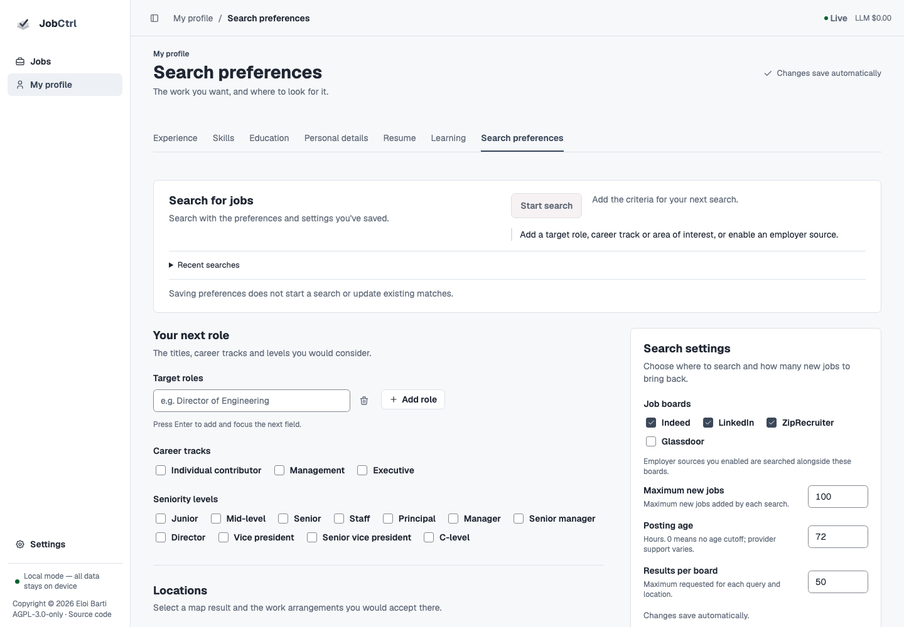

<script setup lang="ts">
import DailyWorkflowJourney from "../.vitepress/theme/DailyWorkflowJourney.vue";
</script>

# Daily Workflow

Start in **Jobs**: find or capture opportunities, compare them, open a job,
prepare its resume, review the application and record the outcome. **My profile**
keeps reusable facts and wording nearby; **Settings** holds shared connections,
budgets, automation, appearance and diagnostics. The command line remains
available for deliberate terminal work and maintenance.

This guide describes the Original redesign source candidate. The
[acceptance ledger](../plans/2026-11-11-original-app-redesign.md) records pending
implementation and verification. Check the
[published release](https://github.com/ebarti/JobCtrl/releases/latest) for
installed-version availability. Source changes, synthetic screenshots and demo
illustrations do not establish a release or hosted deployment.

For the available workspaces, read the [Product Tour](product-tour.md). For the
records the loop creates, read
[Open-source Job Application Tracker](../guides/open-source-job-application-tracker.md).

::: info Command spelling
Commands use `jobctrl <command>`. The same native executable owns installed
`start`, `stop` and `status` regardless of acquisition method. Contributor
commands are in [Local Development](../local-development.md).
:::

<DailyWorkflowJourney />

<WorkflowSurfaceSelector />

## 1. Build The Candidate Profile

<WorkflowSurfacePanel surface="web">

Open **My profile** on **Experience**. Add the roles, position summaries and
achievements JobCtrl may use. **Skills**, **Education** and **Personal details**
are peer sections, with independent editable fields. **Resume** opens the real
Plate baseline editor; **Learning** keeps user-authored development activity
separate from demonstrated capability.

Save a change normally, or let the form autosave. A failed or conflicting save
keeps your draft visible. Removed roles and achievements have a **Restore removed
experience** path; restoration preserves identity rather than replacing the
whole Profile with an old snapshot. Use the PDF import flow when you have a
baseline to extract and explicitly review.

Wording and factual evidence have separate authority. Inspect the requirement
tags beside an achievement, its exact current wording, proposed revisions and
history. Review exact wording deliberately; editing does not transfer approval.
A failed refresh preserves earlier accepted wording and documents.

</WorkflowSurfacePanel>

<WorkflowSurfacePanel surface="cli">

The web app is the full structured Profile and document editor. For an admitted
fresh command-line workspace, use:

```bash
jobctrl init
jobctrl doctor
```

The wizard retains existing authored state. Review saved Profile search targets
before relying on older Discovery targets. Provider setup and source commands
are listed in the [command reference](#command-reference).

</WorkflowSurfacePanel>

[Candidate Profile](candidate-profile.md) owns facts, import, exact wording,
source confirmation, revision conflicts and restoration.

## 2. Set Search Preferences

<WorkflowSurfacePanel surface="web">



Open **My profile → Search preferences**, or edit the same saved preferences
from **Jobs → Search for jobs**. Keep target roles, career tracks/levels, locations,
work arrangements, boards and bounded search limits together. Add another role
with Enter and continue in the next input. Each location remains an independent
row with its own work arrangement.

Use the explicit place lookup and select an actual result when you want a
validated location. Typing or opening the page does not query the place service.
Editing a selected label clears its binding; a legacy text label is unverified.
Saving preferences does not start discovery.

If readiness needs a provider or browser remedy, open **Settings → Connections**
and return to the same search context. Source controls and scheduling remain
available through contextual details; normal search does not require supervising
workers, queues or individual stages.

</WorkflowSurfacePanel>

<WorkflowSurfacePanel surface="cli">

```bash
jobctrl doctor
```

Inspect the rows: a successful diagnostic read does not establish that every
capability is ready. Search configuration and schedule/source ownership are
explained in [Discovery & Sources](discovery.md); provider and spend controls are
in [Configuration](configuration.md).

</WorkflowSurfacePanel>

## 3. Find Or Capture Jobs

<WorkflowSurfacePanel surface="web">

**Filter saved jobs** searches records already in Jobs. **Search for jobs** opens
the search task with **Start search** and its readiness message at the top.
Review the saved criteria, enabled sources and limits below it, resolve any
named blocker, then choose **Start search**. **Back to jobs** returns to the
same table context. Merely opening or saving the task launches nothing.
Discovery has no dry-run mode.

Progress, results, partial failures, stop requests and same-request recovery
stay with that search. Queued is not completed; a stop request is not settled
cancellation. When an acknowledgement is uncertain, reconcile the retained
request instead of starting a different search.

Use **Import job** for one public URL, or the paired extension's **Save job**
action for user-mediated capture. If an inaccessible posting needs supplied
content, use the task's manual-capture recovery. A failed fetch does not create a
placeholder posting or replace accepted content. Manual Jobs remains useful
without automatic Discovery.

</WorkflowSurfacePanel>

<WorkflowSurfacePanel surface="cli">

```bash
jobctrl run discover
```

This explicitly admits the existing bounded discovery/preparation recipe; it
does not approve or submit applications. Discover with `--dry-run` is refused.
Use the exact run identity returned by the command to inspect progress.

</WorkflowSurfacePanel>

[Discovery & Sources](discovery.md) owns effective search values, transports,
source consent, capture, schedules and recovery. An offline optional extension
does not by itself prevent supported anonymous acquisition.

## 4. Compare Jobs And Open A Workspace

The table keeps role/employer, location/work model, recorded compensation, fit,
application state and useful source/freshness information comparable. Use its
filters, sorting, pagination, columns, saved views and supported bulk selection.
Unknown pay, fit or outcome stays unknown; different currencies are not silently
made comparable. An empty workspace differs from a filtered list with no matches.

A fresh built-in **Default** view starts with Title, Company, Location, Posted
pay, Fit and Apply, plus selection. Posted pay uses its recorded display range,
currency and unit. Granular/source fields remain available in **Columns**, and
existing custom or persisted layouts keep their saved choices.

Open a job for its nearby task workspace. Return to the same comparison state
when finished, including after full-size resume editing. Within the job, inspect
**Person fit** separately from **Approved wording coverage**: a missing expression
does not lower factual support. Compensation, employer context, interviews,
contacts and history retain the same job identity.

Open **Jobs → Requirements**, or a Profile requirement tag, to inspect a reusable
meaning, its linked achievements and original occurrences. Your manual links are
unassessed intent; they do not establish fit or coverage. The
[Requirements library](requirements-library.md) owns that distinction.

### Update Matches After Saved Changes

Saving facts, sources, requirement edits, wording or approvals makes no automatic
matching, scoring, authoring or regeneration request. When you want saved changes
reviewed:

1. Save the inputs you want included.
2. Choose **Update affected matches** beside Profile/job evidence, or select a
   scored Jobs cohort and use **Update affected matches for selected jobs**.
3. Review the fixed job scope and **Work limits**, then start the update.
4. Inspect factual results and grouped wording work separately. Current approved
   links are reused; actual gaps are grouped by achievement. A wording proposal
   still requires your exact review.

The update fixes saved versions, identity and limits. Changes during the run stay
pending for a later action. Duplicate/uncertain requests retain their original
identity, cancellation stays explicit, and failures preserve accepted records.
[Update affected matches](candidate-profile.md#update-affected-matches) owns the
complete work-limit and recovery contract.

## 5. Prepare And Edit A Resume

Open the job's resume task. Choose **Tailored resume** or **Full baseline**, then
**Prepare resume**. This one bounded task sequences the existing requirement,
fit, composition, review and rendering owners. Read the blocker/remedy at the
action when work is unavailable. Individual maintenance tools remain under
**Preparation options and history**; ordinary preparation does not need a tour of
operations pages.

If the task needs a saved Profile, its setup link retains the selected job,
comparison context and chosen resume mode. Complete the Profile work, then use
**Return to job**; navigation does not change Settings or start model work.

Preparation produces a candidate for review. Open the actual Plate editor to
edit text, formatting and hyperlinks, compare source/coverage information, and
save a draft. Render and inspect the replacement before document acceptance.
The editor's direct PDF export is a local export of its current document; it
does not by itself register an accepted artifact or approve an application.

The complete authored baseline, exact approvals, accepted versions, template
geometry and supported PDF/DOCX/locale exports retain their owning contracts.
A failed generation, review, render or export leaves the last accepted artifact
available. See [Materials & Tailoring](materials-and-tailoring.md) and
[Reviewed Locale Variants](locale-variants.md).

## 6. Review An Application And Record Its Outcome

Use the selected job's review/application task, or **Jobs → Applications** for
the cross-job queue. Inspect the exact outgoing packet, accepted resume,
screening answers, source bindings and rehearsal result. Document acceptance and
application approval are different decisions. Any changed bound input requires
fresh review of the exact candidate.

A browser dry rehearsal submits nothing. Final submission on an employer website
is manual. Only an exact-approved email application may use JobCtrl's owned
Gmail sender, subject to its existing checks and at-most-once intent. An uncertain
external result remains **Needs verification**; a restart, reset or retry cannot
authorize a second send. [Apply](apply.md) owns the full boundary.

Record manual application/interview outcomes with their actual evidence and
correction history. **Jobs → Outcomes** summarizes recorded results; small or
unknown samples remain explicit. Email lookup proposes outcomes for review
rather than inventing confirmed history. [Outcomes & Feedback](outcomes-and-feedback.md)
explains which records are canonical.

## 7. Use Independent Resources

These tasks remain available without forcing a selected job:

| Task | Entry and authority |
| --- | --- |
| Browse requirements and source history | **Jobs → Requirements**; canonical meanings, recorded assessment/coverage and your separate unassessed links. |
| Browse interview guidance | **Jobs → Interview library**; local graph/list catalog without a provider call. Job-specific Beta preparation keeps evidence, retained inputs, notes and stale history separate. Research-draft criteria do not establish readiness or hiring outcomes. |
| Keep people and outreach drafts | **Jobs → Contacts**; import/edit facts with provenance, review supervised proposals, draft/approve/copy, log your own send and follow-ups. JobCtrl does not send contact outreach. |
| Review learning and career evidence | **My profile → Learning**; activity, aspirations, posting demand and demonstrated capability remain different records. Completing activity proves no skill. |
| Inspect retained documents | **Jobs → Materials**, or the job itself; accepted versions, provenance, comparison and supported exports. |
| Review compensation or an actual offer | The job's compensation/offer controls; unknown terms stay unknown and recorded decisions never submit an application. |

The owning [materials](materials-and-tailoring.md#interview-preparation),
[contacts](contacts-and-outreach.md), [scoring](scoring-and-employer-analysis.md),
[screening answers](screening-answers.md) and [compensation](compensation-evidence.md)
guides state their detailed limits.

## 8. Settings And Task Recovery {#settings-and-task-recovery}

**Settings → Connections** brings provider credentials, live model choices and
browser/extension capability together. **Budgets** owns shared spend policy;
**Automation** owns deliberate standing behavior and runtime policy.
**Appearance** offers light/dark, density, ten color schemes and ten real font
schemes, initially Graphite + Geist. Appearance saves in this browser and does
not change resume-template typography.

Progress, pending/partial/error state and recovery belong beside each task.

<a id="workers-activity-slots-and-queue-backlog"></a>

**Settings → Data & diagnostics** retains technical history and diagnostic entry
points when needed. A connected event stream describes connection freshness; it
does not prove that a provider or action is ready. Neither navigation nor a
read-only diagnostic grants permission to spend, enable a source or send.

## Stopping And Restarting

`jobctrl stop` asks the instance to shut down cleanly, then kills verified
leftovers that exceed the timeout and waits for exit. Detached children remain
part of that instance. A successful stop permits normal restart. Actual cleanup
failures report the process or ownership problem; investigate it and retry,
keeping the registry and data intact. Reboot is a last-resort troubleshooting
option, not part of the normal workflow. See [startup and cleanup](getting-started.md#_2-start-jobctrl).

## Command Reference

```bash
jobctrl check-availability JOB_ID
```

This asks the local worker to check one saved canonical JobId and prints its
availability observation; it does not run Discover or Apply.

Run each command as `jobctrl <command>` from any directory. The installed
launcher handles the lifecycle commands and passes the rest to the Python CLI.
In a source checkout, run the Python commands with
`uv --project workers/automation run jobctrl <command>`; the lifecycle commands
exist only in the installed launcher.

The Python application refuses legacy databases and workflow history; it does
not run the older schema-14-to-15 migration. Preserve the old workspace and use
the explicit `profile-transfer` command with `--source`, a nonexistent `--target`
outside the source, a complete `--browser-sources` export and
`--confirm-profile-only-reset`. This preserves the full Profile and supporting
sources while other application data starts fresh. Verify the transfer receipt
before deliberately selecting the new workspace; the command does not switch it.
For installed cutover, also use a separate fresh native runtime home and preserve
the old installation. Its first selection consumes the verified transfer's
permission to initialize new workflow history once; an interrupted selection
requires inspection or a new explicit transfer into a different nonexistent
target. Follow the unreleased transition boundary in Getting Started, rather
than reusing the old native runtime home or deleting a consumed marker.
Do not perform a real-user cutover during development or QA. Compatible later
Python updates preserve target state; after a failed candidate startup, stop
the owned runtime and resume forward with `jobctrl update`. See
[Getting Started](getting-started.md#update-roll-back-or-remove-jobctrl).

| Lifecycle command | What it does |
| --- | --- |
| `start` | Start the local services and open the app (`--no-open`, `--foreground`). |
| `stop` / `status` / `open` | Stop the runtime, report its state (`--json`, or `--pipeline` for pipeline stats), or open the app. Status includes Temporal probe errors in `healthError` and exits with an error if probe cleanup is unverified. Stop refuses to report success when recorded service ownership or exit is unresolved; see [Start JobCtrl](getting-started.md#_2-start-jobctrl). |
| `logs [component]` | Show the last 200 lines of the `temporal`, `worker`, or `api` log, or of all three when no component is given. |
| `version` | Print the installed version (`--json`). |
| `update` / `rollback` / `uninstall` | Install a newer release, restore an earlier application and its saved database pair (`--to <build-id>`), or remove JobCtrl. Rollback keeps a compatible recovery launcher; Homebrew preserves the selection until an explicit update. `uninstall --remove-data` also deletes your local data after you type a confirmation phrase. |
| `backup` | Snapshot `jobctrl.db` and `temporal.db` as a pair (`--output <directory>`); see [Back Up And Restore](data-and-safety.md#back-up-and-restore). |

| Domain command | What it does |
| --- | --- |
| `init` | Initialize an admitted fresh workspace and show the Profile/import, Discovery and provider setup paths; existing authored state is retained. |
| `setup` | Guide explicit provider/model selection, hidden native credential entry and optional managed Codex login, then report readiness. Source dependency/browser provisioning uses `corepack pnpm dev:setup`; setup supports noninteractive and mutation-free dry-run modes. |
| `doctor` | Read the structured canonical setup/readiness report for Profile, providers, browser, worker, Temporal and budget. A successful read does not mean every capability is ready. |
| `run [stages]` | Submit an explicit preparation recipe. The default `discover` recipe discovers and prepares new/pending work through the canonical worker; it does not implicitly submit applications. |
| `legacy-evidence list` / `recover` / `decide` | Read retained originals/current cells; `recover --payload FILE` inventories a Profile recovery bundle or explicitly unavailable authority, and `decide --payload FILE` records the exact source/version-bound human decision. Neither command restores a database or overwrites current source text. |
| `source-proposals from-history` / `list` / `reset CANDIDATE_ID` | Explicitly propose sources from saved canonical posting/application URLs, read retained evidence and review history, or reset one rejected coordinate. Review and promotion use the existing Source locator; see [Discovery](discovery.md#propose-sources-from-saved-posting-history). |
| `discover` / `enrich` / `analyze` / `score` / `tailor` / `prepare` | Submit the corresponding durable recipe. Preparation commands accept explicit `--job-id` selection, `--force` and `--wait`; inspect `--help` for each command's supported selectors. |
| `job <JobId-or-saved-url>` | Read one saved job or explicitly request `--prepare`, `--score`, `--tailor` or a current approved `--apply`. It does not import a new URL or create submission approval. |
| `apply` | Inspect with `--review-only` or `--recover`; rehearse with `--dry-run`; execute an exact current payload/approval or an approved batch. `--control` records an explicit version-fenced control decision. Standing polling consumes only eligible current approvals and never grants generic submit authority. |
| `retry RUN_ID` | Retry a recorded preparation outcome, optionally restricted by `--job-id`, while preserving its durable identity and accepted artifacts; it does not invent a new application approval. |
| `actions` / `action FEATURE.ACTION` | List registered actions or execute one explicit action with a JSON payload through the same application as HTTP and the worker. |
| `compensation-refresh` | Refresh one job, `--all` or `--stale` through Compensation; optional inputs include `--observations-json` and `--no-eurotoptech`. |
| `pipeline-status` / `runs` | Read application/worker readiness or list canonical durable action runs. Use `run-status RUN_ID` for one durable run. |
| `digest` | Print the local daily digest; it sends no notifications. Incomplete spend is shown as unknown. Only `--acknowledge` marks it reviewed (`--json`, `--min-fit-score`). |
| `capability list` / `enable` / `disable` | Inspect or change optional browser capabilities, for example `capability enable auto-apply-browser --browser-path <path>`. |
| `credentials migrate` | Move allowlisted provider secrets from legacy `.env` files into the native credential store. |
| `gmail-auth` | Connect Gmail for verification codes, outcome lookup, and approved email applications. |
| `material-export RESUME_ID --output FILE --format docx --accepted` | Export the actual accepted Resumes document; an optional `--revision-id` pins a saved revision. The old generated-material migration command is retired with the explicit fresh-state cutover. |
| `backup` | Source checkout only: write an integrity-checked SQLite backup of `jobctrl.db` without replacing an existing destination (`--output`). It is not an application/Temporal pair. |
| `corepack pnpm worker:start` (source checkout) | Run the actual Python Temporal worker. Installed startup manages its worker; there is no current `jobctrl worker` command. |

The digest counts new matches, stale scores and review items by their saved job
identity. Hidden, closed and deleted jobs are excluded from those counts. New
matches use the last review time and the configured high-fit threshold, which
`--min-fit-score` can override for one read. Follow-ups use saved application
outcomes and the seven-day threshold. Reading the digest does not advance its
review time; `--acknowledge` records it with a review event. Pending or
unresolved model usage leaves the other digest sections available and marks
the budget incomplete, with unknown spend and remaining amounts. Other failed
refreshes or reads fail instead of reporting zero counts.


## Semantic Determination Authority

Saved settings drive deterministic provider searches and canonical ingestion. Full-posting analysis and scoring assess suitability; there is no separate listing-admission model or queue. Role-analysis agreement is a persisted model determination. Resume/outreach/interview truthfulness and quality use separate model verdicts and source-bound anchors. Form answers and repeat-role equivalence come from determinations; confirmation and submission authorization remain distinct user actions.

See [the decision](../decisions.md#_2026-10-07-semantic-judgments-are-llm-determinations) for caching, provenance and failure contracts.

### Optional company briefing commands

`jobctrl company-briefing configure JOB_ID --company-url URL --source URL --confirm-identity` confirms a company link and selected public sources. `company-briefing refresh JOB_ID --allow-public-fetch` refreshes explicitly; `--force` re-fetches within the freshness window. `company-briefing show JOB_ID` reads the saved result. All support `--json`. Job Detail, Interviews and the existing digest share the result; see [Company Briefings](company-briefings.md) for bounds, stale state and retention.
