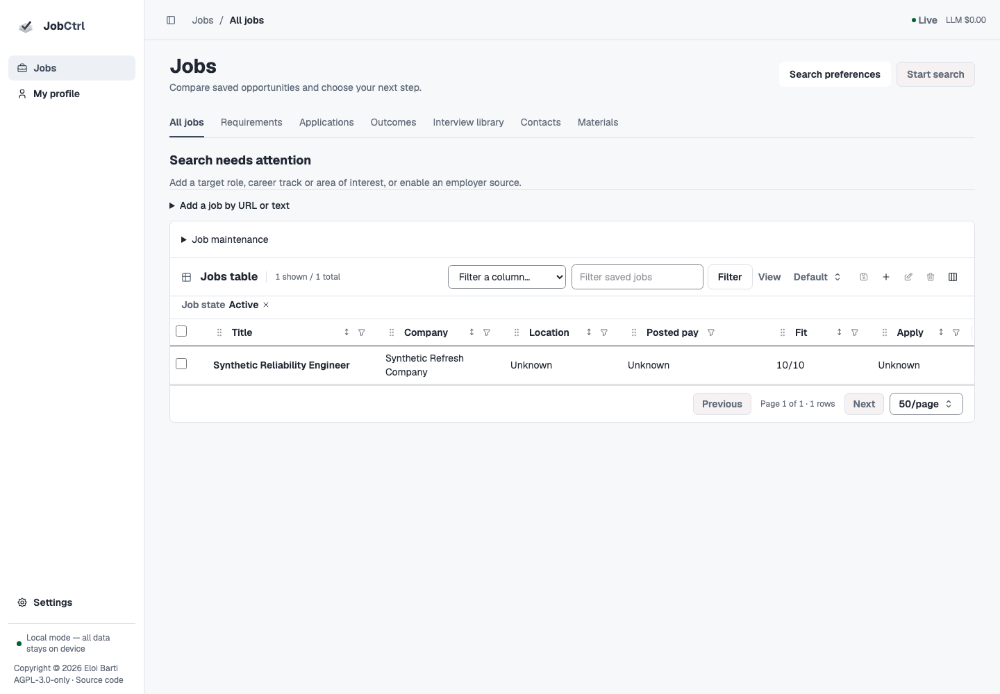
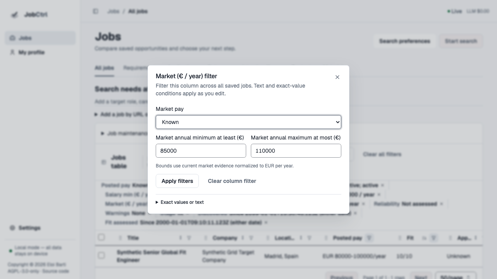
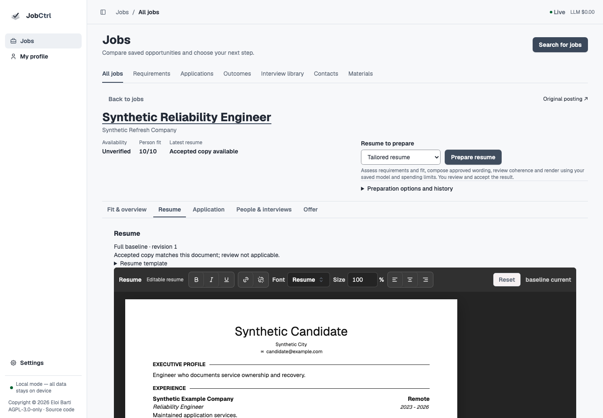
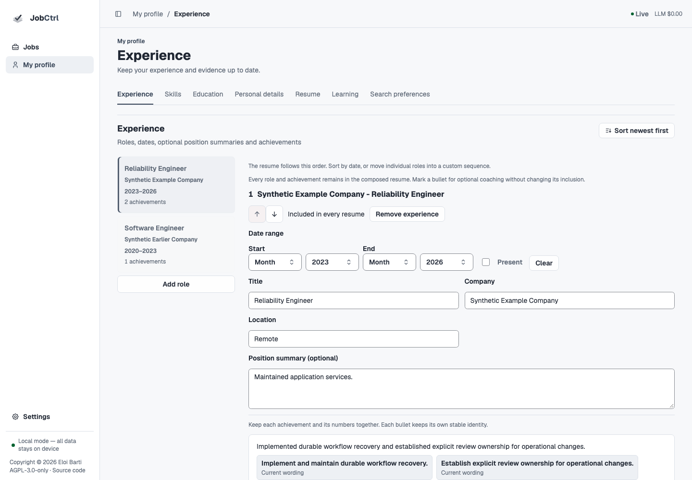
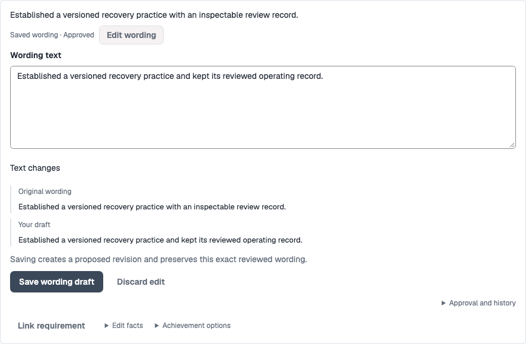
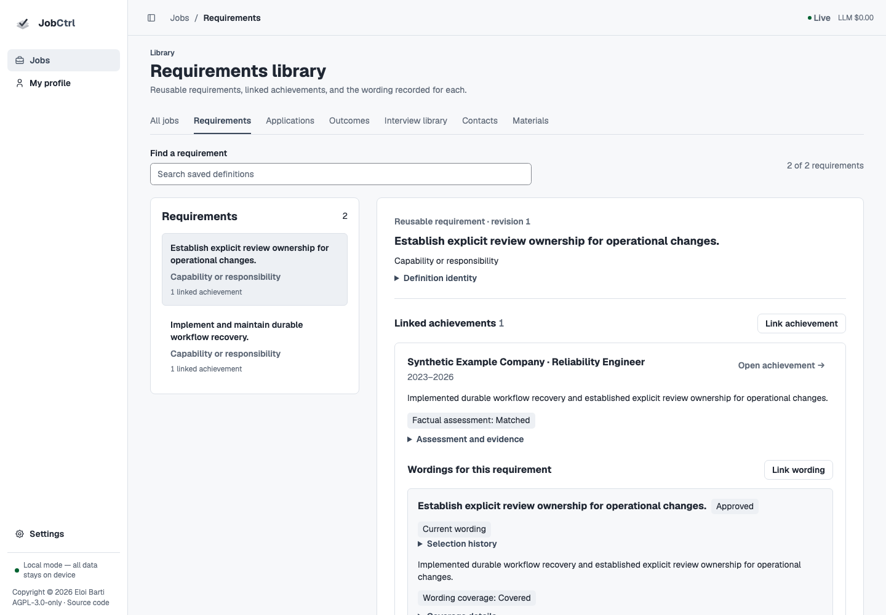
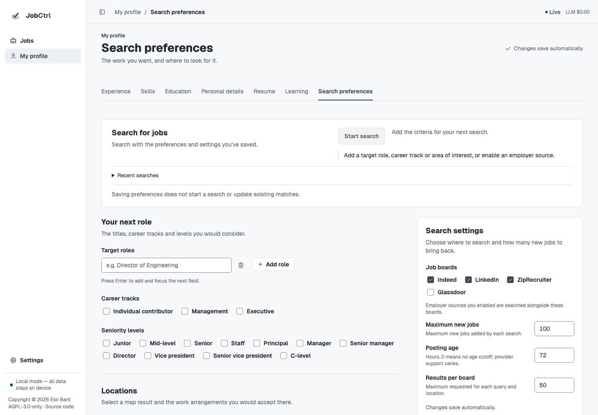
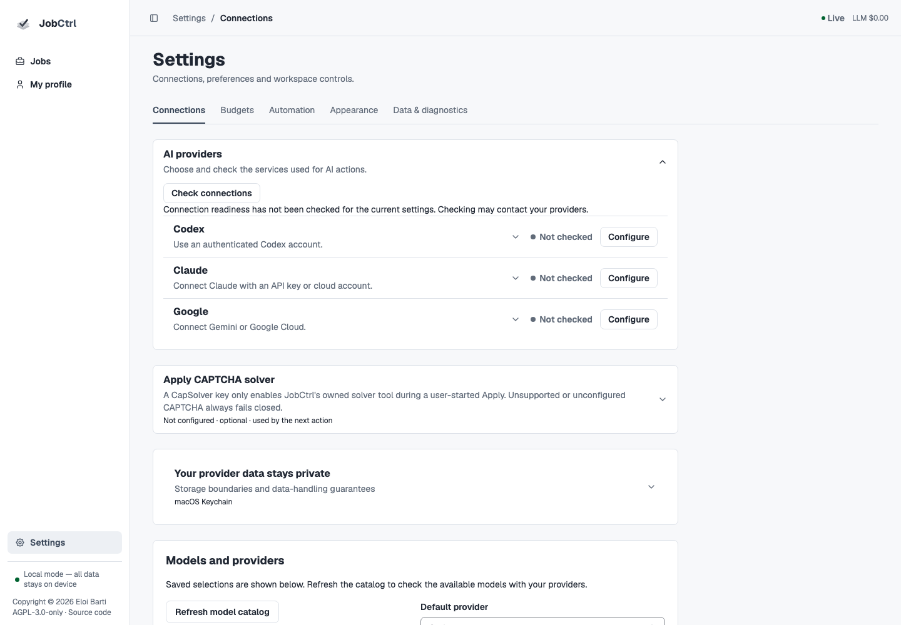
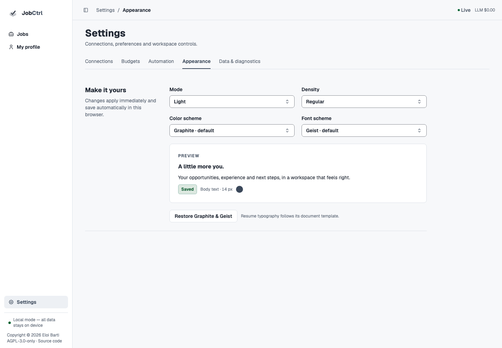

# Product Tour

The Original redesign starts in **Jobs** and keeps **My profile** and **Settings**
one step away. The rail stays small; each workspace exposes its related tasks.
You can compare opportunities, maintain reusable evidence, prepare and edit a
resume, review an application and record its outcome without supervising
individual pipeline stages.

This tour describes the implemented source candidate as its feature contracts
are integrated. The [redesign ledger](../plans/2026-11-11-original-app-redesign.md)
records actual verification and remaining gates. Check the
[published release](https://github.com/ebarti/JobCtrl/releases/latest) for
installed availability; source changes, synthetic screenshots and a demo bundle
do not establish a release or hosted deployment. Follow the
[Daily Workflow](normal-flows.md) for the connected task sequence.

## Jobs: Compare And Act

*Owned synthetic source workspace. Detailed columns and cross-job resources stay
reachable around the main comparison table.*

**All jobs** is a comparison table. Search/filter, sorting, pagination, saved
views, columns and supported selection/bulk actions stay available before
opening one opportunity. Recorded pay retains currency and source context;
unknown fit, salary or outcome remains unknown. A fresh workspace explains that
there are no captures yet, while a filtered zero offers a way to change filters.

The fresh built-in **Default** table leads with Title, Company, Location, Posted
pay, Fit and Apply, plus selection. Detailed/source columns remain optional
choices, and custom persisted layouts are retained. Posted pay uses its recorded
range, currency and unit rather than an invented comparable number.

**Start search** launches the saved search directly from Jobs, with progress,
counts and recovery beside the table. **Search preferences** edits its criteria
and source limits. **Filter saved jobs** searches only existing records; column
filters and the table's **Filter a column** control refine that same query, including
criteria for hidden columns. Opening or saving preferences does not launch work.
**Import job** and manual capture remain available for
known postings.

*Owned synthetic workspace. The column dialog owns its range and availability
criteria; active chips show the saved query. There is no second full-page filter
form.*

The Jobs workspace also reaches **Requirements**, **Applications**, **Outcomes**,
**Interview library**, **Contacts** and **Materials** when their features are
mounted. Those are independent resources as well as contextual job tools.
A hidden optional registration is not advertised as working.

### Job Workspace

Select a row to keep its overview, fit, resume, application/review, interviews,
people and history attached to that exact opportunity. Full-size workspaces
retain an explicit return to the comparison context. Search/filter/order/page,
selection, scroll and drafts should survive the supported return paths; the
[acceptance ledger](../plans/2026-11-11-original-app-redesign.md) records the
actual exercised paths.

**Person fit** explains what saved evidence supports. **Approved wording
coverage** explains what exact approved text expresses. A missing expression is
a document gap, not reduced factual fit. Original posting, source availability,
compensation and employer claims keep their provenance and uncertainty.

### Prepare Resume And Plate

*The existing Plate editor remains inside the selected job. Its accepted copy,
next preparation choice and exact review are separate records.*

Choose **Tailored resume** or **Full baseline**, then **Prepare resume**. One
bounded task sequences the existing requirement, person-fit, composition,
review and rendering stages. Real queued/running/partial/failed state and stop
requests remain beside the task. **Preparation options and history** retains
focused maintenance controls without making them the ordinary workflow.

The job resume and Profile baseline use the actual editable Plate component.
Text editing, formatting, source mapping, drafts and export remain document
work. A draft, rendered candidate, accepted resume and approved application are
separate records. Failed preparation or export preserves the last accepted
artifact and its bytes. See [Materials & Tailoring](materials-and-tailoring.md).

### Applications And Outcomes

The selected job's review controls and **Jobs → Applications** show the exact
packet, accepted resume, screening answers, rehearsal and separate approval.
The selected review uses the same mode + **Prepare resume** task as the job;
unfinished Plate edits block replacement preparation. Without the optional
Preparation feature, **Resume type → Create resume** keeps direct draft creation
and explicit checks/rendering, acceptance and export available.
Final employer-site submission stays manual. Exact-approved email applications
retain the owned Gmail at-most-once boundary. An uncertain result requires
verification; approval or a restart cannot manufacture a trusted receipt.

**Outcomes** summarizes actual recorded application/interview results, with
sample and unknown limits. Manual corrections, email suggestions, offers and
feedback keep their own provenance rather than silently rewriting history.
[Apply](apply.md) and [Outcomes & Feedback](outcomes-and-feedback.md) own those
contracts.

## My Profile: Reusable Facts And Wording

*Owned synthetic Profile. Roles lead the workspace; the
[complete Experience capture](/assets/screenshots/original-profile-wording.png)
also shows canonical requirement tags, one current wording and its separate
proposed revision.*

My profile opens on **Experience**. **Skills**, **Education** and **Personal
details** are peer sections alongside **Resume**, **Learning** and **Search
preferences**. There is no duplicate Overview and no global Advanced mode.

Experience exposes editable roles, position summaries and achievements under
stable IDs. Roles lead the section; **Professional summary** follows the role
inventory and secondary tools stay nearby. Add/edit/remove controls belong beside
the record; **Restore removed experience** recovers retained roles or achievements without replacing newer
Profile edits. Autosave, explicit saves, errors and revision conflicts remain
visible. Profile edits do not regenerate documents or refresh matches.

Each achievement leads with its saved or current wording and **Edit wording**.
Requirement tags stay visible beside **Link requirement**. **Edit facts** opens
the underlying authored record; **Achievement options** contains coaching,
ordering and removal. **Approval and history** keeps exact source references and
earlier revisions available without crowding the reading view.

*Owned synthetic achievement. Editing the wording creates a proposed revision;
it preserves the reviewed wording and the underlying factual record.*

### Requirement-Led Wording

An achievement linked to one requirement has one maintained current wording.
An edit is a proposed revision with exact review and retained history. Additional
maintained wording needs distinct requirement coverage that cannot reuse or
consolidate the current text. Its label names the canonical requirement or
requirements it serves. Editorial-focus alternatives do not create independent
coverage needs.

Approval binds exact text, sources and revision. Proposed edits do not transfer
an older approval; rejected/deferred decisions and recovery remain inspectable.
No global preferred wording is introduced. See
[Approved wording](candidate-profile.md#approved-wording-library) for the owning
workflow and the [plan](../plans/2026-11-11-original-app-redesign.md) for the
current correction's implementation/verification state.

### Requirements Library

*The library groups linked achievements first, then their exact wording. Manual
links do not create the factual assessment or coverage shown here.*

Click an achievement's reusable requirement tag, or open **Jobs → Requirements**
without a selected job. Inspect its definition, scope, qualifiers, version and
source occurrences. **Linked achievements** groups by achievement identity;
**Wordings for this requirement** shows their exact revisions within that group.
The link back opens the exact Profile role and achievement and retains the
library return context.

Your explicit requirement/achievement/wording links remain **unassessed**.
They are separate from recorded factual assessment and exact approved-wording
coverage. Remove/restore preserves original revision pins and history; changed
inputs stay **Needs review**. Neither a manual link nor similar text establishes
fit, coverage or approval. [Requirements Library](requirements-library.md) owns
the complete flow.

### Affected Matches

Save the facts, sources or wording you want included, then explicitly choose
**Update affected matches**. For a selected scored cohort, use the corresponding
Jobs bulk action. Review scope and work limits before starting. The update sees
the complete requirement catalog, reuses current authority, reassesses affected
support and groups actual expression gaps by achievement. It does not approve
its own proposal or expand when inputs change.

The panel reports real progress, partial/error/cancellation state and same-request
recovery. Earlier accepted work remains available. Ordinary saving, approval,
reading and navigation make no automatic model call. See
[Update affected matches](candidate-profile.md#update-affected-matches).

### Search Preferences

*Empty current targets remain empty until explicitly chosen. The source
candidate keeps criteria, source/limit policy and its blocked launch together.*

Target roles are separate repeatable inputs with Enter-to-add/focus. Career
tracks and levels use explicit selections. Each location/work-arrangement row
retains independent validation. Search boards, lookback, results-per-site and
maximum-new-job limits sit with these targets instead of requiring another setup
page.

Place lookup is an explicit action. Select a real result to bind its stable
identity and coordinates; editing the displayed text clears that binding.
Legacy text remains unverified. Save feedback and return from Connections keep
the distinction between changing preferences and starting a search clear.
[Discovery & Sources](discovery.md) owns search execution and source policy.

### Resume, Learning And Import

**Resume** retains the editable baseline, supported templates and direct PDF
export. Document appearance remains independent from app appearance. The
three-step PDF import flow records a draft, lets you select the sections, then
requires exact acceptance before facts change. Import is not automatic
confirmation of evidence.

**Learning** retains career evidence, demand observations and user-authored
milestones. Activity and aspirations do not prove skill or create a readiness
score. Existing source/usage inspection remains available contextually and from
diagnostics.

## Independent Resources

| Resource | What remains available |
| --- | --- |
| Interview library | Full local graph/list browsing, search/filter and source-reading limits without a job or provider call. Job-specific Beta preparation has retained inputs, separate notes and history. Guidance and criteria remain a research draft. |
| Contacts | Job-independent records, imports, provenance and follow-ups, plus contextual supervised research. Outreach ends at reviewed copy/export and your manual-send attestation; JobCtrl does not send contact messages. |
| Materials | **Saved materials** includes drafts and history as well as accepted versions. **Search saved materials** and **Refresh materials** retain the cross-job inspection path; source/approval/coverage, same-job comparison and supported downloads remain separate from acceptance. |
| Compensation and offers | Posted/source-bound pay, neutral calculations and actual terms/decision history. Unknown terms remain unknown. |
| Screening answers and locales | Deliberate source selection, exact independent review, reuse/history and accepted exports through their owning job/document tasks. |
| Extension and CLI | Existing capture, pairing, explicit commands, diagnostics and operational controls keep their own permissions and safety fences. |

## Settings: Shared Choices

*Synthetic source workspace. **Not checked** is explicit; **Check connections**
may contact providers. Opening the workspace does not verify model access.*

**Connections** brings credentials, live provider/model choices and browser or
extension capabilities together. Secrets remain write-only; configured,
verified, unavailable and unknown states are distinct. Existing credentials,
models and browser deep links reveal their corresponding connection panel.

**Budgets** holds daily spend and exact-model pricing quotes. **Automation** holds
deliberate standing behavior, runtime policy and contextual operator detail.
Saving is different from effective application; follow the owning acknowledgement
rather than assuming a connection or restart has succeeded.

**Appearance** defaults to Graphite + Geist. It has ten color schemes and ten
actual font schemes, light/dark mode and density. Changes apply immediately and
persist in this browser. **Restore Graphite & Geist** restores the appearance
defaults; resume typography still follows the document template.

*App appearance applies immediately in this browser while resume typography
continues to follow its document template.*

### Runs

**Data & diagnostics** is the explicit technical entry for task history, recorded
events and retained diagnostic tools. The former Dashboard, Preparation,
Evidence and operations URLs remain reachable where needed without becoming the
daily starting point. Run detail reports its own canonical action/workflow
identity, status, cancellation, failures and events. Missing observations stay
unknown; a live event connection does not establish action/provider readiness.

## Offline Demo

The source-built demo uses the same workspace hierarchy with an owned synthetic
browser-local workspace. It identifies supported local edits, simulations and
unavailable provider/durable actions. It is an illustration of the candidate,
not a connection to your local Profile, a real search, a submitted application or
proof of live-provider behavior. Reading the walkthrough never grants a network
or mutation permission. See the [demo data boundary](data-and-safety.md#public-demo).
