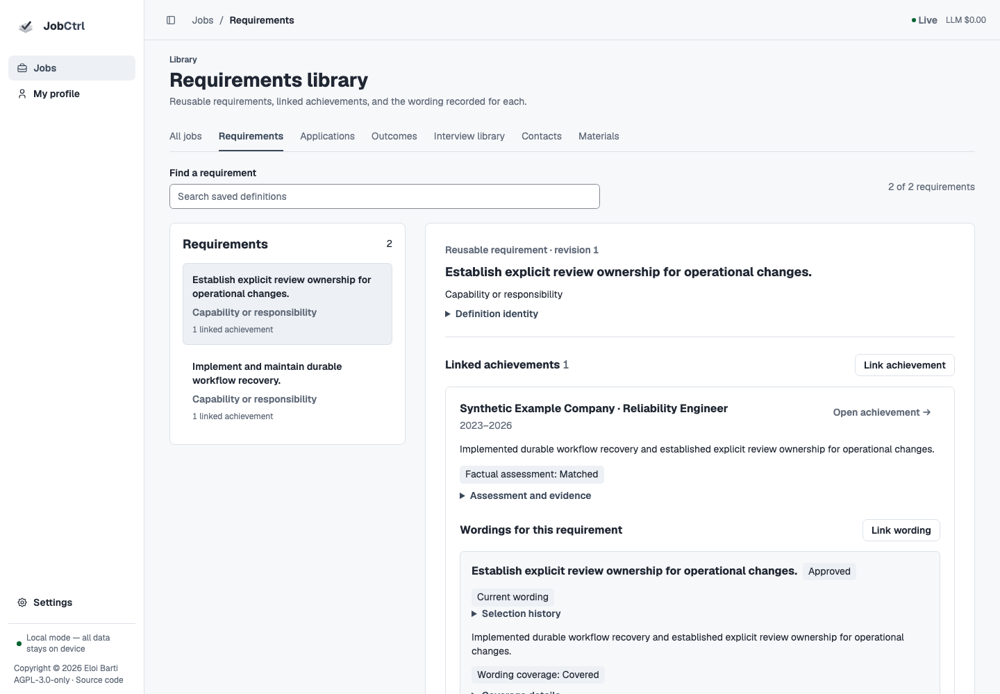

# Requirements Library

Open **Jobs → Requirements** to browse the canonical requirement catalog without
selecting a job. A requirement tag in **My profile → Experience** opens the same
record. Its category, name, definition and revision explain the saved meaning;
its source history records where that meaning occurred in actual postings.

The active library contains meanings used by at least one nondeleted job's
accepted requirements. Moving a job to deleted items removes its unique meanings
from this list; a meaning shared by another nondeleted job stays. Hidden jobs
still count. Restoring a job restores the same saved requirement identities and
history without extracting, assessing or rewriting anything. Profile skills,
saved links, Fit history and accepted resumes remain retained independently.
Historical support or a manual link alone does not keep a deleted-only meaning
in the active list.

Older catalogs may need **Consolidate skills** before their reusable meanings
are ready for current matching. This explicit action reviews the complete saved
catalog and its retained posting sources, including sources from deleted jobs.
It may use your configured model; opening the library does not start it. The
existing catalog and accepted artifacts remain available if the action is
refused, cancelled or cannot finish. Check the recorded run before retrying an
unconfirmed request. A prior requirement link resolves to its recorded current
identity when that meaning is in the active library; its original source history
is retained. Open **Earlier consolidated identities** in the current record to
inspect each earlier identity's definition and posting history.

Permanently deleting a job also permanently removes its requirement meanings
when no other retained job references them. A shared meaning remains even when
the other job is in deleted items. The same transaction removes Fit-owned links,
coverage, assessments and maintained selections for removed meanings; authored
Profile skills, facts and approved wording remain. Independent model audit
receipts retain their historical records. Permanent deletion cannot be undone
with **Restore**.

The current `requirements-v2` catalog contains **Skills** and **Professional
Experience** only. **Education** and **Languages** remain direct demands on the
job's Fit view, bound to that posting and revision. They do not appear in this
reusable library, achievement links or wording preparation. Personal traits,
certifications and licenses, job conditions and detailed tenure analysis are
excluded from this iteration; structured certification support is tracked in
[#1476](https://github.com/ebarti/JobCtrl/issues/1476).

A subject mentioned in an interview agenda enters scoring only when the employer
independently states it as a job responsibility or a candidate qualification.

When a posting accepts prior work in any of several fields, one Professional
Experience requirement can preserve the full choice. Fit can assess it once
using factual role or achievement evidence for an accepted field. A posting
that instead requests a technical practice can list example tools under that
skill. If the posting leaves eligibility unclear, its Requirements attempt
can remain unresolved.

When a new posting joins the library, Requirements compares its wording with
the exact demands already saved. It can keep the demand associated with the
posting evidence, select a specific saved demand shared by the relevant jobs,
or write a new definition from the posting. If the choice is ambiguous, the
last accepted requirements remain available.

This guide describes the Original redesign source candidate. The
[active acceptance ledger](../plans/2026-11-11-original-app-redesign.md) separates
implementation and verification. The
[published release](https://github.com/ebarti/JobCtrl/releases/latest) establishes
installed availability; a source build or offline demo does not establish a
release or hosted deployment.

## Read A Requirement

*The saved meaning, factual assessment, exact approval and wording coverage keep
their own identities. Your manual links remain separate unassessed intent.*

The library opens as a full-width table. Search filters saved names and
definitions literally. Column filters and sorting apply to the complete library
before pagination. Use the column controls to resize, reorder or hide columns,
then save a named view to keep the filters, sort and layout you use. These
controls do not discover semantic equivalence or assess your evidence.

Select a row to open its detail alongside the table on a wide screen. On a
phone, the selected detail takes the workspace; **Back to requirements** restores
the table with its filters and page. Browser Back and return links from Profile
or a source job preserve the same table context. Select a requirement to inspect:

- its category, name, exact definition and canonical revision;
- **Linked achievements**, grouped by saved achievement identity rather than by
  the number of wording revisions. The count includes recorded relationships
  that need review; it does not assert current factual support;
- **Wordings for this requirement** within each achievement, with the exact text,
  approval and recorded coverage shown separately;
- maintained current wording separately from proposed revisions, old selections
  and approval history, with stale saved selections still marked for review;
- prior meaning revisions and original posting occurrences, including whether
  their saved revisions are still current.

**Profile match** compares saved Profile facts with each job-specific demand.
It shows **Not assessed** when no assessment is recorded, **Needs update** when
only earlier assessments remain, and **Partially assessed** when some demands
have current assessments. When every demand has a current assessment, it shows
their shared outcome or **Varies by job** if those outcomes differ. The number of
job-specific demands appears separately; several demands do not imply different
match outcomes. When consolidation is required, any demands shown may be incomplete.

Open **Job-specific demands** to inspect each demand, its source jobs, assessment,
evidence and freshness. Linked achievements include recorded relationships across
those demands and **Earlier links and assessments**, deduplicated by achievement
identity. Earlier-only relationships are marked **needs review** and keep their
original IDs and provenance; they do not establish current support or wording
coverage. Removed manual links and removed wording selections stay in history and
do not contribute to the count unless another recorded relationship independently
references the achievement. Consolidation never turns an earlier assessment,
wording approval or manual link into current match authority.

A requirement can link to several achievements, and an achievement can serve
several requirements. One exact wording can cover several requirements. Missing
assessment, missing wording and stale information remain explicit; none is
silently converted into zero fit or a confirmed match.
A Skills match already supported by structured Profile Skills is not a missing
achievement expression. Existing approved wording is reused, and stylistic
variation cannot create an authoring need. See the
[permitted evidence rules](scoring-and-employer-analysis.md#how-the-score-is-calculated).

The achievement link opens its exact role and achievement in **My profile →
Experience**. The return link restores the selected requirement and library
filter. Profile displays reusable requirement tags; original job excerpts belong
in the requirement's source history.

## Distinguish Support, Wording And Your Links

These records answer different questions:

| Record | Meaning |
| --- | --- |
| Factual assessment | A recorded source-bound determination, or explicit supported correction, of what the saved evidence establishes about this requirement. |
| Exact wording coverage | A recorded determination about a particular wording revision, its sources and approval. Approval alone does not prove coverage. |
| Your link | Your intended requirement–achievement association, optionally pinned to exact wording. It is always unassessed. |

Only recorded assessment and coverage identities supply those claims. A manual
link, similar phrase or library filter cannot create support, qualification,
wording coverage or a score. Requirement definitions are not facts about you.
See [Scoring](scoring-and-employer-analysis.md) for person-fit authority and
[Candidate Profile](candidate-profile.md#approved-wording-library) for exact
wording approval.

## Link An Achievement Or Wording

Choose **Link achievement** from the selected requirement, or **Link
requirement** beside a saved Profile achievement. Choose the canonical record and
saved achievement. **Specific wording** optionally binds one exact saved wording
revision; choosing none records only the achievement relationship. **Save link**
records your intent without calling a model or refreshing matches.

The link retains the requirement revision, achievement identity, source
revisions and any exact wording revision/text. A changed meaning, source or
wording marks the original binding **Needs review**. It cannot inherit current
approval or coverage silently. Save current Profile edits before linking; stale
inputs refuse the write and keep the choice available for review.

An existing link can revise its optional exact wording under the same stable
achievement/requirement pair and history. Remove and restore a link through its
own controls. Restoration preserves its
original revision pins and history, including any stale status. It does not
reassess the association. Earlier accepted documents and their source records
remain independent of this action.

## Keep Maintained Wording Focused

The current owner contract uses one maintained current wording when an
achievement serves only one requirement. Editing proposes a revision and retains
the exact earlier approval and history. Additional maintained wording is useful
only when distinct requirement coverage cannot reuse or consolidate the existing
wording. Wording labels use the canonical requirement names, including several
names where one expression serves several requirements.

This is the accepted implementation contract; its final integrated proof is
tracked in the [redesign ledger](../plans/2026-11-11-original-app-redesign.md).
It does not authorize automatic rewriting, approval transfer, a semantic rule
based on text similarity, or replacement of an accepted resume. Semantic work
remains explicitly admitted through
[Update affected matches](candidate-profile.md#update-affected-matches).

**Use as current wording** is available only for exact approved wording with
current recorded positive coverage. It can reuse the same expression or make a
change leaving one distinct maintained expression on the achievement. If a
different expression would need to be maintained alongside it, the application
requires **Update affected matches** to consider reuse/consolidation and the
actual distinct coverage. The manual control does not perform that semantic
judgment. Current selection history remains separate from your unassessed links.
Restoring a current selection refuses stale approval/coverage; restoring an
unassessed link can retain its stale original pins for review.

## History And Recovery

The library reads accepted canonical records and retained occurrences. A failed
assessment or refresh is separate attempt history; it does not become a new
accepted requirement or overwrite the last accepted resume. A source-history
page can be old without implying its original posting is currently available.
Inspect the recorded revisions and staleness reasons before reuse.
An exact requirement or history API lookup remains available for a retained
meaning outside the active list and reports `active_in_library: false`. The
complete retained canonical inventory remains available to explicit semantic
matching, so a later equivalent posting can reuse the original meaning. When
that posting's requirements are accepted, the meaning reappears in the active
library with the same identity. This reuse includes meanings hidden because all
their jobs are in deleted items; matching does not filter by library visibility.

The active catalog starts empty for `requirements-v2` and reads only that
generation. Missing contract versions are legacy; older meanings are not
promoted because they look similar. Historical accepted rows, job revisions and
resume bytes remain retained, with contract-change refresh status where
applicable. They cannot establish current ranking or composition readiness.
Only a successful explicit refresh or scoped correction publishes a replacement
accepted snapshot.

Meaning corrections use the existing source-bound posting correction path;
this library does not offer arbitrary catalog creation or silently broaden a
posting's meaning or alternatives. Model-created equivalence, support and coverage require
the configured provider, budget admission, strict source validation and a
persisted determination. Unavailable or invalid work remains unavailable.

The API also supports explicitly correcting selected posting occurrences rather
than interpreting the whole posting again. Each correction must be supported by
that posting, and your reason guides the review without becoming evidence.
The corrected batch passes through the complete retained-catalog consolidation,
which can also reconcile other existing meanings and job-demand bindings.
Unselected occurrences retain their original semantic fields and evidence, and
earlier snapshots remain in history. The correction does not automatically
reassess your Fit or rewrite achievement wording; changed bindings can require
review.

The API ownership and revision fences are documented in
[Jobs and Materials API](../api/jobs-and-materials.md#requirements-library-and-associations).
