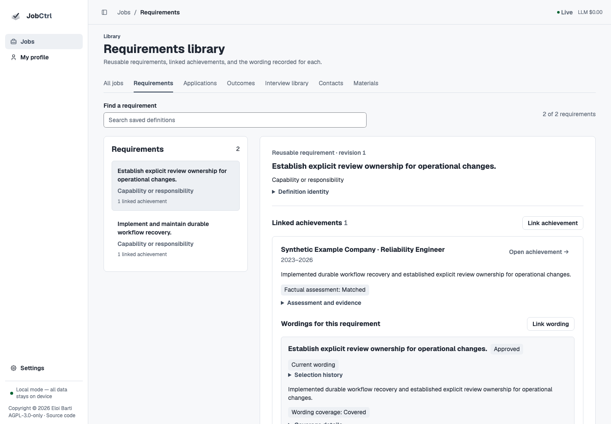

# Requirements Library

Open **Jobs → Requirements** to browse the canonical requirement catalog without
selecting a job. A requirement tag in **My profile → Experience** opens the same
record. Its category, name, definition and revision explain the saved meaning;
its source history records where that meaning occurred in actual postings.

The current `requirements-v2` catalog contains **Skills** and **Professional
Experience** only. **Education** and **Languages** remain direct demands on the
job's Fit view, bound to that posting and revision. They do not appear in this
reusable library, achievement links or wording preparation. Personal traits,
certifications and licenses, job conditions and detailed tenure analysis are
excluded from this iteration; structured certification support is tracked in
[#1476](https://github.com/ebarti/JobCtrl/issues/1476).

This guide describes the Original redesign source candidate. The
[active acceptance ledger](../plans/2026-11-11-original-app-redesign.md) separates
implementation and verification. The
[published release](https://github.com/ebarti/JobCtrl/releases/latest) establishes
installed availability; a source build or offline demo does not establish a
release or hosted deployment.

## Read A Requirement

*The saved meaning, factual assessment, exact approval and wording coverage keep
their own identities. Your manual links remain separate unassessed intent.*

Search filters saved definitions literally. It does not discover semantic
equivalence or assess your evidence. Select a requirement to inspect:

- its category, name, exact definition and canonical revision;
- **Linked achievements**, grouped by saved achievement identity rather than by
  the number of wording revisions;
- **Wordings for this requirement** within each achievement, with the exact text,
  approval and recorded coverage shown separately;
- maintained current wording separately from proposed revisions, old selections
  and approval history, with stale saved selections still marked for review;
- prior meaning revisions and original posting occurrences, including whether
  their saved revisions are still current.

A requirement can link to several achievements, and an achievement can serve
several requirements. One exact wording can cover several requirements. Missing
assessment, missing wording and stale information remain explicit; none is
silently converted into zero fit or a confirmed match.
A Skills match already supported by structured Profile Skills is not a missing
achievement expression. Existing approved wording is reused, and stylistic
variation cannot create an authoring need. See the
[permitted evidence rules](scoring-and-employer-analysis.md#how-the-score-is-calculated).

The achievement link opens its exact role and achievement in **My profile →
Experience**. The return link restores the selected requirement and library
filter. Profile displays reusable requirement tags; original job excerpts belong
in the requirement's source history.

## Distinguish Support, Wording And Your Links

These records answer different questions:

| Record | Meaning |
| --- | --- |
| Factual assessment | A recorded source-bound determination, or explicit supported correction, of what the saved evidence establishes about this requirement. |
| Exact wording coverage | A recorded determination about a particular wording revision, its sources and approval. Approval alone does not prove coverage. |
| Your link | Your intended requirement–achievement association, optionally pinned to exact wording. It is always unassessed. |

Only recorded assessment and coverage identities supply those claims. A manual
link, similar phrase or library filter cannot create support, qualification,
wording coverage or a score. Requirement definitions are not facts about you.
See [Scoring](scoring-and-employer-analysis.md) for person-fit authority and
[Candidate Profile](candidate-profile.md#approved-wording-library) for exact
wording approval.

## Link An Achievement Or Wording

Choose **Link achievement** from the selected requirement, or **Link
requirement** beside a saved Profile achievement. Choose the canonical record and
saved achievement. **Specific wording** optionally binds one exact saved wording
revision; choosing none records only the achievement relationship. **Save link**
records your intent without calling a model or refreshing matches.

The link retains the requirement revision, achievement identity, source
revisions and any exact wording revision/text. A changed meaning, source or
wording marks the original binding **Needs review**. It cannot inherit current
approval or coverage silently. Save current Profile edits before linking; stale
inputs refuse the write and keep the choice available for review.

An existing link can revise its optional exact wording under the same stable
achievement/requirement pair and history. Remove and restore a link through its
own controls. Restoration preserves its
original revision pins and history, including any stale status. It does not
reassess the association. Earlier accepted documents and their source records
remain independent of this action.

## Keep Maintained Wording Focused

The current owner contract uses one maintained current wording when an
achievement serves only one requirement. Editing proposes a revision and retains
the exact earlier approval and history. Additional maintained wording is useful
only when distinct requirement coverage cannot reuse or consolidate the existing
wording. Wording labels use the canonical requirement names, including several
names where one expression serves several requirements.

This is the accepted implementation contract; its final integrated proof is
tracked in the [redesign ledger](../plans/2026-11-11-original-app-redesign.md).
It does not authorize automatic rewriting, approval transfer, a semantic rule
based on text similarity, or replacement of an accepted resume. Semantic work
remains explicitly admitted through
[Update affected matches](candidate-profile.md#update-affected-matches).

**Use as current wording** is available only for exact approved wording with
current recorded positive coverage. It can reuse the same expression or make a
change leaving one distinct maintained expression on the achievement. If a
different expression would need to be maintained alongside it, the application
requires **Update affected matches** to consider reuse/consolidation and the
actual distinct coverage. The manual control does not perform that semantic
judgment. Current selection history remains separate from your unassessed links.
Restoring a current selection refuses stale approval/coverage; restoring an
unassessed link can retain its stale original pins for review.

## History And Recovery

The library reads accepted canonical records and retained occurrences. A failed
assessment or refresh is separate attempt history; it does not become a new
accepted requirement or overwrite the last accepted resume. A source-history
page can be old without implying its original posting is currently available.
Inspect the recorded revisions and staleness reasons before reuse.

The active catalog starts empty for `requirements-v2` and reads only that
generation. Missing contract versions are legacy; older meanings are not
promoted because they look similar. Historical accepted rows, job revisions and
resume bytes remain retained, with contract-change refresh status where
applicable. They cannot establish current ranking or composition readiness.
Only a successful explicit refresh publishes replacement accepted pointers.

Meaning corrections use the existing source-bound posting correction path;
this library does not offer arbitrary catalog creation or silently broaden a
posting's meaning or alternatives. Model-created equivalence, support and coverage require
the configured provider, budget admission, strict source validation and a
persisted determination. Unavailable or invalid work remains unavailable.

The API ownership and revision fences are documented in
[Jobs and Materials API](../api/jobs-and-materials.md#requirements-library-and-associations).
